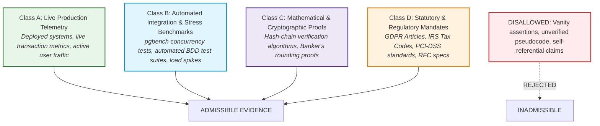
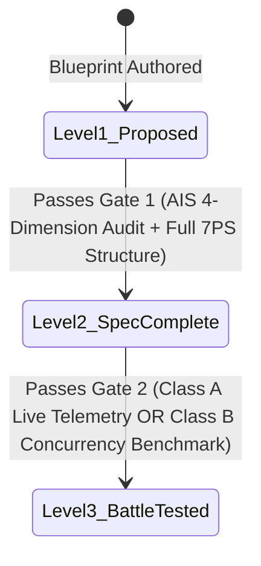

# ⚖️ 03 — Rules of Evidence & Maturity Rating System
> **The Empirical Verification Protocol for System Readiness in `system-blueprint-os`.**  
> *Status: RATIFIED & LOCKED.*

---

## 🎯 Purpose & Scope

The **Rules of Evidence & Maturity Rating System** enforces absolute intellectual honesty across OpenBSA. 

In enterprise systems engineering, marketing assertions like *"enterprise-ready"* or *"battle-tested"* are meaningless without verifiable proof. This standard codifies what constitutes admissible evidence and defines the rigorous gates through which a blueprint advances in maturity.

---

## 🏛️ The Hierarchy of Evidence (The 4 Admissible Classes)

When asserting that a blueprint's failure mode is mitigated or that an architectural pattern is sound, only four classes of evidence are admissible:

### Class A: Live Production Telemetry (Highest Weight)
* **Definition:** Empirical data collected from live production software operating with real commercial users and real financial transactions.
* **Admissible Artifacts:**
  * Publicly accessible, live production systems (e.g., [ROTARI Multi-Tenant Platform](https://rotari.vercel.app)).
  * Database query logs demonstrating PostgreSQL Row-Level Security (RLS) enforcement under multi-tenant load.
  * Real-world incident response post-mortems validating recovery time objective (RTO).

### Class B: Automated Integration & Stress Benchmarks
* **Definition:** Repeatable, automated testing suites executing against isolated test environments.
* **Admissible Artifacts:**
  * Concurrency stress tests (e.g. 50 parallel requests hitting 1 inventory row via `pgbench` or k6) demonstrating zero negative stock.
  * Passing Gherkin BDD automated regression test suites.
  * Database transaction logs proving atomic rollback on constraint violation.

### Class C: Mathematical & Cryptographic Proofs
* **Definition:** Formal deterministic algorithms and numerical proofs.
* **Admissible Artifacts:**
  * Unit tests validating Banker's Rounding across 100,000 synthetic transaction variations with zero cumulative cent drift.
  * Cryptographic SHA-256 hash-chain verification scripts proving tamper detection on immutable audit tables.

### Class D: Statutory & Regulatory Citations
* **Definition:** Authoritative external legal, tax, or technical standards.
* **Admissible Artifacts:**
  * Official government legal codes (e.g. GDPR Article 17(3)(b), US IRS Code § 6001, German Commercial Code HGB § 257).
  * Industry technical RFCs (e.g. RFC 8959, PCI-DSS v4.0 Requirement 10.2).

---

## 🚫 Strictly Inadmissible Evidence (Vanity Claims)

The following assertions are explicitly disqualified from supporting maturity ratings:
1. **Vanity Assertions:** Statements such as *"industry standard"*, *"best practice"*, or *"enterprise-grade"* without underlying Class A, B, C, or D artifacts.
2. **Untested Pseudocode:** Code snippets that have never been compiled or executed against a real database kernel.
3. **Self-Referential Claims:** Assertions supported solely by another unverified document within the same repository.

---

## 📈 The Evidence-Based Maturity Rating System

Every blueprint in `system-blueprint-os` is assigned one of three explicit maturity ratings:

| Maturity Rating | Badge | Operational Meaning | Evidence Required |
|---|---|---|---|
| **Level 1: PROPOSED** | 🟡 `PROPOSED` | Conceptual draft under active design review. | Problem statement documented. Open for community peer review. |
| **Level 2: SPEC_COMPLETE** | 🔵 `SPEC_COMPLETE` | Rigorous, developer-ready specification approved for sprint backlogs. | 100% compliance with Tier 1 AIS (4 dimensions) and Tier 2 7PS (8 sections), plus executable BDD test cases. |
| **Level 3: BATTLE-TESTED** | 🟢 `BATTLE-TESTED` | Gold standard reference architecture proven under real commercial conditions. | Class A (Live Production Telemetry, e.g. ROTARI) OR Class B (Concurrency Integration Stress Benchmark), with zero unresolved vulnerabilities. |

---

## 🚪 The Strict Promotion Gates

### Gate 1: Promotion from `PROPOSED` $\longrightarrow$ `SPEC_COMPLETE`
To advance to Level 2, the blueprint must:
1. Satisfy all 4 dimensions of the Analysis Integrity Standard (AIS-1: Math, AIS-2: Consistency, AIS-3: Reality, AIS-4: Traceability).
2. Author all 8 sections of the Seven-Pillar Standard (7PS) with zero blank headings.
3. Provide executable PostgreSQL DDL and Gherkin BDD test scenarios.
4. Pass formal peer-review by the Lead Systems Analyst.

### Gate 2: Promotion from `SPEC_COMPLETE` $\longrightarrow$ `BATTLE-TESTED`
To advance to Level 3, the blueprint must:
1. Provide verifiable **Class A Evidence** from a live deployed production system (e.g. ROTARI POS & Multi-Tenant Engine) OR verifiable **Class B Evidence** from an automated concurrency stress benchmark.
2. Document zero unhandled edge-case failures across at least 1,000 real or simulated transaction cycles.
3. Cite the exact production repository or test suite commit hash in the blueprint's metadata table.
