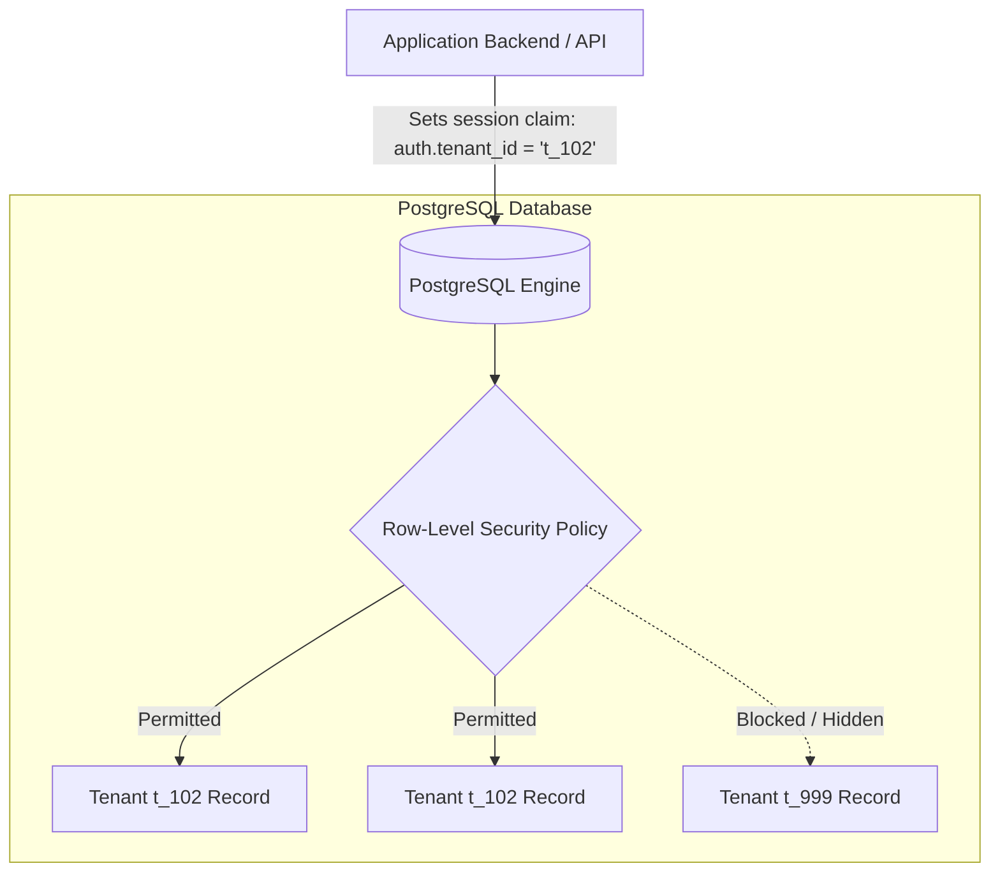

# Architecture Decision Record (ADR)

> **Format:** Inspired by Michael Nygard's ADR format with modern enterprise extensions.  
> **Repository:** OpenBSA Core Architecture  
> **Status:** `Proposed` | `Accepted` | `Rejected` | `Superseded by ADR-[Number]`

---

# ADR-001: [Short Title of the Decision, e.g., Multi-Tenant Data Isolation Strategy via PostgreSQL Row-Level Security]

* **Date:** 2026-11-03
* **Author(s):** [Tri Raida / Author Name]
* **Technical Stakeholders:** [Lead Backend Engineer, Security Officer, Product Owner]
* **Decision Status:** `Accepted`

---

## 1. Context and Problem Statement

<!-- Describe the business and technical context, forces, and constraints. What problem are we solving? -->
Our platform serves thousands of small and medium business tenants. As a multi-tenant application, we must guarantee strict data isolation—a business tenant must never, under any circumstances, view or modify another tenant's financial, customer, or transaction records.

We need to decide on the data architecture pattern to balance:
1. **Security & Compliance:** Zero possibility of multi-tenant data cross-contamination.
2. **Infrastructure Cost:** Operational overhead for small business pricing models.
3. **Operational Simplicity:** Ease of database migrations, backups, and schema evolution.

---

## 2. Decision Drivers (Key Requirements)

* **Isolation Guarantee:** High confidence that human coding errors (e.g., forgetting a `WHERE tenant_id = x` clause) will not leak data.
* **Cost Efficiency:** Must remain economically viable when hosting hundreds of low-activity freemium/starter tenants.
* **Maintenance Overhead:** Running database migrations across hundreds of disparate physical databases is unacceptable for our current team size.
* **Query Performance:** Minimal latency penalty on high-frequency POS transaction queries.

---

## 3. Considered Options

* **Option 1:** Database-per-tenant (Separate physical or managed database instance for each tenant).
* **Option 2:** Schema-per-tenant (Single database instance, separate PostgreSQL schema per tenant).
* **Option 3 (Selected):** Shared database, shared schema with **PostgreSQL Row-Level Security (RLS)**.

---

## 4. Evaluation Matrix

| Criteria | Option 1: DB-per-Tenant | Option 2: Schema-per-Tenant | Option 3: Shared Schema with RLS |
|---|---|---|---|
| **Data Isolation** | Absolute (Physical) | High (Logical) | High (Kernel/Database enforced) |
| **Infra Cost** | Very High ($$$) | Moderate ($$) | Low / Optimal ($) |
| **Migration Simplicity** | Complex (N-migrations) | Moderate (N-schemas) | Simple (Single migration run) |
| **Connection Pooling** | Terrible (Exhausts pool) | Difficult | Standard (PgBouncer / Supabase) |
| **Developer Ergonomics** | Moderate | Poor (Dynamic search_path) | Excellent (Transparent security context) |

---

## 5. Decision Outcome

**Chosen Option:** **Option 3 (Shared Database & Schema with PostgreSQL Row-Level Security).**

We will enforce multi-tenancy at the database engine level using native PostgreSQL RLS policies tied to the authenticated user's JWT session claims.

### 5.1 Architecture Decision Diagram


### 5.2 Implementation Example
```sql
-- Enable RLS on core business table
ALTER TABLE transactions ENABLE ROW LEVEL SECURITY;

-- Enforce strict tenant isolation policy
CREATE POLICY tenant_isolation_policy ON transactions
    FOR ALL
    USING (tenant_id = (current_setting('request.jwt.claims', true)::json->>'tenant_id')::uuid);
```

---

## 6. Consequences & Trade-Offs

### Positive Consequences
* **Accidental Leak Prevention:** Even if a developer writes `SELECT * FROM transactions`, PostgreSQL automatically filters rows to only return records belonging to the current caller's `tenant_id`.
* **Cost Efficiency:** Enables sub-dollar per-tenant hosting economics.
* **Instant Migrations:** Running schema updates and DDL changes applies globally to all tenants in a single transaction.

### Negative Consequences / Risks & Mitigations
* **Risk:** Superuser or database connection misconfiguration could accidentally bypass RLS.
  * *Mitigation:* The API application connection pool connects via a restricted non-superuser role (`authenticated_user_role`) where `BYPASSRLS` is explicitly revoked.
* **Risk:** Indexing challenges on large shared tables.
  * *Mitigation:* All primary and composite indexes on shared tables must prefix `(tenant_id, ...)` to ensure index scan pruning.

---

## 7. Compliance & Audit Verification

* **Review Frequency:** Annually or upon introducing new enterprise data entities.
* **Automated Test Requirement:** CI pipeline must include multi-tenant penetration tests validating that an authenticated request from Tenant A receives an empty dataset or 404/403 when querying Tenant B's UUID.
