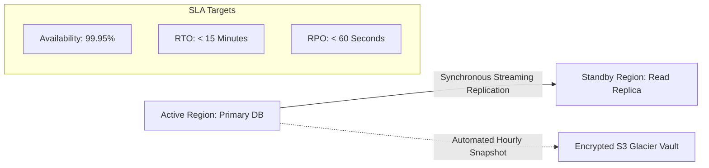
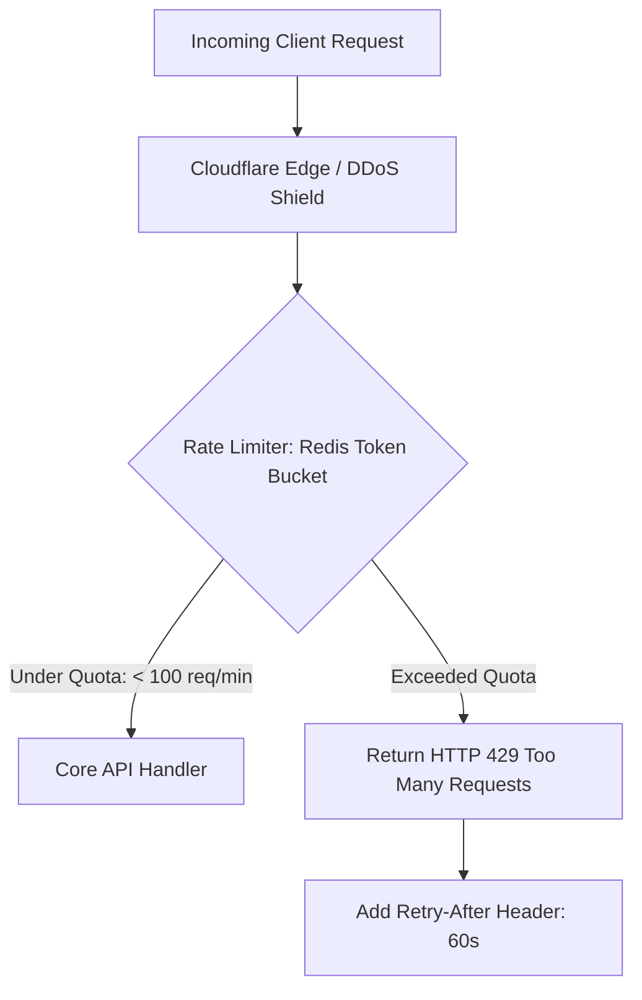

# Non-Functional Requirements (NFR) Master Checklist

> **Purpose:** Ensures no critical production characteristics (availability, throughput, security, compliance) are neglected during discovery and architecture design.  
> **Maintainer:** [System Architecture & Business System Analysis Team]  
> **Target System:** [System Name]

---

## 1. Performance & Latency Budgets

| Interaction Type | Target Metric | SLA Threshold | Measurement Method | Verified (Y/N) |
|---|---|---|---|---|
| **POS Transaction Submission** | 95th Percentile (p95) | `< 250 ms` | APM (Datadog/NewRelic) | [ ] |
| **Read Queries (Dashboard/List)** | 99th Percentile (p99) | `< 150 ms` | Database Query Profiler | [ ] |
| **Full-Text Product Search** | p95 Latency | `< 80 ms` | Elasticsearch / Meilisearch | [ ] |
| **Async Background Event Worker** | Queue Processing Lag | `< 2.0 seconds` | Message Broker Queue Depth | [ ] |
| **Report Generation (CSV/PDF)** | Completion Time | `< 5.0 seconds` | Background Job Monitor | [ ] |

---

## 2. Scalability & Concurrency Invariants

* [ ] **Peak Concurrent Users (CCU):** System must support at least **`[5,000]`** active concurrent users without latency degradation beyond 15%.
* [ ] **Write Throughput:** Capable of sustaining **`[500]` transactions per second (TPS)** during peak flash sales.
* [ ] **Horizontal Auto-scaling:** Backend stateless containers must auto-scale when CPU utilization exceeds 70% for > 2 consecutive minutes.
* [ ] **Database Connection Pooling:** PgBouncer or equivalent connection pooler configured to handle up to 10,000 idle connections while keeping PostgreSQL active connections `<= 150`.

---

## 3. Reliability, Availability & Disaster Recovery (DR)

* **Target Availability SLA:** `99.95%` monthly uptime (maximum unplanned downtime: ~21.9 minutes/month).
* **Recovery Point Objective (RPO):** `< 60 seconds` (Maximum permissible data loss in the event of catastrophic datacenter failure).
* **Recovery Time Objective (RTO):** `< 15 minutes` (Time to failover traffic to hot standby replica).
* **Automated Health Checks:** `/healthz` (liveness probe) and `/readyz` (readiness probe checking DB and Redis connectivity).

---

## 4. Security, Privacy & Data Protection

### 4.1 Data Encryption
* [ ] **In-Transit:** TLS 1.3 enforced across all public endpoints; TLS 1.2 minimum for legacy client compatibility. Perfect Forward Secrecy (PFS) ciphers enabled.
* [ ] **At-Rest:** AES-256 database volume encryption; AWS KMS / Vault customer managed keys (CMK) with automated annual rotation.
* [ ] **Field-Level Sensitive PII:** Phone numbers, credit cards, and government identifiers hashed or encrypted using AES-GCM-256 before disk writes.

### 4.2 Multi-Tenant Isolation & Access Control
* [ ] Row-Level Security (RLS) active on all tenant-bearing tables.
* [ ] Principle of Least Privilege: Services use dedicated scoped IAM database roles.
* [ ] Strict Cross-Origin Resource Sharing (CORS) whitelisting only authorized origins.

### 4.3 Regulatory Compliance Matrix
| Regulation | Scope Requirement | Implementation Architecture |
|---|---|---|
| **GDPR** | Right to be Forgotten (Article 17) | Automated soft-delete + 30-day purge worker with anonymization |
| **SOC 2 Type II** | Immutable Audit Trail | Structured JSON logs shipped to write-once-read-many (WORM) storage |
| **PCI-DSS** | Zero Credit Card Handling | Tokenized checkout via Stripe / Adyen iframe components |

---

## 5. Rate Limiting, Throttling & DDoS Protection

* [ ] **Public Auth Endpoints (`/api/login`):** Maximum **5 attempts per minute** per IP address; triggers CAPTCHA / lockout upon 5 consecutive failures.
* [ ] **Standard REST API:** Maximum **100 requests per minute** per authenticated user token.
* [ ] **Webhook Ingestion:** Maximum **500 events per minute** with burst capacity buffered in Amazon SQS / Redis Stream.

---

## 6. Observability & Operational Telemetry

* [ ] **Distributed Tracing:** All incoming HTTP requests assigned a unique `X-Request-ID` or W3C `traceparent` header propagated across microservices.
* [ ] **Structured Logging:** All application logs emitted as JSON to `stdout` containing `timestamp`, `level`, `trace_id`, `tenant_id`, and `message`.
* [ ] **Zero Logged PII:** Strict automated masking regex preventing passwords, API secrets, and credit cards from appearing in log streams.
* [ ] **Alerting Thresholds:** PagerDuty trigger if HTTP 5xx error rate exceeds 1% of total traffic over a 5-minute rolling window.
