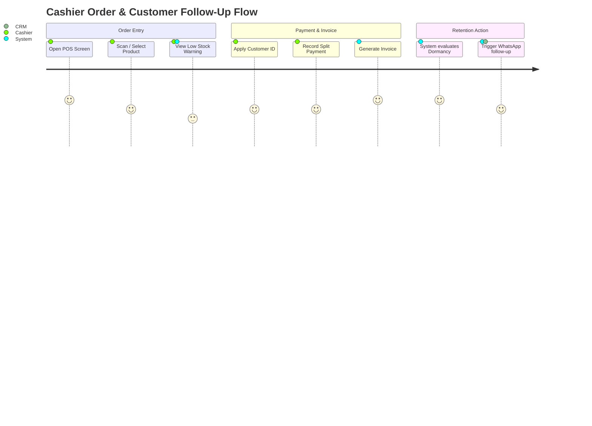
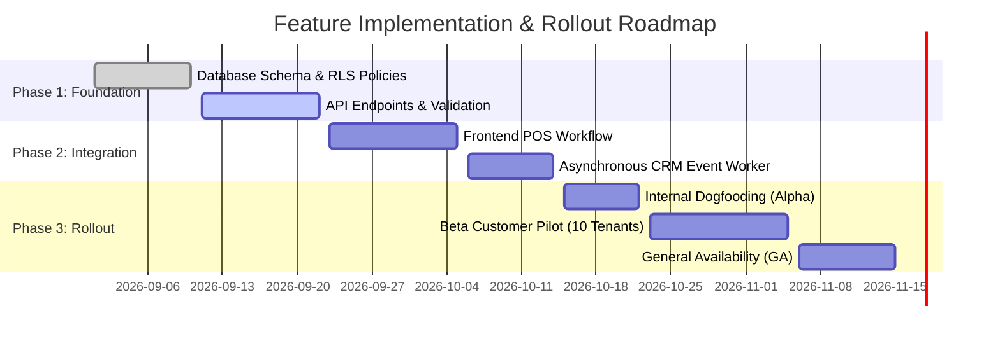

# Product Requirements Document (PRD)

> **Document Status:** `Draft` | `Under Review` | `Approved` | `Deprecated`  
> **Author:** [Author Name / Tri Raida]  
> **Technical Lead:** [Tech Lead Name]  
> **Target Release:** [Q3 2026 / Sprint 24]  
> **Last Updated:** [YYYY-MM-DD]  
> **Version:** `1.0.0`

---

## 1. Executive Summary & Problem Statement

### 1.1 The Problem
<!-- Describe the concrete pain point experienced by customers or operational teams. Use real data points whenever possible. -->
* **Context:** [Describe current state and why the current workflow is insufficient.]
* **Impact:** [Quantify impact: e.g., "Customer churn has increased by 14% due to manual delayed follow-ups; operational staff spends 3.5 hours/day reconciling invoices across two platforms."]
* **Urgency:** [Why is solving this now critical to company objectives?]

### 1.2 Proposed Solution
<!-- Provide a high-level overview of what we are building to solve the problem. Keep it focused on outcomes rather than deep technical mechanics. -->
[Provide a 2-3 paragraph summary of the system capability being introduced. Highlight how the solution automates friction and delivers immediate business value.]

---

## 2. Business Objectives & Success Metrics (OKRs)

| Metric Type | Metric Name | Baseline (Current) | Target (Success) | Measurement Method |
|---|---|---|---|---|
| **North Star** | [e.g., Active Retention Rate] | 42% | 68% within 90 days | Mixpanel / Amplitude cohort analysis |
| **Operational** | [e.g., Transaction Reversal Time] | 48 hours | < 5 minutes automated | System event logs / Datadog |
| **Financial** | [e.g., Monthly Processing Volume] | $120,000 | $500,000 | Stripe / Core DB ledger |
| **Guardrail** | [e.g., Error Rate on Checkout] | 0.8% | Must stay < 0.2% | Sentry error alerts |

---

## 3. Goals & Non-Goals (Scope Boundary)

Defining what we will **NOT** build is as critical as defining what we build to prevent scope creep.

### ✅ Goals (In-Scope)
- [Goal 1: Enable automated tenant-scoped transaction reconciliation via webhook.]
- [Goal 2: Provide cashiers with real-time stock balance alerts prior to invoice completion.]
- [Goal 3: Expose standardized GraphQL/REST query endpoint for order status.]

### 🚫 Non-Goals (Strictly Out-of-Scope for this Release)
- [Non-Goal 1: In-person hardware POS terminal card reader integration (defer to Phase 2).]
- [Non-Goal 2: Multi-currency automated FX hedging (only USD and IDR fixed rates supported).]
- [Non-Goal 3: Custom white-label client domain routing.]

---

## 4. User Personas & Target Audiences

### Persona 1: The Operator / Cashier
* **Role:** High-frequency daily system operator.
* **Core Need:** Fast, error-tolerant transaction processing with zero lag during rush hours.
* **Frustration:** Having to navigate between three different tabs to check if a customer has an existing credit balance.

### Persona 2: The Business Owner / Tenant Admin
* **Role:** Executive decision maker overseeing business metrics.
* **Core Need:** Real-time visibility into daily revenue, dead stock, and dormant customer cohorts.
* **Frustration:** Monthly reports only available 5 days after month-end.

---

## 5. User Journey & Process Flow

---

## 6. Functional Requirements & Feature Prioritization

*Prioritized using the **MoSCoW** framework (Must-Have, Should-Have, Could-Have, Won't-Have).*

### 6.1 Core Transaction Module (Must-Have)
- **REQ-001:** System must validate available inventory before committing transaction line items.
- **REQ-002:** System must enforce multi-tenant isolation via authenticated JWT claims (`tenant_id`).
- **REQ-003:** System must generate an immutable transaction ledger record upon payment confirmation.

### 6.2 Customer Feedback Loop (Should-Have)
- **REQ-004:** When an order is completed, system must asynchronously calculate updated Customer Lifetime Value (LTV).
- **REQ-005:** If a customer's `last_active_date` was > 60 days, system must assign a "Re-engaged" tag and dispatch a webhook event to CRM workers.

### 6.3 Reporting & Export (Could-Have)
- **REQ-006:** Tenant owners may export monthly financial summaries into CSV format with encrypted PII masking.

---

## 7. Non-Functional Requirements (NFRs) Summary

*Refer to [`01-core-templates/NFR-Checklist.md`](./NFR-Checklist.md) for detailed technical specifications.*

* **Performance:** 95th percentile API response time must be under **250ms** for order submission.
* **Availability:** 99.9% uptime target during business operating hours (07:00 - 23:00 UTC).
* **Security & Compliance:** All customer PII must be encrypted at rest using AES-256; tenant data strictly isolated via Row-Level Security.

---

## 8. Release Plan & Phasing

---

## 9. Stakeholder Sign-Off Matrix

| Role | Name | Status | Approval Date | Notes |
|---|---|---|---|---|
| **Product Lead** | [Name] | `Approved` | 2026-09-02 | Scope confirmed |
| **Technical Architect** | [Name] | `Approved` | 2026-09-03 | Architectural review completed |
| **Security & Compliance** | [Name] | `Pending Review` | — | Awaiting RLS audit results |
| **Business Stakeholder** | [Name] | `Approved` | 2026-09-01 | Aligned with Q4 budget |
