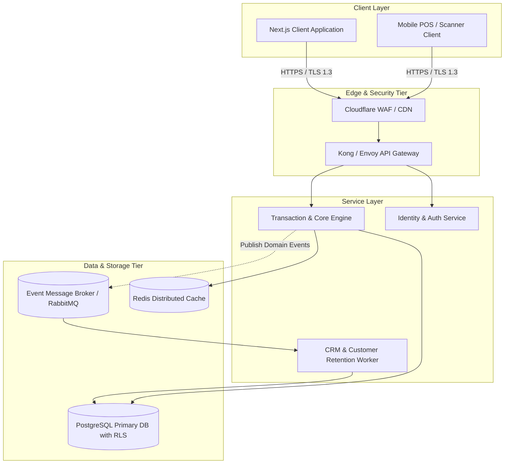
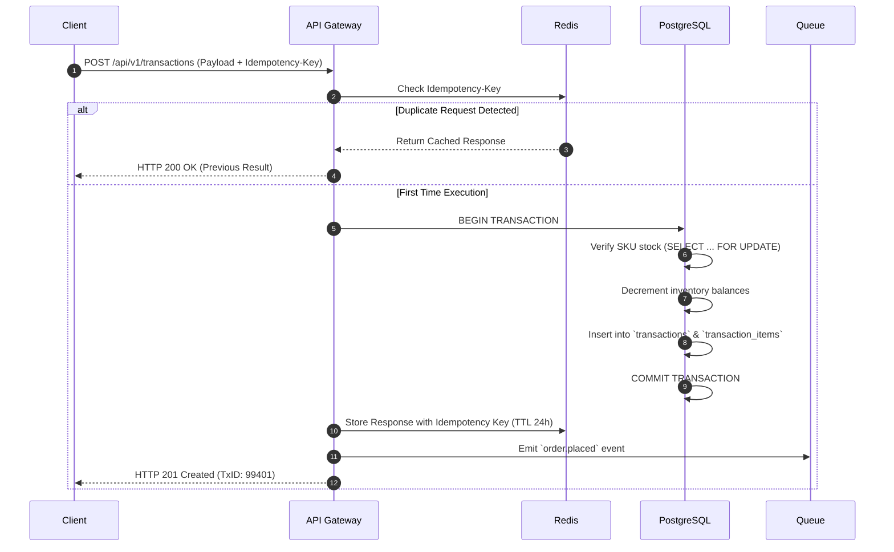
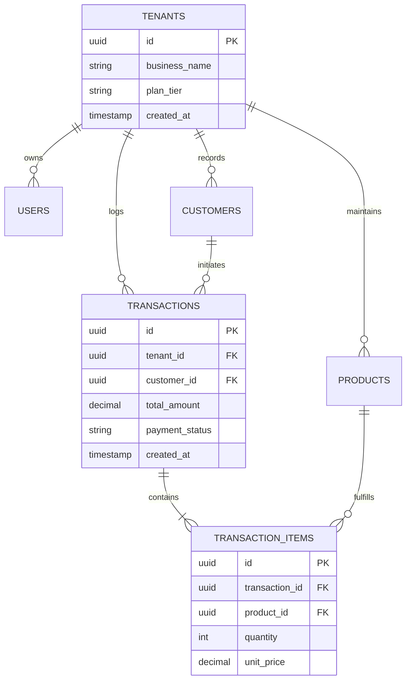

# System Requirements Specification (SRS)

> **Standard:** Adapted from IEEE 830 / ISO/IEC/IEEE 29148 for Cloud & Modern Microservices  
> **Target System:** [System / Platform Name]  
> **Prepared by:** [Author Name / Tri Raida]  
> **Status:** `Approved` | `Under Review`  
> **Version:** `1.1.0`

---

## 1. System Overview & Context

### 1.1 Purpose
This document specifies the software architecture, system boundaries, external interfaces, and functional requirements for the **[System Name]** platform. It provides the definitive technical specification for backend engineering, frontend development, devops, and automated QA verification.

### 1.2 System Scope & Architecture Topology
The system operates as a distributed multi-tenant platform. Data isolation is maintained at the database tier using row-level policies, fronted by an API Gateway handling identity verification, rate limiting, and request correlation tracing.

---

## 2. External Interface Specifications

### 2.1 User Interfaces (UI)
* **Design System Reference:** Figma Component Library v2.4 (Design Tokens: Tailwind CSS).
* **Responsive Breakpoints:** 
  * Mobile: `375px - 767px`
  * Tablet / POS Terminal: `768px - 1024px`
  * Desktop Back-office: `>= 1025px`
* **Accessibility SLA:** Web Content Accessibility Guidelines (WCAG) 2.1 Level AA compliance.

### 2.2 Hardware Interfaces
* **Barcode / QR Scanner:** Supports HID (Human Interface Device) keyboard emulation mode via USB/Bluetooth.
* **Thermal Receipt Printer:** ESC/POS command protocol over WebSocket/Serial bridge for direct silent printing.

### 2.3 Software & API Interfaces

| Interface ID | Target System | Protocol | Data Format | Authentication | Retry / SLA |
|---|---|---|---|---|---|
| **INT-01** | Stripe Payment Gateway | REST / HTTPS | JSON | Bearer API Key + HMAC Webhook | Exponential backoff (Max 5 retries) |
| **INT-02** | WhatsApp Business Cloud API | REST / Webhook | JSON | OAuth 2.0 Bearer Token | Circuit breaker threshold: 5 failures/min |
| **INT-03** | Auth Provider (Supabase Auth) | HTTPS / JWT | JSON (RS256) | Ed25519 / RSA asymmetric public key | Cached token verification (TTL 15m) |

---

## 3. Detailed System Features & Functional Specifications

### 3.1 Feature: Multi-Tenant Transaction Processing (`SYS-FEAT-001`)

#### 3.1.1 Description & Priority
High-throughput order placement and financial ledger entry. Must guarantee ACID compliance and atomic inventory decrements.  
**Priority:** Critical (P0)

#### 3.1.2 Input / Output Contract
* **Input Payload:** Order submission payload containing `tenant_id`, `cashier_id`, `customer_id` (optional), array of `line_items` (SKU, quantity, unit_price, discount), and `payment_details`.
* **Output Payload:** Canonical HTTP `201 Created` with serialized `transaction_id`, invoice reference number, payment status, and generated timestamp.

#### 3.1.3 Sequence Diagram & State Transition

#### 3.1.4 Error Handling & Fallback Modes
| Error Condition | HTTP Code | Internal Error Code | Recovery Behavior |
|---|---|---|---|
| Insufficient Stock balance | `422 Unprocessable` | `ERR_INSUFFICIENT_STOCK` | Abort transaction, return offending SKU IDs |
| Stale Idempotency Key mismatch | `409 Conflict` | `ERR_IDEMPOTENCY_MISMATCH` | Reject request, log security audit warning |
| DB Connection Timeout | `503 Service Unavailable`| `ERR_DATABASE_TIMEOUT` | Trigger circuit breaker, return retry-after header |

---

## 4. Data Storage & Schema Invariants

### 4.1 Tenancy Isolation Rules
* Every query executed against tenant tables (`customers`, `transactions`, `products`) must include `tenant_id = auth.jwt_claim('tenant_id')`.
* Direct schema updates bypassing Row-Level Security (RLS) are strictly disabled for non-superadmin database roles.

### 4.2 Data Integrity & Foreign Key Rules

---

## 5. Security & Cryptographic Invariants

1. **Authentication:** Stateless JSON Web Tokens (JWT) signed via asymmetric RS256 algorithm with a strict 60-minute expiration window. Refresh tokens are rotating single-use tokens stored in HTTP-Only, Secure, SameSite=Strict cookies.
2. **Authorization (RBAC):** Role enforcement at gateway and service level:
   * `Owner`: Full read/write across all modules within their `tenant_id`.
   * `Cashier`: Restricted to transaction entry, product lookup, and customer creation. No access to raw financial aggregations or expense settings.
   * `SuperAdmin`: System-level diagnostics; zero unprompted access to tenant PII data.
3. **Data Protection at Rest & In-Transit:**
   * TLS 1.3 enforced for all external ingress and egress traffic.
   * Field-level encryption for customer credit numbers, phone numbers, and banking details using AES-GCM-256 with KMS key rotation.
