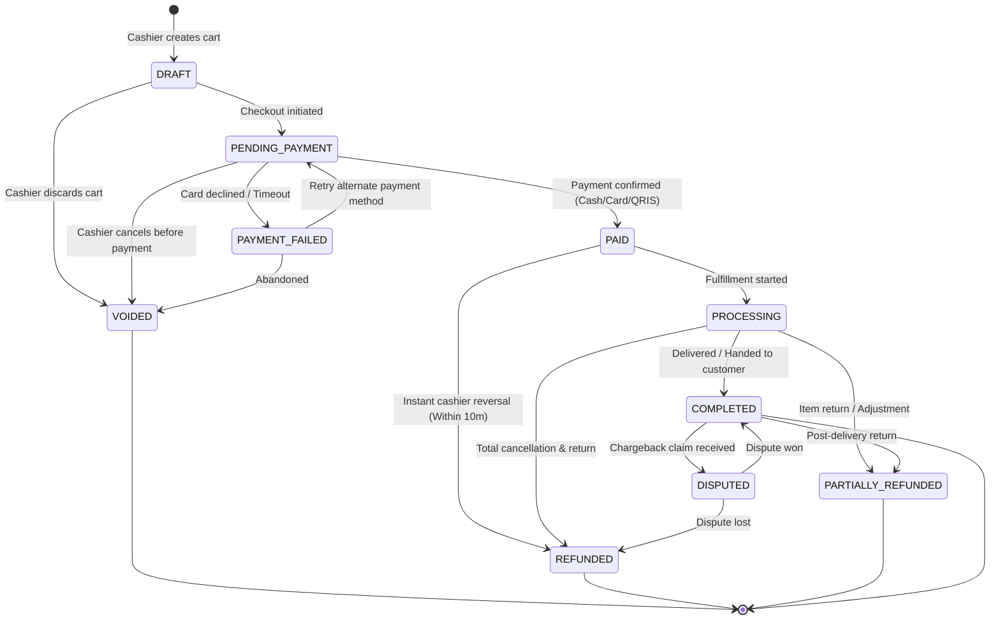
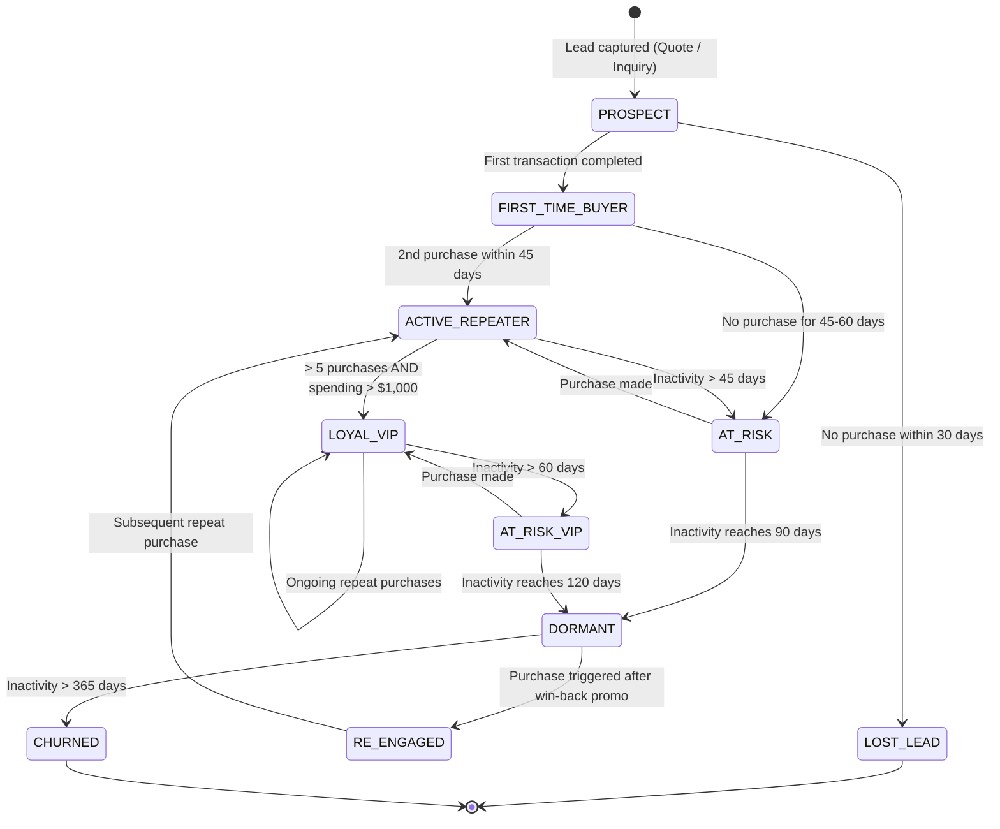

# Business State Machine Diagrams (Mermaid.js)

> **Purpose:** Explicitly defines allowable state transitions, transition triggers, and terminal states for business objects to prevent illegal data mutations.

---

## 1. Transaction & Order Lifecycle State Machine

Defines how an order progresses from creation to settlement, refund, or cancellation.

### Transition Guard Rules & Invariants
| Current State | Target State | Trigger Event | Guard Condition / Permission | Side Effect |
|---|---|---|---|---|
| `DRAFT` | `PENDING_PAYMENT` | Checkout click | Cart must have `>= 1` item and total `> 0` | Locks stock quantities |
| `PENDING_PAYMENT` | `PAID` | Payment gateway webhook | Verified payment amount matches total | Emits `order.paid` domain event |
| `PAID` | `REFUNDED` | Refund request | Requires `Owner` or `Supervisor` role PIN | Reverses stock decrement; ledger debit |
| `COMPLETED` | `DISPUTED` | Chargeback notice | Received within 90 days of order date | Freezes merchant escrow funds |

---

## 2. Customer Lifecycle & Retention State Machine

Models customer progression and dormancy feedback loops, enabling automated CRM follow-up triggers.

### Automated System Actions by State
* **When entering `AT_RISK`:** Queue automated personalized promotional notification with 10% discount voucher.
* **When entering `DORMANT`:** Flag in CRM dashboard for manual high-touch sales rep outreach.
* **When entering `RE_ENGAGED`:** Attribute marketing conversion to the specific reactivation campaign.
