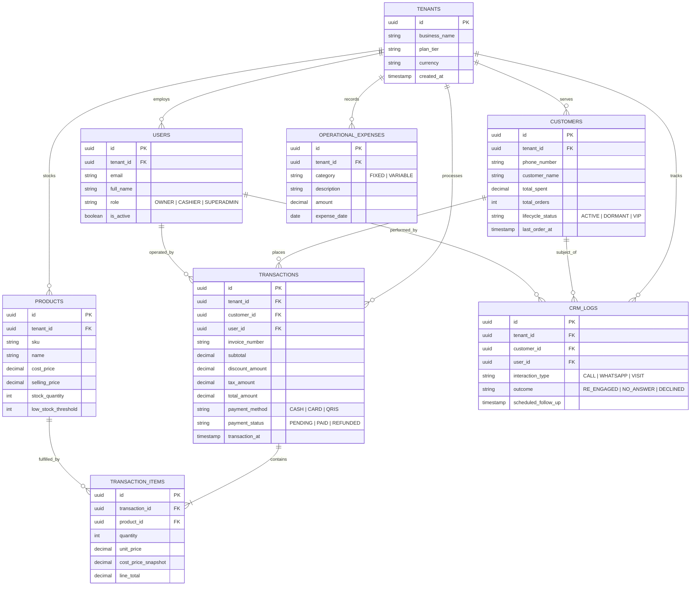

# Entity Relationship Diagram (ERD) & Schema Design

> **Standard:** Crow's Foot Notation modeled in Mermaid.js with multi-tenant row-level isolation invariants.

---

## 1. Multi-Tenant Enterprise Schema Model

---

## 2. Key Data Architecture Principles

1. **Denormalized Snapshots for Auditing:**
   * In `TRANSACTION_ITEMS`, notice `cost_price_snapshot` and `unit_price`. This ensures that when a merchant alters product prices in the catalog tomorrow, historical financial reporting and profit-margin calculations remain permanently accurate.
2. **Tenant ID Foreign Key Invariant:**
   * Every single entity table contains a direct `tenant_id` foreign key referencing `tenants(id)`. This prevents expensive cascading multi-table joins when enforcing Row-Level Security (RLS) policies.
3. **Optimistic Locking via Version Columns:**
   * High-contention tables (like `PRODUCTS` stock quantities) include a `version integer DEFAULT 1` column to support optimistic concurrency control during high-volume sales.
