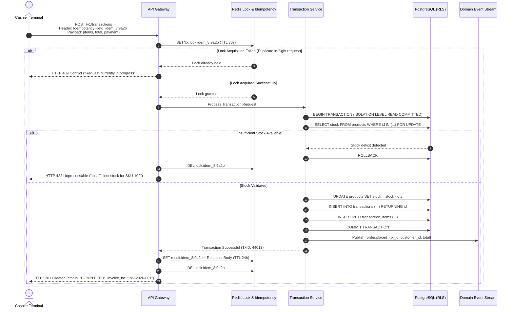
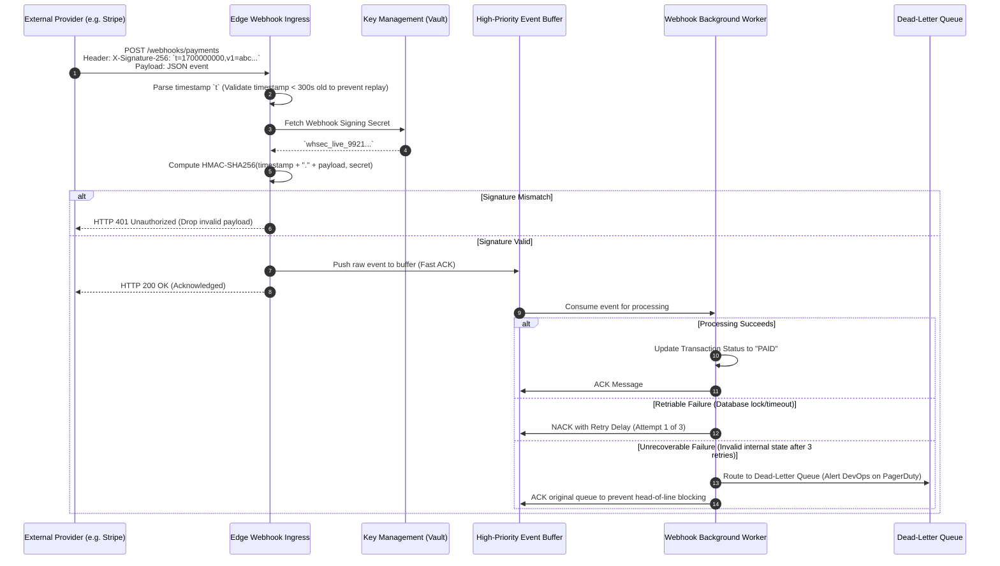
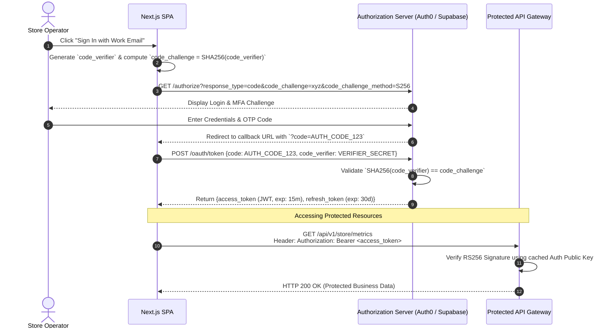

# System Sequence Flow Patterns (Mermaid.js)

> **Purpose:** Reusable, enterprise-grade sequence flows covering the most critical technical interactions in modern SaaS and distributed architectures.

---

## 1. Idempotent Transaction Submission with Distributed Lock

Guarantees that network retries or double-clicks by a cashier never result in duplicate orders or double-billing.

---

## 2. Secure Webhook Ingestion with HMAC Verification & Dead-Letter Queue (DLQ)

Pattern for receiving external asynchronous notifications (e.g., Stripe, WhatsApp, Payment Gateways) with replay attack protection.

---

## 3. OAuth2 PKCE Authentication & Rotating Token Flow

Secure authentication flow for Single Page Applications (Next.js / React) and mobile apps without exposing client secrets.

