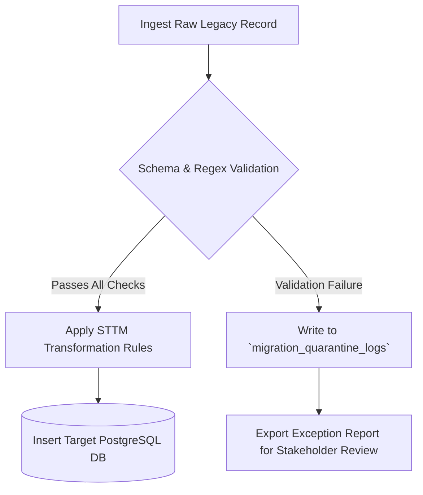

# Source-to-Target Mapping (STTM) & Data Dictionary

> **Context:** Data Lineage and Field Transformation Specification for System Migration, ETL pipelines, and API integrations.  
> **Author:** [Tri Raida / Author Name]  
> **Source System:** Legacy Retail POS / ERP (Flat CSV / Legacy MySQL)  
> **Target System:** Modern Cloud Multi-Tenant Platform (PostgreSQL)

---

## 1. Customer Entity Data Mapping Matrix

| Source Field (Legacy) | Source Data Type | Target Field (PostgreSQL) | Target Data Type | Nullable | Transformation & Business Logic Rule | Validation / Edge Case Rule |
|---|---|---|---|---|---|---|
| `cust_no` | `VARCHAR(20)` | `legacy_customer_code` | `VARCHAR(32)` | Yes | Direct 1:1 copy for historical traceability. | Index for fast legacy lookups. |
| *N/A (Generated)* | — | `id` | `UUID` | **No** | Generate cryptographically secure `UUID v4`. | Primary Key. |
| *Session Context* | — | `tenant_id` | `UUID` | **No** | Populated from active migration tenant context. | Enforces Row-Level Security. |
| `cust_name` | `VARCHAR(100)` | `customer_name` | `VARCHAR(150)` | **No** | `TRIM(UPPER(SUBSTRING(cust_name, 1, 150)))` | If blank, default to `'Valued Customer'`. |
| `msisdn_raw` | `VARCHAR(30)` | `phone_e164` | `VARCHAR(20)` | Yes | Normalize to international E.164 format: Remove hyphens, spaces; prefix with `+62` if starts with `08`. | Regex check: `^\+[1-9]\d{1,14}$`. Flag bad records to quarantine table. |
| `accumulated_val`| `DOUBLE` | `total_spent` | `NUMERIC(14,2)`| **No** | Cast `ROUND(accumulated_val, 2)` to fixed-point numeric. Prevent floating-point rounding errors. | Must be `>= 0.00`. |
| `last_tx_date` | `VARCHAR(10)` | `last_order_at` | `TIMESTAMPTZ` | Yes | Parse format `'DD/MM/YYYY'` and convert to UTC ISO-8601 timestamp. | If date is in the future, set to `NULL` and log audit warning. |
| *Calculated* | — | `lifecycle_status`| `VARCHAR(20)` | **No** | **Derived Business Logic:** `IF last_order_at IS NULL THEN 'PROSPECT'` `ELSE IF NOW() - last_order_at <= INTERVAL '45 days' THEN 'ACTIVE'` `ELSE IF NOW() - last_order_at <= INTERVAL '90 days' THEN 'AT_RISK'` `ELSE 'DORMANT'` | Enum constrained: `PROSPECT`, `ACTIVE`, `AT_RISK`, `DORMANT`, `VIP`. |

---

## 2. Transaction Line Items Data Mapping Matrix

| Source Field | Target Field | Transformation Rule | Sample Source Value | Sample Target Value |
|---|---|---|---|---|
| `item_code` | `product_id` | Lookup `products.id` WHERE `sku = item_code AND tenant_id = current_tenant` | `"SKU-COF-01"` | `"e58ed763-928c-4155..."` |
| `qty_sold` | `quantity` | `CAST(qty_sold AS INTEGER)` | `"3"` | `3` |
| `sale_price` | `unit_price` | `CAST(sale_price AS NUMERIC(12,2))` | `15000.00` | `15000.00` |
| `cost_basis` | `cost_price_snapshot`| Snapshot of product cost at the exact time of order settlement. Prevents profit margin drift. | `8500.00` | `8500.00` |
| *Computed* | `line_total` | `(quantity * unit_price) - discount_allocated` | — | `45000.00` |

---

## 3. Data Cleansing & Quarantine Protocol

### Exception Logging Schema:
Any record failing validation (e.g., malformed phone numbers or orphaned foreign keys) is routed to an audit table:
* `source_table`: Name of legacy table.
* `source_primary_key`: Identifier in legacy system.
* `failure_reason`: Human-readable error (e.g., `"Invalid E.164 phone: 0812-XXXX"`).
* `raw_payload_json`: Raw JSON snapshot of the rejected row for forensic debugging.
