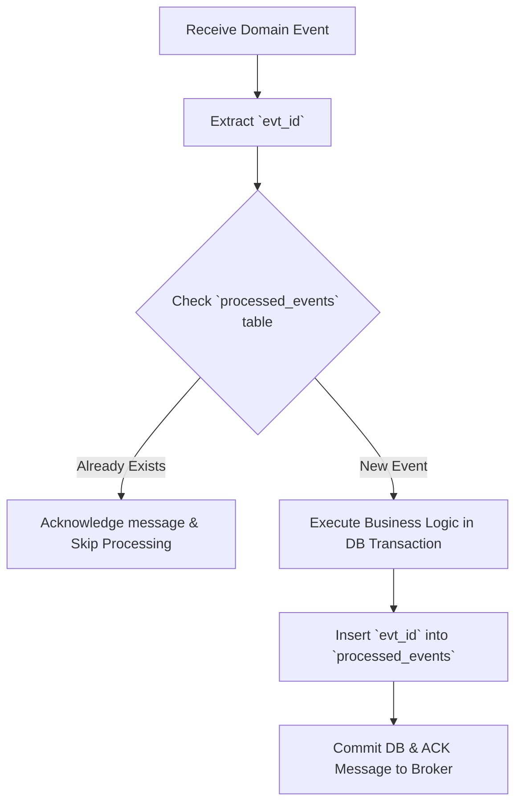

# Event-Driven Architecture (EDA) & Pub/Sub Specification

> **Standard:** CloudEvents v1.0 compatible  
> **Broker Target:** Kafka, RabbitMQ, Amazon SQS/SNS, or Redis Streams  
> **Author:** [Tri Raida / Author Name]

---

## 1. Domain Event Taxonomy & Naming Invariants

Events represent immutable facts that have already occurred in the past. 

**Naming Convention:** `<domain>.<entity>.<past-tense-verb>`
* Examples:
  * `retail.order.placed`
  * `retail.payment.settled`
  * `retail.inventory.threshold_breached`
  * `crm.customer.dormancy_flagged`

---

## 2. Standard CloudEvents Envelope Structure

All event payloads published to message brokers must adhere to the standardized schema envelope below:

```json
{
  "specversion": "1.0",
  "id": "evt_99b0c2d3-8e4f-4318-8f83-e02948bbcd89",
  "source": "/services/transaction-engine",
  "type": "retail.order.placed",
  "datacontenttype": "application/json",
  "time": "2026-11-03T06:30:15.124Z",
  "tenantid": "t_09a1b2c3-4d5e-6f7a-8b9c-0d1e2f3a4b5c",
  "data": {
    "transaction_id": "f47ac10b-58cc-4372-a567-0e02b2c3d479",
    "invoice_number": "INV/2026/11/0042",
    "customer_id": "9b1deb4d-3b7d-4bad-9bdd-2b0d7b3dcb6d",
    "total_amount": 374625.00,
    "currency": "IDR",
    "payment_method": "QRIS",
    "item_count": 3,
    "cashier_id": "usr_772102"
  }
}
```

---

## 3. Partitioning, Ordering, and Delivery Guarantees

### 3.1 Partition Key Strategy
To ensure in-order message processing per tenant and per customer, the broker partition key is structured as:
```text
partition_key = "${tenantid}:${customer_id}"
```
* **Guarantee:** All orders and CRM status changes for a specific customer are guaranteed to land on the exact same message partition, preserving strict chronological execution order.

### 3.2 At-Least-Once Delivery & Consumer Idempotency
Because network brokers provide **at-least-once** delivery guarantees, message consumers may receive duplicate events during network splits or worker crashes.

**Consumer Idempotency Pattern:**


---

## 4. Consumer Registry & Event Routing Matrix

| Topic / Stream | Event Type | Consumer Service | Action Triggered | SLA / Latency Target |
|---|---|---|---|---|
| `retail.transactions` | `retail.order.placed` | **Inventory Worker** | Verifies permanent warehouse stock reservation. | `< 500 ms` |
| `retail.transactions` | `retail.order.placed` | **CRM Analytics Worker** | Recalculates Customer Lifetime Value (LTV) and RFM score. | `< 2,000 ms` |
| `retail.transactions` | `retail.order.placed` | **Notification Worker** | Dispatches electronic invoice via WhatsApp / Email. | `< 5,000 ms` |
| `retail.inventory` | `retail.inventory.threshold_breached` | **Purchasing Alert Worker** | Sends Telegram / Slack alert to store manager. | `< 1,000 ms` |
