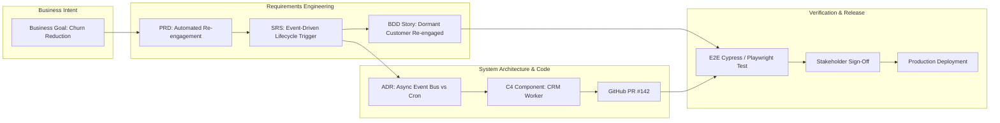

# Requirements Traceability Matrix (RTM)

> **Purpose:** Ensures full bidirectional traceability from initial business goals through functional requirements, system architecture components, automated test suites, and final UAT sign-off.  
> **Maintainer:** [Tri Raida / Lead Business System Analyst]

---

## 1. Master Traceability Table

| Business Goal ID | Functional Req ID | SRS Module | C4 Component | Jira / Issue Key | Automated Test Suite (QA) | UAT Status |
|---|---|---|---|---|---|---|
| **BG-01:** Reduce dormant customer churn by 20% | **REQ-CRM-001** | `01-core-templates/SRS-Template.md#3.1` | `CRMWorker` | `JIRA-4021` | `crm_reactivation_test.spec.ts` | **PASSED** (Sign-off: 2026-10-15) |
| **BG-02:** Prevent double billing on mobile POS | **REQ-TX-004** | `03-data-and-api-specs/api-contract-template.md#1.1` | `IdempotencyGuard` | `JIRA-4033` | `idempotency_concurrency_test.go` | **PASSED** (Sign-off: 2026-10-18) |
| **BG-03:** Enforce multi-tenant data privacy | **REQ-SEC-002** | `01-core-templates/ADR-Template.md` | `PostgreSQL RLS` | `JIRA-4008` | `rls_tenant_leak_penetration_test.sql` | **PASSED** (Sign-off: 2026-10-12) |
| **BG-04:** Real-time stock reservation under peak load | **REQ-INV-008** | `02-diagrams-as-code/system-sequence-flows.md#1` | `StockManager` | `JIRA-4055` | `k6_load_test_500tps.js` | **IN PROGRESS** (Target: Sprint 26) |

---

## 2. Traceability Visual Graph

---

## 3. Change Impact Analysis Protocol

When a business requirement changes during active development:
1. Identify all downstream nodes linked via the RTM (Architecture Components, Code PRs, and Automated Test Suites).
2. Quantify timeline and budget impact before approving Scope Changes in Sprint Planning.
3. Update the RTM status to `Under Review` until all corresponding test suites are refactored.
