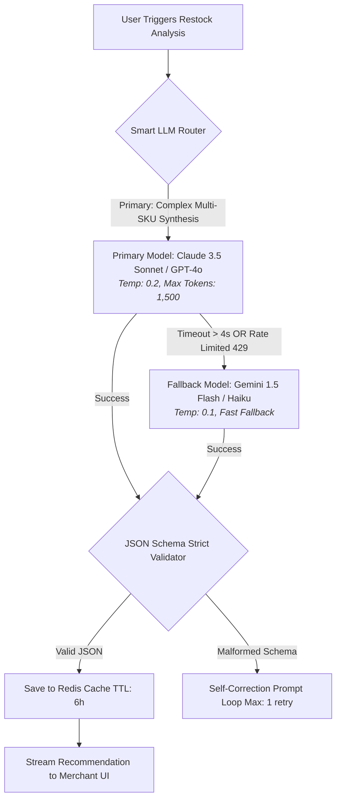

# Generative AI & LLM System Feature Specification

> **Feature Name:** Automated Retail Inventory & Re-Stocking AI Copilot  
> **Target System:** [System / Platform Name]  
> **Prepared by:** [Tri Raida / Lead Business System Analyst]  
> **Status:** `Approved for Implementation`  
> **Version:** `1.0.0`

---

## 1. Feature Purpose & Value Proposition

* **Problem:** Small business operators struggle to analyze complex stock depletion velocities, seasonal demand spikes, and supplier lead times, frequently causing stockouts on high-margin items or overstocking dead inventory.
* **Solution:** An embedded AI Copilot that analyzes historical transaction velocity, evaluates lead times, and synthesizes structured replenishment recommendations with natural language rationales.

---

## 2. LLM Model Selection & Tiered Fallback Architecture



### Model Configuration Matrix
| Tier | Model | Provider | Temperature | Token Budget (Max) | Target Latency (p90) | Est. Cost / Request |
|---|---|---|---|---|---|---|
| **Tier 1 (Primary)** | Claude 3.5 Sonnet / GPT-4o | Anthropic / OpenAI | `0.2` (Low variance) | `1,500` tokens | `< 2,800 ms` | ~$0.008 |
| **Tier 2 (Fallback)**| Gemini 1.5 Flash | Google Cloud Vertex | `0.1` | `1,200` tokens | `< 1,100 ms` | ~$0.0006 |

---

## 3. Prompt Contract & Context Budget Allocation

### 3.1 Context Window Budget Breakdown (4,000 Token Cap)
* **System Prompt & Guardrails:** `600 tokens`
* **Dynamic Business Context:** `2,200 tokens` (Tenant profile, top 20 moving SKUs, last 30-day transaction summary, lead-time matrix).
* **Few-Shot Examples:** `400 tokens`
* **Output Response Budget:** `800 tokens`

### 3.2 System Prompt Specification
```markdown
You are an expert Retail Supply Chain & Inventory Analyst for a multi-tenant business platform.
Your objective is to review the tenant's sales velocity and generate structured restocking recommendations.

STRICT INVARIANTS:
1. Ground your recommendations ONLY in the provided sales velocity and lead-time data.
2. If data is insufficient for a SKU, state: "INSUFFICIENT_HISTORICAL_DATA". Never invent supplier details.
3. You must respond ONLY with a valid JSON object matching the requested schema. Do not include markdown code block wrappers (```json).
```

---

## 4. Structured Output Contract (JSON Schema Enforcement)

The AI model output is strictly parsed and validated against this JSON Schema before any data is presented to the merchant:

```json
{
  "$schema": "http://json-schema.org/draft-07/schema#",
  "title": "RestockRecommendationPayload",
  "type": "object",
  "required": ["tenant_id", "analysis_timestamp", "recommendations", "estimated_reorder_cost"],
  "properties": {
    "tenant_id": { "type": "string", "format": "uuid" },
    "analysis_timestamp": { "type": "string", "format": "date-time" },
    "estimated_reorder_cost": { "type": "number", "minimum": 0 },
    "recommendations": {
      "type": "array",
      "items": {
        "type": "object",
        "required": ["sku", "product_name", "suggested_reorder_qty", "urgency", "rationale"],
        "properties": {
          "sku": { "type": "string" },
          "product_name": { "type": "string" },
          "suggested_reorder_qty": { "type": "integer", "minimum": 1 },
          "urgency": { "type": "string", "enum": ["CRITICAL", "MODERATE", "LOW"] },
          "days_until_stockout": { "type": "integer" },
          "rationale": { "type": "string", "maxLength": 200 }
        }
      }
    }
  }
}
```

---

## 5. Guardrails, Safety & Failure Protocols

1. **Hallucination Prevention:** The prompt employs strict context-grounding. If zero sales are logged for a requested item, the output flags the item with `urgency: "LOW"` and notes zero historical velocity.
2. **PII Masking Invariant:** Prior to injecting transaction records into the LLM prompt context, all customer names, phone numbers, and payment references are stripped. Only anonymized SKU IDs, quantities, and timestamps are passed to third-party LLM APIs.
3. **Graceful UI Fallback:** If both Tier 1 and Tier 2 LLM providers return `5xx` or timeout (> 5 seconds), the frontend seamlessly falls back to a deterministic heuristic formula:
   $$\text{Reorder Point} = (\text{Average Daily Sales} \times \text{Lead Time Days}) + \text{Safety Stock}$$
