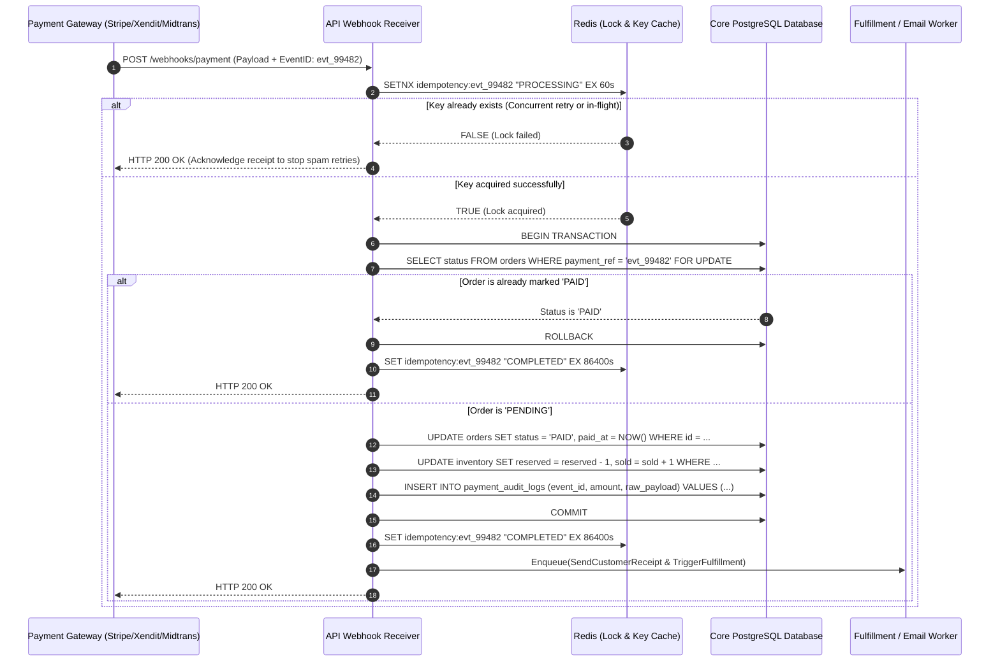

# Blueprint 01: Payment Webhook Idempotency & Auto-Reconciliation

> **Target Problem:** A customer's bank card is charged $150, but an unstable network drops your server connection before the order is marked `PAID`. The customer complains of a stolen charge, or the payment gateway retries the webhook 5 times, creating 5 duplicate orders and shipping 5 items.

---

## 1. The Nightmare Scenario
On Black Friday, Payment Gateway X issues a webhook for Order #8921. Your server is under high CPU load and takes 5.2 seconds to respond. The gateway assumes a timeout and retries the webhook 4 times over the next 15 minutes. 
Because your developer wrote a naive `INSERT INTO orders ...` endpoint without an idempotency key or a state check:
1. The customer is billed once, but 4 duplicate order records are created.
2. Warehouse inventory is decremented 4 times.
3. 4 automated fulfillment labels are printed, shipping 4 units of product for the price of 1.

---

## 2. Architectural Blueprint: Idempotency Key & Mutex



---

## 3. Database Specification & Constraints

```sql
-- 1. Enforce strict uniqueness on external payment references
CREATE TABLE payment_events (
    id UUID PRIMARY KEY DEFAULT gen_random_uuid(),
    tenant_id UUID NOT NULL REFERENCES tenants(id),
    gateway_name VARCHAR(50) NOT NULL, -- 'stripe', 'midtrans', 'xendit'
    gateway_event_id VARCHAR(255) NOT NULL,
    order_id UUID NOT NULL REFERENCES orders(id),
    amount_in_cents BIGINT NOT NULL,
    currency VARCHAR(3) NOT NULL DEFAULT 'USD',
    status VARCHAR(50) NOT NULL, -- 'PROCESSED', 'IGNORED_DUPLICATE', 'FAILED'
    received_at TIMESTAMPTZ NOT NULL DEFAULT NOW(),
    payload_hash VARCHAR(64) NOT NULL, -- SHA-256 to detect forged payload tampering
    raw_payload JSONB NOT NULL,
    
    -- HARD CONSTRAINT: A gateway event ID can NEVER be recorded twice for the same tenant
    CONSTRAINT uq_gateway_event UNIQUE (tenant_id, gateway_name, gateway_event_id)
);

CREATE INDEX idx_payment_events_order ON payment_events(order_id);
```

---

## 4. Business Rules & Acceptance Criteria (Gherkin BDD)

```gherkin
Scenario: Webhook arrives after network timeout retry
  Given an order "ORD-1001" exists with status "PENDING"
  When the payment gateway sends webhook event "evt_abc123" with status "SUCCESS"
  Then the system records the payment and updates "ORD-1001" status to "PAID"
  And the system returns HTTP 200 OK to the gateway

Scenario: Duplicate webhook arrives for an already processed payment
  Given an order "ORD-1001" has already been marked "PAID" by event "evt_abc123"
  When the payment gateway retries webhook event "evt_abc123"
  Then the system detects the existing idempotency key
  And does NOT deduct inventory again
  And does NOT trigger a duplicate fulfillment email
  And returns HTTP 200 OK immediately to stop gateway retries
```

---

## 5. Automated Nightly Reconciliation Worker (Auto-Healer)

Even with webhook locks, what if your server was down for 30 minutes?
* **Specification:** A cron worker runs daily at 02:00 AM UTC.
* **Logic:** 
  1. Queries all orders with `status = 'PENDING'` older than 2 hours.
  2. Calls the payment gateway's REST API: `GET /v1/charges?payment_intent={id}`.
  3. If gateway says `SUCCESS`, marks the order `PAID` with note `AUTO_RECONCILED_BY_CRON`.
  4. If gateway says `EXPIRED` or `FAILED`, releases the reserved inventory back to available stock.
