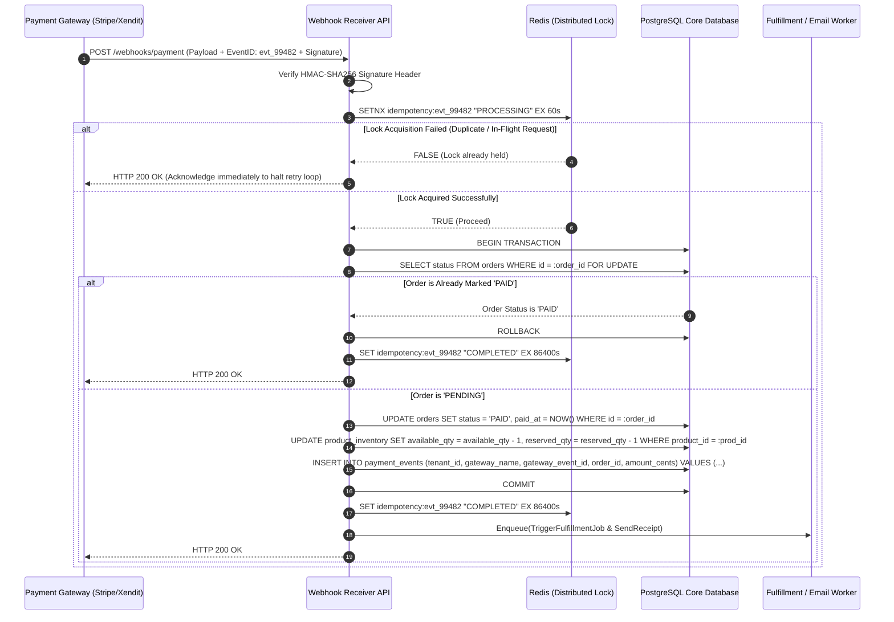

# Blueprint 01: Payment Webhook Idempotency & Auto-Reconciliation

> **Target Problem:** A customer's credit card is charged $150, but an unstable network drops your server connection before the order is marked `PAID`. The payment gateway retries the webhook 5 times, creating 5 duplicate orders, deducting inventory 5 times, and shipping 5 items for the price of 1.

---

## 1. Assumptions (Asumsi)
* **At-Least-Once Delivery:** The payment gateway (Stripe, Midtrans, Xendit, PayPal) guarantees *at-least-once* webhook delivery, which makes duplicate HTTP requests inevitable by design.
* **Network Asynchrony:** Network latency or temporary server spikes will occasionally cause webhooks to exceed the gateway's 3-second timeout threshold.
* **Stateless API Gateway:** Webhook worker nodes are horizontally scalable and stateless; state coordination must rely on a shared distributed cache (Redis) and relational database (PostgreSQL).

---

## 2. Prerequisites (Prasyarat)
* **PostgreSQL 14+:** Supporting row-level locking (`SELECT ... FOR UPDATE`) and unique compound constraints.
* **Redis 6.2+:** Configured for atomic distributed locking using `SET ... NX EX`.
* **Cryptographic Signature Verification:** Gateway webhook signing secrets (`STRIPE_WEBHOOK_SECRET`) configured in environment variables and never checked into source control.

---

## 3. Failure Scenario & Blast Radius (Skenario Kegagalan)
* **The Failure Story:** During a promotional surge, Payment Gateway X issues a webhook for Order #8921. The API server takes 5.2 seconds to process the request due to heavy load. The gateway flags a timeout and retries the webhook 4 times over the next 15 minutes. Because the endpoint uses naive `INSERT INTO orders` code without an idempotency key or distributed mutex, 4 duplicate paid orders are created.
* **Financial Impact:** 3 extra physical units shipped for free ($450 loss) plus warehouse fulfillment labor costs.
* **Blast Radius:** Downstream inventory counts, financial revenue reports, fulfillment label printers, and automated customer receipt emails.

---

## 4. Architectural Blueprint & DDL (Spesifikasi Arsitektur)



```sql
-- Production DDL: Enforce strict gateway event idempotency
CREATE TABLE payment_events (
    id UUID PRIMARY KEY DEFAULT gen_random_uuid(),
    tenant_id UUID NOT NULL REFERENCES tenants(id),
    gateway_name VARCHAR(50) NOT NULL, -- 'stripe', 'midtrans', 'xendit'
    gateway_event_id VARCHAR(255) NOT NULL,
    order_id UUID NOT NULL REFERENCES orders(id),
    amount_in_cents BIGINT NOT NULL,
    currency VARCHAR(3) NOT NULL DEFAULT 'USD',
    status VARCHAR(50) NOT NULL, -- 'PROCESSED', 'IGNORED_DUPLICATE', 'FAILED'
    received_at TIMESTAMPTZ NOT NULL DEFAULT NOW(),
    payload_hash VARCHAR(64) NOT NULL, -- SHA-256 hash of raw payload to detect tampering
    raw_payload JSONB NOT NULL,
    
    -- HARD DATABASE CONSTRAINT: An event ID can NEVER be recorded twice for the same tenant
    CONSTRAINT uq_gateway_event UNIQUE (tenant_id, gateway_name, gateway_event_id)
);

CREATE INDEX idx_payment_events_order ON payment_events(order_id);
```

---

## 5. Recovery Strategy & Self-Healing (Strategi Pemulihan)
* **Automated Reconciliation Cron:** A daily worker runs at 02:00 AM UTC. It queries all orders in `PENDING` state older than 2 hours and queries the gateway's REST API (`GET /v1/charges/{charge_id}`). If the gateway reports success, the cron marks the order `PAID` with note `AUTO_RECONCILED_BY_CRON`.
* **Dead-Letter Queue (DLQ):** Webhooks with invalid signatures or database transaction timeouts are directed to a DLQ topic (`payments.webhook.dlq`) with exponential backoff (1m, 5m, 15m).
* **Manual Runbook:** If an order remains orphaned, support staff can trigger `POST /admin/reconcile-order/:id`, which forces a direct API query to the payment gateway without manual SQL edits.

---

## 6. Security Boundary & Access Scope (Batas Keamanan)
* **Cryptographic Verification First:** The payload is discarded with `HTTP 401 Unauthorized` before parsing JSON if the HMAC-SHA256 signature does not match the shared gateway secret.
* **Least Privilege:** The webhook ingestion service database credentials have permission only to `SELECT/UPDATE` orders and `INSERT` to `payment_events`. It has zero permissions to delete tables or modify user credentials.
* **Row-Level Security:** In multi-tenant environments, the gateway webhook handler extracts `tenant_id` from metadata and scopes all database mutations to that tenant context.

---

## 7. Test Scenarios (Skenario Pengujian)

```gherkin
Feature: Payment Webhook Idempotency & Reconciliation

  Scenario: Standard Successful Payment
    Given an order "ORD-100" exists with status "PENDING"
    When the gateway sends webhook "evt_123" with valid signature and status "SUCCESS"
    Then the system updates order "ORD-100" status to "PAID"
    And records an event in "payment_events" with status "PROCESSED"
    And responds with HTTP 200 OK within 300 milliseconds

  Scenario: Duplicate Webhook Attack / Network Retry
    Given an order "ORD-100" was already marked "PAID" by event "evt_123"
    When the gateway resends webhook "evt_123" 10 seconds later
    Then the system detects the existing idempotency key in Redis
    And does NOT decrement product inventory again
    And does NOT enqueue duplicate fulfillment jobs
    And returns HTTP 200 OK immediately to stop retries

  Scenario: Concurrency Spike (Thundering Herd)
    Given an order "ORD-100" with status "PENDING"
    When 5 identical webhook requests for "evt_123" hit the server within the same 5ms window
    Then exactly 1 request acquires the distributed lock and updates the database
    And 4 requests fail to acquire the lock and exit safely with HTTP 200 OK
    And the final inventory is decremented exactly 1 time
```

---

## 8. Batasan Penerapan & Trade-offs (Kapan JANGAN Digunakan)
* **Contraindications:** Do not implement distributed Redis mutexes for zero-cost free trials or non-financial user interactions where duplicates carry zero financial liability.
* **Performance Overhead:** Distributed locking adds 2–6 milliseconds of latency per webhook call.
* **Complexity Burden:** Requires monitoring Redis memory utilization and setting proper TTL expiry (default: 60s processing lock, 24h completion marker).
