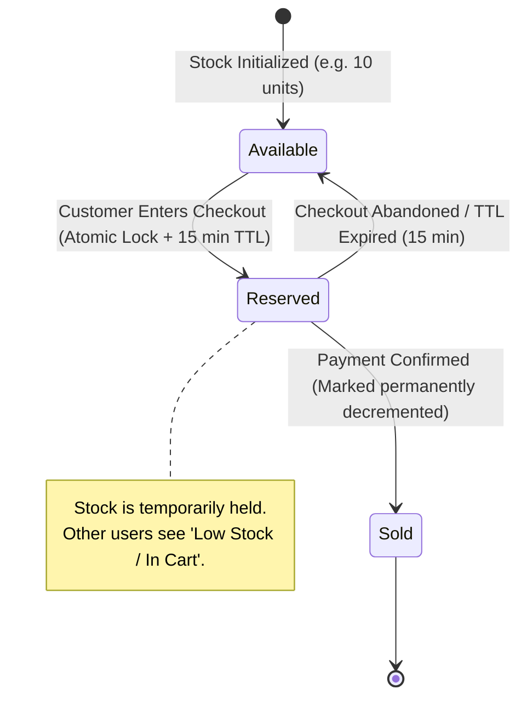
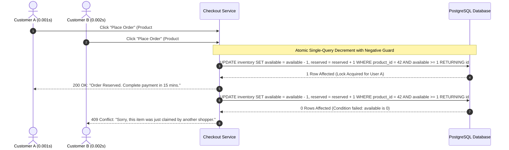

# Blueprint 02: Inventory Concurrency & Race Conditions

> **Target Problem:** There is only 1 unit of a hot product left. Three customers click "Buy Now" at the exact same millisecond. Without pessimistic locking or atomic checks, the database allows all 3 checkouts to pass, creating 2 backorders, an angry customer dispute, and negative stock numbers.

---

## 1. The Nightmare Scenario
During a limited flash sale, your e-commerce platform sells 50 limited-edition jackets. 1,000 users hit the checkout API concurrently.
Because the developer used naive read-then-write code:
```javascript
// NAIVE CODE (DISASTER WAITING TO HAPPEN)
const item = await db.query('SELECT stock FROM items WHERE id = ?', itemId);
if (item.stock > 0) {
    await db.query('UPDATE items SET stock = stock - 1 WHERE id = ?', itemId);
    createOrder();
}
```
Between the `SELECT` and the `UPDATE`, 40 threads read `stock = 1`. 
Result: 41 people are billed. The inventory shows `-40`. You have to refund 40 angry customers and pay transaction processing fees out of your own pocket.

---

## 2. Architectural Blueprint: Atomic Reservation with TTL Expire





---

## 3. Database Specification: The Zero-Race Condition SQL

Never check stock in application memory. Enforce it at the database engine level via constraints and single atomic updates:

```sql
-- 1. Hard constraint preventing stock from ever dipping below zero
CREATE TABLE product_inventory (
    product_id UUID PRIMARY KEY REFERENCES products(id),
    available_qty INT NOT NULL DEFAULT 0,
    reserved_qty INT NOT NULL DEFAULT 0,
    sold_qty INT NOT NULL DEFAULT 0,
    updated_at TIMESTAMPTZ NOT NULL DEFAULT NOW(),
    
    CONSTRAINT chk_positive_available CHECK (available_qty >= 0),
    CONSTRAINT chk_positive_reserved CHECK (reserved_qty >= 0)
);

-- 2. Atomic Reservation Query (Application runs this single query)
-- Returns 0 rows if available_qty was already 0. Zero race conditions.
UPDATE product_inventory
SET 
    available_qty = available_qty - 1,
    reserved_qty = reserved_qty + 1,
    updated_at = NOW()
WHERE 
    product_id = '018f3a21-7b3b-7412-bf91-a123456789ab'
    AND available_qty >= 1
RETURNING product_id, available_qty, reserved_qty;
```

---

## 4. TTL Reservation Worker (Releasing Abandoned Carts)

If a user reserves stock but closes their browser, that inventory must not remain locked forever:

```sql
CREATE TABLE inventory_holds (
    id UUID PRIMARY KEY DEFAULT gen_random_uuid(),
    product_id UUID NOT NULL REFERENCES product_inventory(product_id),
    session_id VARCHAR(100) NOT NULL,
    qty INT NOT NULL DEFAULT 1,
    status VARCHAR(20) NOT NULL DEFAULT 'ACTIVE', -- 'ACTIVE', 'CONVERTED', 'EXPIRED'
    expires_at TIMESTAMPTZ NOT NULL DEFAULT (NOW() + INTERVAL '15 minutes')
);

-- Cron worker running every minute to release expired reservations:
-- BEGIN TRANSACTION;
-- UPDATE product_inventory pi
-- SET available_qty = pi.available_qty + ih.qty, reserved_qty = pi.reserved_qty - ih.qty
-- FROM inventory_holds ih
-- WHERE ih.product_id = pi.product_id AND ih.status = 'ACTIVE' AND ih.expires_at < NOW();
-- UPDATE inventory_holds SET status = 'EXPIRED' WHERE status = 'ACTIVE' AND expires_at < NOW();
-- COMMIT;
```
