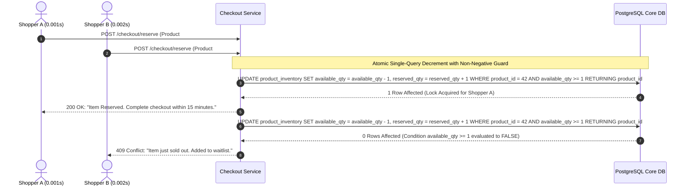

# Blueprint 02: Inventory Concurrency & Race Conditions

> **Target Problem:** There is only 1 unit of a high-demand product left. Three customers click "Buy Now" at the exact same millisecond. Without database-enforced pessimistic locking or atomic decrement guards, the system bills all 3 users, creating negative stock, backorders, and customer refund disputes.

---

## 1. Assumptions (Asumsi)
* **High Concurrency Surges:** Traffic during product launches or flash sales creates bursts of 500+ requests per second hitting the same inventory row.
* **ACID Relational Storage:** PostgreSQL is the definitive source of truth for stock quantities (not memory variables or eventual consistency NoSQL).
* **Inventory Hold Window:** Shoppers expect stock to be reserved for a limited time (e.g., 15 minutes) while completing payment details.

---

## 2. Prerequisites (Prasyarat)
* **PostgreSQL 14+:** Capable of executing single atomic SQL updates with `RETURNING` clauses and `CHECK` constraints.
* **Background Scheduler / Worker:** A cron runner or job queue (pg_cron, Redis BullMQ, or Celery) capable of running minutely sweeps.

---

## 3. Failure Scenario & Blast Radius (Skenario Kegagalan)
* **The Failure Story:** During a limited-edition merchandise drop of 50 items, 1,000 users initiate checkout simultaneously. The engineering team implemented standard application-level stock checks: `if (stock > 0) { await updateStock(); createOrder(); }`. Between the read and update steps, 40 parallel web requests see `stock = 1`.
* **Financial Impact:** 40 customers billed for products that do not exist. Direct payment processing refund fees incurred ($0.30 + 2.9% per refund) plus reputational damage.
* **Blast Radius:** Inventory tables corrupted with negative numbers (`available = -39`), customer service ticket queues overwhelmed.

---

## 4. Architectural Blueprint & DDL (Spesifikasi Arsitektur)



```sql
-- Production DDL: Zero-Race Condition Schema
CREATE TABLE product_inventory (
    product_id UUID PRIMARY KEY REFERENCES products(id) ON DELETE CASCADE,
    tenant_id UUID NOT NULL REFERENCES tenants(id),
    available_qty INT NOT NULL DEFAULT 0,
    reserved_qty INT NOT NULL DEFAULT 0,
    sold_qty INT NOT NULL DEFAULT 0,
    updated_at TIMESTAMPTZ NOT NULL DEFAULT NOW(),
    
    -- HARD DATABASE GUARDS: Quantities can NEVER dip below zero under any condition
    CONSTRAINT chk_positive_available CHECK (available_qty >= 0),
    CONSTRAINT chk_positive_reserved CHECK (reserved_qty >= 0),
    CONSTRAINT chk_positive_sold CHECK (sold_qty >= 0)
);

CREATE TABLE inventory_holds (
    id UUID PRIMARY KEY DEFAULT gen_random_uuid(),
    tenant_id UUID NOT NULL REFERENCES tenants(id),
    product_id UUID NOT NULL REFERENCES product_inventory(product_id),
    session_id VARCHAR(100) NOT NULL,
    qty INT NOT NULL DEFAULT 1,
    status VARCHAR(20) NOT NULL DEFAULT 'ACTIVE', -- 'ACTIVE', 'CONVERTED', 'EXPIRED'
    expires_at TIMESTAMPTZ NOT NULL DEFAULT (NOW() + INTERVAL '15 minutes'),
    created_at TIMESTAMPTZ NOT NULL DEFAULT NOW()
);

CREATE INDEX idx_inventory_holds_active ON inventory_holds(status, expires_at) WHERE status = 'ACTIVE';
```

---

## 5. Recovery Strategy & Self-Healing (Strategi Pemulihan)
* **Automated TTL Expire Worker:** A lightweight background worker runs every 60 seconds:
  ```sql
  BEGIN;
  -- Release reserved quantities back to available stock
  UPDATE product_inventory pi
  SET available_qty = pi.available_qty + ih.qty,
      reserved_qty = pi.reserved_qty - ih.qty,
      updated_at = NOW()
  FROM inventory_holds ih
  WHERE ih.product_id = pi.product_id 
    AND ih.status = 'ACTIVE' 
    AND ih.expires_at < NOW();

  -- Mark holds as expired
  UPDATE inventory_holds 
  SET status = 'EXPIRED' 
  WHERE status = 'ACTIVE' AND expires_at < NOW();
  COMMIT;
  ```
* **Ghost Stock Over-Correction:** If physical count discrepancies occur, adjustments are logged via `inventory_adjustments` table with required supervisor reasoning.

---

## 6. Security Boundary & Access Scope (Batas Keamanan)
* **No Direct Write from Client:** Inventory quantities can only be modified through stored procedures or server-side atomic reservation queries. Direct client API updates (`PUT /api/inventory/:id`) are strictly blocked.
* **Tenant Isolation:** All inventory checks are filtered by `tenant_id` ensuring a tenant's flash sale never locks another tenant's catalog.

---

## 7. Test Scenarios (Skenario Pengujian)

```gherkin
Feature: Inventory Concurrency & Stock Locking

  Scenario: Standard Stock Reservation
    Given product "SKU-99" has "available_qty = 10" and "reserved_qty = 0"
    When customer "User-1" reserves 2 units
    Then "available_qty" becomes 8 and "reserved_qty" becomes 2
    And an active hold is created with a 15-minute expiration

  Scenario: Concurrent Flash Sale Race Condition
    Given product "SKU-99" has "available_qty = 1"
    When 50 shoppers simultaneously submit a reservation request for 1 unit within 10ms
    Then exactly 1 request returns HTTP 200 OK with reserved hold
    And exactly 49 requests return HTTP 409 Conflict (Out of Stock)
    And "available_qty" equals 0
    And "available_qty" never reaches a negative value under any condition

  Scenario: Abandoned Cart Stock Release
    Given product "SKU-99" has an active hold of 1 unit that expired 1 minute ago
    When the expiration sweep worker executes
    Then the hold status updates to "EXPIRED"
    And "available_qty" is restored by 1 unit
```

---

## 8. Batasan Penerapan & Trade-offs (Kapan JANGAN Digunakan)
* **Contraindications:** Do not implement for digital goods with infinite license inventory (e.g. downloadable PDFs, streaming video subscriptions).
* **Performance Overhead:** Row-level locks in PostgreSQL introduce minor serialization delays during extreme flash sales (thousands of hits on the exact same row). For ultra-massive scale (>50k requests/second on a single SKU), introduce an in-memory Redis inventory counter as a pre-filtering admission gate.
