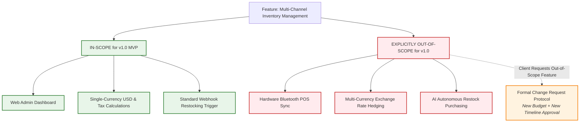

# Blueprint 05: The Anti-Scope Creep Pact & Definition of Done

> **Target Problem:** A client asks for "a simple dashboard like Shopify". Halfway through development, the client says: "Where is the multi-currency crypto checkout and AI auto-restocking? I assumed that was included!" The developer feels exploited, the client feels cheated, and the project descends into legal threats.

---

## 1. The Nightmare Scenario
A software agency quotes a founder $25,000 to build an inventory and ordering platform. 
Three months in, the founder remarks casually: *"Oh, we also need this to sync automatically with our 3 physical POS machines via Bluetooth, and we need offline batch sync."*
The agency says that will cost an extra $15,000. 
The founder refuses to pay: *"You promised me a complete inventory system! If it doesn't work with my offline stores, it's useless! I'm withholding the final $10,000 payment until you build it."*
The project stalls for 8 months. Both sides lose money.

---

## 2. Architectural Blueprint: The Scope Boundary Specification

Every feature in the backlog MUST have an explicit **IN-SCOPE** vs **OUT-OF-SCOPE** boundary documented in the project contract before engineering starts.



---

## 3. The 4-Tier "Definition of Done" (DoD) Checklist

A feature is NOT complete simply because the developer says "it runs on my localhost machine". A feature is only complete when all 4 tiers pass:

| Tier | Gate | Requirement | Verification Method |
|---|---|---|---|
| **Tier 1** | **Functional** | The Given-When-Then acceptance criteria pass. | Automated E2E test or QA test sign-off |
| **Tier 2** | **Edge-Case** | Handles bad inputs, null states, and error timeouts gracefully. | Negative test cases executed |
| **Tier 3** | **Security** | Multi-tenant RLS checks pass; actor permissions verified. | Automated security regression suite |
| **Tier 4** | **Operational** | Migration script runs in staging without table lock timeouts; rollback script exists. | DevOps Staging deployment log |

---

## 4. The Formal Change Request (CR) Protocol Template

When a client or business stakeholder requests a change during active development, this standard document is generated:

```markdown
### 📋 Change Request Form (CR-042)
* **Date:** 2026-11-05
* **Requested By:** [Founder / Stakeholder Name]
* **Feature Title:** Add Offline Bluetooth Hardware Sync to POS
* **Original Scope Status:** EXPLICITLY OUT-OF-SCOPE in Master Service Agreement (Section 3.2).

#### Impact Analysis:
1. **Engineering Effort Required:** 85 developer hours
2. **Timeline Impact:** Delays Release v1.0 by 3 weeks (New Target Launch: Dec 15 -> Jan 05)
3. **Financial Adjustment:** +$6,800 USD (Billed at agreed contract hourly rate)
4. **Architectural Trade-offs:** Requires local SQLite cache layer on client tablets and sync conflict resolution engine.

#### Decision:
* [ ] **Option A: Approve & Fund.** Add $6,800 to invoice, extend launch deadline to Jan 05.
* [ ] **Option B: Defer to Version 2.0.** Launch v1.0 on schedule; build this as the first post-launch enhancement.
* [ ] **Option C: Scope Swap.** Remove Feature X (Automated PDF reporting) to maintain original budget and launch date.

*Signed by Client:* ___________________________  *Date:* ____________
*Signed by Lead Analyst:* _____________________  *Date:* ____________
```
