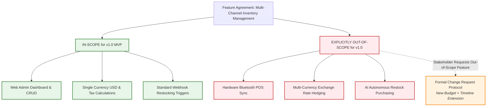

# Blueprint 05: The Anti-Scope Creep Pact & Definition of Done

> **Target Problem:** A client asks for "a simple dashboard like Shopify". Halfway through development, the client says: "Where is the multi-currency crypto checkout and AI auto-restocking? I assumed that was included!" The developer feels exploited, the client feels cheated, and the project descends into legal threats and unpaid milestones.

---

## 1. Assumptions (Asumsi)
* **The "Obvious" Fallacy:** Business stakeholders assume complex edge cases (offline sync, multi-currency, fraud gates) are "standard features included by default".
* **Fixed-Price / Fixed-Scope Vulnerability:** Software agreements without an explicit "Out-of-Scope" negative list will experience an average of 45% unbudgeted scope expansion.
* **The Definition of Done Gap:** Developers consider a task done when code runs on their local machine; business stakeholders consider it done only when edge cases, training, and zero-downtime migrations succeed.

---

## 2. Prerequisites (Prasyarat)
* **Pre-Kickoff Execution:** This blueprint must be signed by both the Lead Business Analyst/Founder and the Lead Engineer **prior to the release of deposit funds or sprint kickoff**.
* **Traceability Matrix Tool:** A project management tool (Jira, Linear, GitHub Projects) mapped directly to this agreement's ticket identifiers.

---

## 3. Failure Scenario & Blast Radius (Skenario Kegagalan)
* **The Failure Story:** An agency quotes $25,000 to build an inventory and ordering platform. Three months into the build, the client states: *"We also need this to sync in real-time with our 3 physical POS machines via Bluetooth, and we need offline batch sync."* The agency requests $15,000 in additional fees. The founder refuses to pay and withholds the final $10,000 milestone payment. The project stalls for 8 months.
* **Financial Impact:** $10,000 unpaid agency revenue, $25,000 wasted client capital, and legal fees.
* **Blast Radius:** Project cancellation, developer team demoralization, and delayed market entry.

---

## 4. Architectural Blueprint & Specification (Spesifikasi Batasan Scope)



---

## 5. Recovery Strategy: The Formal Change Request (CR) Protocol
When an unbudgeted feature is requested during development, engineering does NOT debate or argue. They execute the standard CR Protocol:

```markdown
### 📋 Change Request Form (CR-Template)
* **Date:** [YYYY-MM-DD]
* **Requested By:** [Stakeholder Name]
* **Feature Title:** [Feature Name]
* **Contract Status:** EXPLICITLY OUT-OF-SCOPE in Master Specification (Section 3).

#### Impact Analysis:
1. **Engineering Effort:** [X] Developer Hours
2. **Timeline Impact:** Extends Target Release Date by [Y] Weeks
3. **Financial Adjustment:** +$[Z] USD (Billed at agreed contract hourly rate)
4. **Architectural Trade-offs:** [Performance or infrastructure impacts]

#### Stakeholder Decision (Select One):
* [ ] **Option A: Approve & Fund.** Add $[Z] to invoice, extend release date by [Y] weeks.
* [ ] **Option B: Defer to Version 2.0.** Launch v1.0 on schedule; prioritize for post-launch sprint.
* [ ] **Option C: Scope Swap.** Remove Feature [Name] of equal effort to maintain original budget.
```

---

## 6. Security Boundary: The 4-Tier "Definition of Done" (DoD) Gate
No pull request or milestone payment is released until all 4 verification gates pass:

| Tier | Gate | Engineering Verification | Sign-off Authority |
|---|---|---|---|
| **Tier 1** | **Functional** | BDD Given-When-Then acceptance criteria pass. | QA Engineer |
| **Tier 2** | **Edge-Case** | Handles bad inputs, null states, and network timeouts. | Lead Developer |
| **Tier 3** | **Security** | RLS tenant isolation verified; least privilege enforced. | Security Architect |
| **Tier 4** | **Operational** | Migration script runs in staging without table locks. | DevOps / DBA |

---

## 7. Test Scenarios (Skenario Pengujian)

```gherkin
Feature: Scope Creep Governance & Change Control

  Scenario: Feature Request is Within In-Scope Boundaries
    Given a task "User Password Reset via Email" is listed under "IN-SCOPE"
    When the developer submits the feature meeting the 4-Tier DoD
    Then the task is approved for milestone payout without additional negotiation

  Scenario: Stakeholder Requests Out-of-Scope Capability
    Given a client asks for "Automated WhatsApp Invoice Notifications"
    And "WhatsApp API" is explicitly documented under "OUT-OF-SCOPE for v1.0"
    When the request is submitted during active sprint development
    Then the system triggers the Formal Change Request Form
    And development on the core sprint continues uninterrupted
    And the new feature is NOT started until Change Request funding is signed
```

---

## 8. Batasan Penerapan & Trade-offs (Kapan JANGAN Digunakan)
* **Contraindications:** Do not implement for exploratory R&D labs, 48-hour hackathons, or internal proof-of-concept prototypes where rapid experimentation takes priority over contractual boundaries.
* **Overhead:** Adds 1-2 hours of administrative overhead per significant change request.
