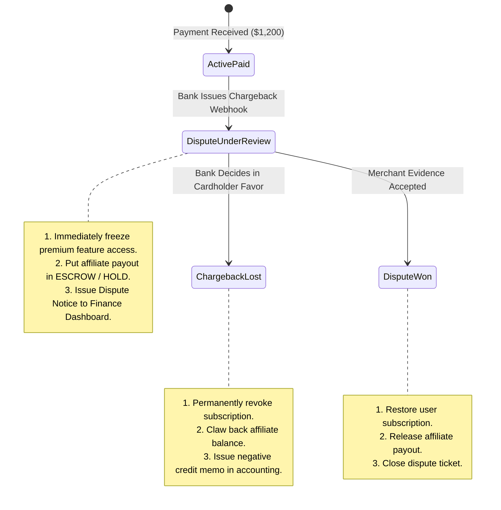

# Blueprint 06: Chargebacks, Refunds & Dispute Cascades

> **Target Problem:** A customer buys an annual SaaS plan for $1,200. You pay a 30% affiliate commission ($360) to a partner. 45 days later, the customer files a credit card chargeback claiming fraud. Your bank deducts the $1,200 + a $25 dispute fee. Your system doesn't revoke their account, leaving them with free access, while you're in the hole for $385!

---

## 1. The Nightmare Scenario
A digital products platform pays out affiliate commissions every 14 days. 
A fraudulent affiliate drives 100 fake buyers using stolen credit cards ($10,000 total sales). 
The platform pays the affiliate $3,000 in clean commission on Day 15. 
On Day 35, the true cardholders initiate chargebacks. 
The payment processor reclaims $10,000 from the platform's bank account, plus $2,500 in chargeback penalty fines. 
The platform is left with a **-$5,500 net loss** because the refund logic had no escrow delay or dispute state cascade.

---

## 2. Architectural Blueprint: The Dispute State Machine



---

## 3. Database Specification: The Dispute & Escrow Ledger

```sql
CREATE TABLE subscription_disputes (
    id UUID PRIMARY KEY DEFAULT gen_random_uuid(),
    tenant_id UUID NOT NULL REFERENCES tenants(id),
    subscription_id UUID NOT NULL REFERENCES subscriptions(id),
    gateway_dispute_id VARCHAR(100) NOT NULL UNIQUE,
    dispute_amount_cents BIGINT NOT NULL,
    fee_cents BIGINT NOT NULL DEFAULT 1500, -- e.g. $15 dispute fee
    reason VARCHAR(100) NOT NULL, -- 'fraudulent', 'unrecognized', 'product_not_received'
    status VARCHAR(50) NOT NULL DEFAULT 'NEEDS_RESPONSE', -- 'NEEDS_RESPONSE', 'UNDER_REVIEW', 'WON', 'LOST'
    evidence_due_by TIMESTAMPTZ NOT NULL,
    created_at TIMESTAMPTZ NOT NULL DEFAULT NOW()
);

-- Affiliate Commission Escrow Rule:
-- Commission is marked 'PENDING_CLEARANCE' with a mandatory 45-day rolling reserve
CREATE TABLE affiliate_commissions (
    id UUID PRIMARY KEY DEFAULT gen_random_uuid(),
    affiliate_id UUID NOT NULL,
    order_id UUID NOT NULL,
    amount_cents BIGINT NOT NULL,
    status VARCHAR(30) NOT NULL DEFAULT 'IN_ESCROW', -- 'IN_ESCROW', 'APPROVED_PAYABLE', 'CLAWED_BACK'
    payable_after TIMESTAMPTZ NOT NULL DEFAULT (NOW() + INTERVAL '45 days')
);
```

---

## 4. Business Rules: Dispute Cascade Protocol

1. **Immediate Access Suspension:**
   Upon receipt of `chargeback.created` webhook, user session is terminated across all devices, and tenant tier is temporarily downgraded to `RESTRICTED_DISPUTE`.
2. **Automated Evidence Compilation:**
   The system automatically bundles login IP logs, signed Terms of Service timestamp, and product usage records into a single PDF package ready for merchant bank submission within 24 hours.
