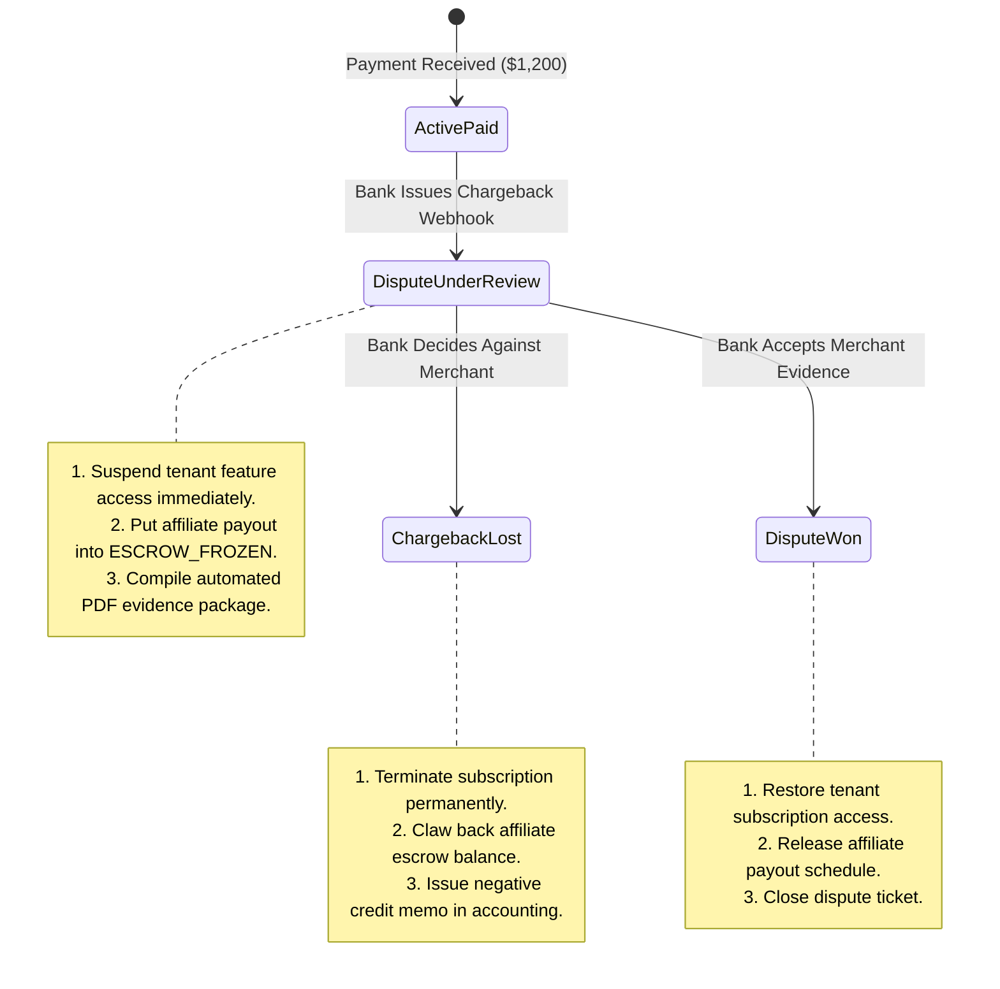

# Blueprint 06: Chargebacks, Refunds & Dispute Cascades

> **Target Problem:** A customer buys an annual SaaS plan for $1,200. You pay a 30% affiliate commission ($360) to a marketing partner on Day 14. On Day 45, the customer files a credit card dispute claiming fraud. Your bank deducts the $1,200 plus a $25 dispute fine. Your system doesn't revoke access, leaving them with free service while you suffer a net loss of $385!

---

## 1. Assumptions (Asumsi)
* **The 90-Day Dispute Window:** Financial credit card networks allow cardholders to initiate chargebacks for up to 90–120 days post-purchase.
* **Affiliate Fraud Vectors:** Fraudulent marketing affiliates routinely purchase plans using stolen cards, collect clean commissions, and abandon their accounts before the chargeback hits.
* **Multi-Step Cascade Requirement:** A refund or dispute is not a single database update; it is an operational cascade affecting accounting ledgers, affiliate balances, subscription access, and tax records.

---

## 2. Prerequisites (Prasyarat)
* **Webhook Subscription:** Integration with gateway events: `charge.dispute.created`, `charge.dispute.closed`, `charge.refunded`.
* **Escrow Ledger:** Business capability to hold third-party payouts (affiliates, marketplace vendors) in rolling escrow reserves.

---

## 3. Failure Scenario & Blast Radius (Skenario Kegagalan)
* **The Failure Story:** An e-learning platform pays affiliate commissions on a 14-day cycle. A rogue affiliate drives 50 fraudulent buyers using compromised cards ($5,000 total revenue). The platform pays out $1,500 in commissions on Day 15. On Day 35, the true cardholders initiate chargebacks. The payment processor clawbacks $5,000 from the merchant bank account, plus $1,250 in dispute penalty fees.
* **Financial Impact:** Net cash loss of -$2,750 USD, plus payment processor risk monitoring placement (potential merchant account termination).
* **Blast Radius:** Bank cash balances, affiliate trust, corrupted tax reporting, and orphan active subscriptions.

---

## 4. Architectural Blueprint & DDL (Spesifikasi Arsitektur)



```sql
-- Production DDL: Dispute Tracking & Rolling Escrow Reserves
CREATE TABLE subscription_disputes (
    id UUID PRIMARY KEY DEFAULT gen_random_uuid(),
    tenant_id UUID NOT NULL REFERENCES tenants(id),
    subscription_id UUID NOT NULL REFERENCES subscriptions(id),
    gateway_dispute_id VARCHAR(100) NOT NULL UNIQUE,
    dispute_amount_cents BIGINT NOT NULL,
    fee_cents BIGINT NOT NULL DEFAULT 1500, -- e.g. $15 dispute fee
    reason VARCHAR(100) NOT NULL, -- 'fraudulent', 'unrecognized', 'product_not_received'
    status VARCHAR(50) NOT NULL DEFAULT 'NEEDS_RESPONSE', -- 'NEEDS_RESPONSE', 'UNDER_REVIEW', 'WON', 'LOST'
    evidence_due_by TIMESTAMPTZ NOT NULL,
    created_at TIMESTAMPTZ NOT NULL DEFAULT NOW()
);

-- Affiliate Commission Escrow Rule: Mandatory 45-day clearance window
CREATE TABLE affiliate_commissions (
    id UUID PRIMARY KEY DEFAULT gen_random_uuid(),
    tenant_id UUID NOT NULL REFERENCES tenants(id),
    affiliate_id UUID NOT NULL REFERENCES users(id),
    order_id UUID NOT NULL REFERENCES orders(id),
    amount_cents BIGINT NOT NULL,
    status VARCHAR(30) NOT NULL DEFAULT 'IN_ESCROW', -- 'IN_ESCROW', 'APPROVED_PAYABLE', 'CLAWED_BACK'
    payable_after TIMESTAMPTZ NOT NULL DEFAULT (NOW() + INTERVAL '45 days'),
    created_at TIMESTAMPTZ NOT NULL DEFAULT NOW()
);
```

---

## 5. Recovery Strategy & Self-Healing (Strategi Pemulihan)
* **Automated Evidence Compilation:** Within 1 hour of a dispute webhook arriving, a worker bundles:
  1. Login IP address timestamps and geolocation.
  2. Cryptographic hash of signed Terms of Service at checkout.
  3. Feature utilization logs (e.g. "User logged in 14 times and exported 3 reports").
  4. Dispatches the bundle directly to the gateway dispute API via automated webhook response.
* **Negative Balance Clawback:** If an affiliate's balance is insufficient to cover a chargeback, the affiliate's account is flagged with a negative ledger balance, automatically deducting from future earnings.

---

## 6. Security Boundary & Access Scope (Batas Keamanan)
* **Instant Session Revocation:** Upon `dispute.created`, the authentication service terminates all active JWT tokens across all sessions for the disputed account in < 1 second.
* **Accounting Immutability:** Historical paid invoices are NEVER deleted. A formal **Credit Note / Negative Invoice** is generated to balance accounting books.

---

## 7. Test Scenarios (Skenario Pengujian)

```gherkin
Feature: Dispute & Chargeback Cascade

  Scenario: Dispute Webhook Received
    Given user "usr_99" has an active annual subscription
    And affiliate "aff_12" has a pending commission of $360 in escrow
    When the gateway sends "charge.dispute.created" for user "usr_99"
    Then user "usr_99" subscription status is changed to "SUSPENDED_DISPUTE"
    And the affiliate commission status is updated to "FROZEN_DISPUTE"
    And an evidence collection job is automatically queued

  Scenario: Merchant Wins Dispute
    Given a dispute is in "UNDER_REVIEW" status
    When the gateway sends "charge.dispute.closed" with status "won"
    Then the subscription is restored to "ACTIVE"
    And the affiliate commission returns to "IN_ESCROW" schedule
```

---

## 8. Batasan Penerapan & Trade-offs (Kapan JANGAN Digunakan)
* **Contraindications:** Do not implement 45-day escrow holding for physical in-person retail point-of-sale transactions where card-present chip & PIN transactions carry zero chargeback liability.
* **Customer Friction:** Immediate account suspension during a dispute may anger legitimate customers whose banks accidentally flagged a transaction. Implement a 48-hour grace period notification for low-risk established accounts.
