# Blueprint 07: Tax & Multi-Currency Decimal Rounding Integrity

> **Target Problem:** A developer stores monetary amounts using floating-point types (`FLOAT` / `DOUBLE`) and calculates taxes row-by-row. After 100,000 transactions, the ledger balance differs from the actual merchant bank balance by $1,842.17 due to decimal rounding drift. The company fails its annual tax audit and receives a penalty for incorrect tax remittance.

---

## 1. Assumptions (Asumsi)
* **Binary Floating-Point Inaccuracy:** IEEE 754 floating-point math cannot represent base-10 fractions (e.g. `0.1 + 0.2 === 0.30000000000000004`), making `FLOAT` types fundamentally disqualified for financial systems.
* **Statutory Tax Audit Requirements:** Tax revenue agencies require transaction rounding to adhere to strict jurisdictional standards (typically Half-Even Banker's Rounding).
* **Multi-Currency Volatility:** Exchange rates fluctuate minute-by-minute; historical reporting requires permanently snapshotted conversion rates at the second of transaction settlement.

---

## 2. Prerequisites (Prasyarat)
* **Integer Storage Standards:** Application architecture mandating integer storage in lowest atomic units (cents, satuan).
* **High-Precision Math Library:** Backend libraries supporting arbitrary-precision decimal operations (e.g., `decimal.js`, `Big.js`, or native Java/Python `BigDecimal`).

---

## 3. Failure Scenario & Blast Radius (Skenario Kegagalan)
* **The Failure Story:** An international SaaS platform bills $19.99/month with an 8.25% state sales tax and a 15% promotional discount. Developers compute line-item taxes in application memory using standard floats and round on each line item. Over 12 months and 250,000 invoices, the sum of line-item rounded taxes diverges from the corporate general ledger by $3,410.22.
* **Financial Impact:** Statutory audit fines ($15,000), accounting recertification audit fees ($20,000), and mandatory restatement of financial earnings.
* **Blast Radius:** General ledger, corporate balance sheets, and tax filing accuracy.

---

## 4. Architectural Blueprint & DDL (Spesifikasi Arsitektur)

```mermaid
graph TD
    classDef bad fill:#ffebee,stroke:#c62828,stroke-width:2px;
    classDef good fill:#e8f5e9,stroke:#2e7d32,stroke-width:2px;

    subgraph The Forbidden Anti-Pattern
        F1[Price: $19.99 Float]:::bad --> F2[Calculate Tax Row-by-Row: $1.449275 Float]:::bad
        F2 --> F3[Cumulative Drift over 100k transactions: ±$1,842.00]:::bad
    end

    subgraph The Enterprise Standard
        I1[Price: 1999 Cents Integer]:::good --> I2[Subtotal Cents: 1999]:::good
        I2 --> I3[Tax Engine: Half-Even Banker's Rounding]:::good
        I3 --> I4[Tax Cents: 165 Cents exact]:::good
        I4 --> I5[Total Cents: 2164 Cents exact]:::good
    end
```



```sql
-- Production DDL: Strict Atomic Currency Ledger
CREATE TABLE financial_transactions (
    id UUID PRIMARY KEY DEFAULT gen_random_uuid(),
    tenant_id UUID NOT NULL REFERENCES tenants(id),
    currency_code VARCHAR(3) NOT NULL, -- 'USD', 'EUR', 'IDR', 'JPY'
    
    -- ALWAYS store amounts in the lowest currency unit (cents, satuan)
    subtotal_atomic_units BIGINT NOT NULL, -- e.g. 1999 cents ($19.99)
    tax_atomic_units BIGINT NOT NULL,      -- e.g. 165 cents ($1.65)
    discount_atomic_units BIGINT NOT NULL DEFAULT 0,
    total_atomic_units BIGINT NOT NULL,    -- 2164 cents ($21.64)
    
    -- Snapshotted multi-currency conversion rates (if converted to base currency)
    base_currency_code VARCHAR(3) NOT NULL DEFAULT 'USD',
    exchange_rate_numerator BIGINT NOT NULL DEFAULT 1000000, -- Rate scaled by 10^6
    exchange_rate_denominator BIGINT NOT NULL DEFAULT 1000000,
    base_total_atomic_units BIGINT NOT NULL,
    
    -- HARD DATABASE CONSTRAINT: Total MUST equal subtotal + tax - discount
    CONSTRAINT chk_ledger_math_integrity CHECK (
        total_atomic_units = (subtotal_atomic_units + tax_atomic_units - discount_atomic_units)
    )
);
```

---

## 5. Recovery Strategy & Self-Healing (Strategi Pemulihan)
* **Automated Cent-Drift Reconciler:** A monthly ledger reconciliation worker compares total bank deposits against `SUM(total_atomic_units)` grouped by currency. Any discrepancy > $0.05 triggers an immediate investigation ticket before tax submissions are generated.
* **Rounding Anomaly Isolation:** When calculating splits among multiple tax jurisdictions (e.g. State + County + City), the largest remainder method (*Hare-Niemeyer method*) is applied to allocate the residual 1-cent difference deterministically.

---

## 6. Security Boundary & Access Scope (Batas Keamanan)
* **Rate Immutability:** Historical exchange rates and tax rates are permanently saved with the invoice record. Re-querying live exchange rates for past invoices is strictly prevented by application logic.
* **No Client-Side Price Calculation:** The client frontend submits item IDs and quantities only. All subtotal, tax, and discount computations occur exclusively on the secure backend server.

---

## 7. Test Scenarios (Skenario Pengujian)

```gherkin
Feature: Financial Integer Math & Decimal Rounding

  Scenario: Standard Order Financial Computation
    Given an order with item price 1999 cents ($19.99)
    And an 8.25% sales tax rate
    When the tax is calculated using Banker's Rounding
    Then the tax amount is exactly 165 cents ($1.65)
    And total amount is exactly 2164 cents ($21.64)
    And the database constraint "chk_ledger_math_integrity" passes

  Scenario: Database Constraint Rejects Bad Math
    Given an attempted insert with subtotal = 1000, tax = 100, discount = 0, but total = 1101
    When the query executes
    Then PostgreSQL raises a check constraint violation "chk_ledger_math_integrity"
    And the invalid row is rejected
```

---

## 8. Batasan Penerapan & Trade-offs (Kapan JANGAN Digunakan)
* **Zero-Decimal Currencies:** Certain currencies (JPY, KRW, IDR) do not have fractional cents. The system must maintain a currency precision dictionary (`USD: 2 decimals`, `JPY: 0 decimals`, `KWD: 3 decimals`) to prevent invalid cent conversions.
* **Micro-Transactions:** If billing for fractional API units (e.g. $0.00001 per token), maintain a sub-cent accumulator table and convert to atomic cents only when invoicing.
