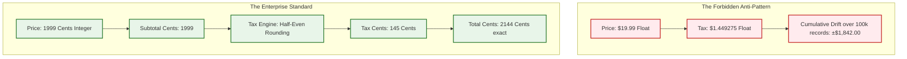

# Blueprint 07: Tax & Multi-Currency Decimal Rounding Integrity

> **Target Problem:** A developer stores money as `FLOAT` or `DECIMAL(10,2)` and calculates taxes row-by-row with floating-point math. After 100,000 transactions, the ledger balance differs from the actual merchant bank account by $1,842.17. The company fails its annual tax audit and receives a penalty for incorrect tax remittance.

---

## 1. The Nightmare Scenario
In JavaScript, `0.1 + 0.2 === 0.30000000000000004`. 
A platform sells items for $19.99 with a 7.25% state sales tax and a 15% promotional discount. 
The developer calculates line-item tax using JavaScript floating point:
`tax = (price * 0.85) * 0.0725` -> `$1.2318625`. 
They round row-by-row on the screen. 
When the corporate accounting system sums the unrounded totals versus the rounded receipts, **the numbers do not match**. 
The state tax revenue auditor flags this as fraudulent underreporting of sales tax.

---

## 2. Architectural Blueprint: The Integer-Cent Rule & Rounding Engine

All financial computations follow 3 non-negotiable rules:
1. **Never store currency as float:** Store all values as **integers representing the smallest atomic currency unit** (e.g. cents for USD/EUR, rupiah for IDR, yen for JPY).
2. **Standardized Rounding Mode:** Standardize on **Banker's Rounding (Half-Even)** to avoid cumulative statistical drift.
3. **Calculate Tax at Subtotal Level, Not Line-Item:** Round once at the order summary level, not on every individual unit.



---

## 3. Database Specification: Multi-Currency Ledger

```sql
CREATE TABLE transaction_entries (
    id UUID PRIMARY KEY DEFAULT gen_random_uuid(),
    tenant_id UUID NOT NULL REFERENCES tenants(id),
    currency VARCHAR(3) NOT NULL, -- 'USD', 'EUR', 'IDR', 'JPY'
    
    -- ALWAYS store amounts in the lowest currency unit (cents, satuan)
    subtotal_atomic_units BIGINT NOT NULL, -- e.g. 1999 cents ($19.99)
    tax_atomic_units BIGINT NOT NULL,      -- e.g. 145 cents ($1.45)
    discount_atomic_units BIGINT NOT NULL DEFAULT 0,
    total_atomic_units BIGINT NOT NULL,    -- 2144 cents ($21.44)
    
    -- Hard integrity constraint: total MUST equal subtotal + tax - discount
    CONSTRAINT chk_ledger_math_integrity CHECK (
        total_atomic_units = (subtotal_atomic_units + tax_atomic_units - discount_atomic_units)
    )
);
```

---

## 4. Multi-Currency Conversion Rate Snapshot Rule

When an international customer pays in EUR for a USD-denominated subscription:
* The exchange rate MUST be snapshotted at the exact second the transaction commits.
* Store both `original_currency_amount` and `settlement_currency_amount` with the `locked_exchange_rate`. Never re-query live rates for historical reporting!
