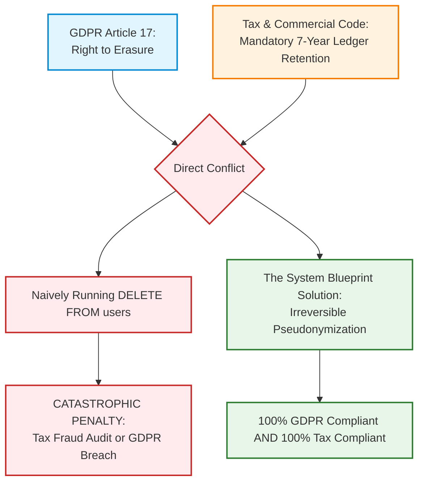

# Blueprint 08: GDPR Anonymization vs Financial Audit Compliance

> **Target Problem:** A European customer emails demanding: "Delete all my personal data immediately under GDPR Article 17 (Right to be Forgotten)!" A developer runs `DELETE FROM users WHERE id = ...;` which cascades and deletes all past invoices and order history. Three months later, the tax authority audits the business, fines them $25,000 for missing financial records, and the bank freezes their merchant account!

---

## 1. The Dilemma: Two Laws in Direct Conflict



---

## 2. Architectural Blueprint: Irreversible Cryptographic Anonymization

When an account deletion request is approved:
1. **Never delete the financial ledger row:** Keep invoice numbers, tax amounts, line items, timestamps, and currency amounts intact.
2. **Purge PII (Personally Identifiable Information):** Overwrite names, emails, phone numbers, IP logs, and delivery addresses with cryptographic hashes or static placeholders (`ANONYMIZED_USER_XXXX`).
3. **Hard-Delete Non-Financial Data:** Wipe marketing cookies, search history, saved cart items, and uploaded avatars.

```sql
-- PostgreSQL Anonymization Procedure
CREATE OR REPLACE PROCEDURE gdpr_anonymize_user(target_user_id UUID)
LANGUAGE plpgsql AS $$
BEGIN
    -- 1. Wipe PII from Auth / Profile table
    UPDATE users
    SET 
        email = 'anonymized_' || target_user_id || '@redacted.invalid',
        full_name = 'GDPR Anonymized User',
        phone_number = NULL,
        avatar_url = NULL,
        is_active = FALSE,
        anonymized_at = NOW()
    WHERE id = target_user_id;

    -- 2. Anonymize Invoices (Preserving financial numbers for tax audit)
    UPDATE invoices
    SET 
        billing_address = '{"country": "' || (billing_address->>'country') || '", "status": "ANONYMIZED"}',
        customer_tax_id = 'REDACTED_GDPR'
    WHERE user_id = target_user_id;

    -- 3. Hard-delete non-essential tracking tables
    DELETE FROM user_activity_logs WHERE user_id = target_user_id;
    DELETE FROM user_saved_cards WHERE user_id = target_user_id;
    DELETE FROM cart_sessions WHERE user_id = target_user_id;
END;
$$;
```

---

## 3. Compliance Acceptance Criteria

```gherkin
Scenario: Customer requests GDPR account deletion
  Given a customer with ID "usr_102" has 5 historical paid orders
  When the admin approves the GDPR Erasure Request for "usr_102"
  Then the customer's email, phone, and name are replaced with non-identifiable hashes
  And all saved credit card tokens and marketing logs are completely deleted
  And the 5 historical order records still exist with intact financial totals and tax values
  And a permanent compliance audit certificate is logged: "GDPR_ERASURE_EXECUTED"
```
