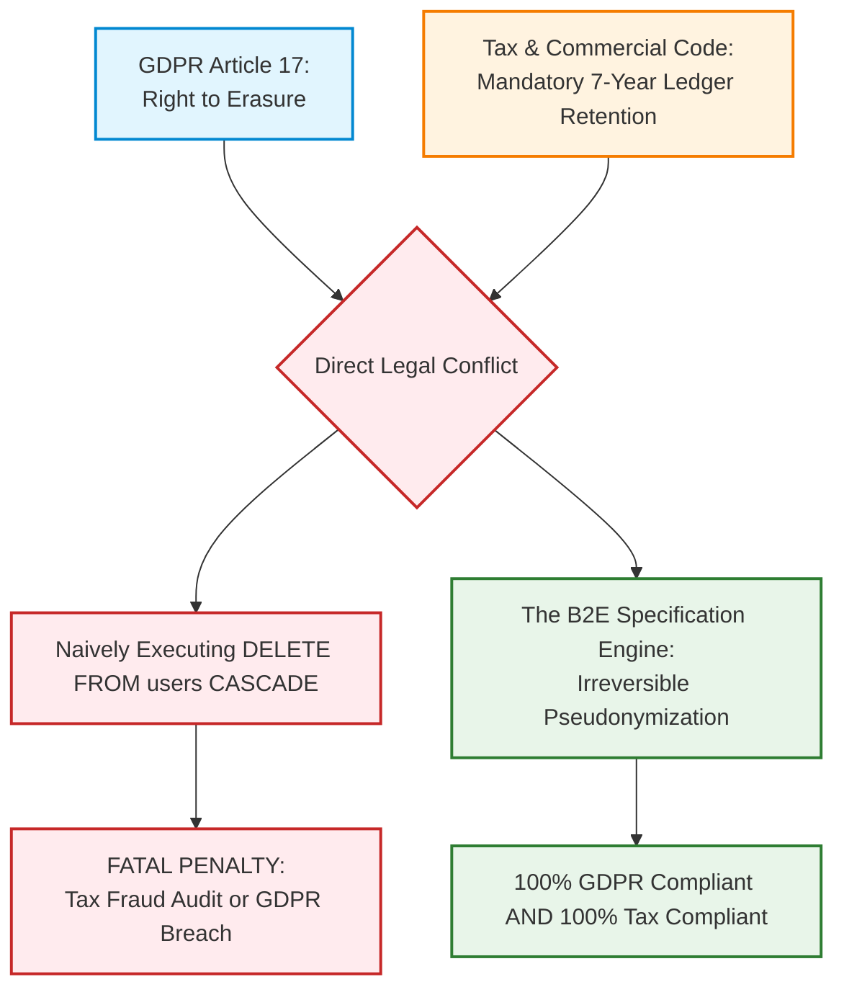

# Blueprint 08: GDPR Anonymization vs Statutory Audit Compliance

> **Target Problem:** A European customer emails demanding: "Delete all my personal data immediately under GDPR Article 17 (Right to Erasure)!" A developer runs `DELETE FROM users WHERE id = ...;`, which cascades and deletes past invoices and transaction logs. Three months later, the tax authority audits the company, fines them $25,000 for missing financial records, and the merchant bank freezes payments.

---

## 1. Assumptions (Asumsi)
* **The Legal Deadlock:** GDPR Article 17 (Right to Erasure) and Statutory Commercial/Tax Codes (e.g. German HGB, US IRS Code § 6001, UK Companies Act) are in direct conflict. Tax laws mandate storing financial records for 5–10 years.
* **The Legal Exemption:** GDPR Article 17(3)(b) explicitly provides an exemption to data erasure when processing is necessary for compliance with a legal obligation (such as statutory tax accounting).
* **The Pseudonymization Standard:** True compliance means purging Personally Identifiable Information (PII) while preserving non-identifiable financial ledgers intact.

---

## 2. Prerequisites (Prasyarat)
* **Data Classification Schema:** All database columns must be classified as either **PII** (name, phone, IP address, delivery notes) or **Statutory Financial Data** (invoice numbers, tax amounts, line items).
* **Automated Anonymization Stored Procedure:** Pre-approved SQL migration scripts reviewed by legal counsel.

---

## 3. Failure Scenario & Blast Radius (Skenario Kegagalan)
* **The Failure Story:** A SaaS company receives a GDPR deletion request from a churned subscriber. The support engineer executes a standard account deletion script that performs `DELETE FROM users CASCADE`. The cascade deletes 24 historical billing invoices, payment references, and tax records. During a subsequent state tax audit, the auditor finds an unexplained $8,400 gap in historical books.
* **Financial Impact:** $25,000 statutory tax fine for failure to produce audit records, plus forensic accounting reconstruction costs.
* **Blast Radius:** Accounting ledger corruption, broken historical revenue reports, and inability to defend against bank dispute inquiries.

---

## 4. Architectural Blueprint & DDL (Spesifikasi Arsitektur)



```sql
-- Production DDL & Anonymization Stored Procedure
CREATE OR REPLACE PROCEDURE execute_gdpr_erasure(target_user_id UUID, admin_actor_id UUID)
LANGUAGE plpgsql AS $$
DECLARE
    v_anonymized_email VARCHAR(255);
BEGIN
    v_anonymized_email := 'anonymized_' || target_user_id || '@privacy-redacted.invalid';

    -- 1. Wipe PII from User Profiles & Auth Tables
    UPDATE users
    SET 
        email = v_anonymized_email,
        full_name = 'Redacted GDPR User',
        phone_number = NULL,
        avatar_url = NULL,
        is_active = FALSE,
        gdpr_anonymized_at = NOW()
    WHERE id = target_user_id;

    -- 2. Scramble PII in Invoices while preserving financial numbers & tax amounts
    UPDATE customer_invoices
    SET 
        billing_address = jsonb_build_object(
            'country', billing_address->>'country', -- Retain country code for VAT audit
            'state', billing_address->>'state',
            'city', 'REDACTED',
            'street', 'REDACTED',
            'status', 'ANONYMIZED_GDPR_ARTICLE_17'
        ),
        customer_tax_identifier = 'GDPR_REDACTED'
    WHERE user_id = target_user_id;

    -- 3. Hard-delete purely behavioral / non-financial data
    DELETE FROM user_activity_logs WHERE user_id = target_user_id;
    DELETE FROM user_marketing_preferences WHERE user_id = target_user_id;
    DELETE FROM cart_sessions WHERE user_id = target_user_id;

    -- 4. Log permanent compliance certificate in the immutable audit ledger
    INSERT INTO system_audit_ledger (
        tenant_id, actor_id, actor_role, action_type, entity_name, entity_id, reason, previous_record_hash, record_hash
    ) VALUES (
        (SELECT tenant_id FROM users WHERE id = target_user_id),
        admin_actor_id,
        'DATA_PROTECTION_OFFICER',
        'GDPR_ERASURE_EXECUTED',
        'users',
        target_user_id::TEXT,
        'Compliant Article 17 Pseudonymization under Article 17(3)(b) tax retention exemption',
        '0000000000000000000000000000000000000000000000000000000000000000',
        encode(digest(concat(target_user_id, NOW()), 'sha256'), 'hex')
    );
END;
$$;
```

---

## 5. Recovery Strategy & Self-Healing (Strategi Pemulihan)
* **Irreversibility Guarantee:** By design, pseudonymization is one-way. It cannot and must not be reversed. If a user returns later, they must create a brand-new account.
* **Compliance Certificate Export:** The stored procedure generates an automated PDF compliance certificate (`GDPR_Erasure_Certificate_usr_123.pdf`) signed with a SHA-256 timestamp for the user's records.

---

## 6. Security Boundary & Access Scope (Batas Keamanan)
* **Data Protection Officer (DPO) Privilege Only:** The procedure can only be invoked by users with the explicit `DATA_PROTECTION_OFFICER` role. General support agents cannot execute account anonymizations.
* **Backup Strategy:** Database backup tapes retain historical cold backups for 30 days before natural rotation overwrites them, satisfying GDPR Recital 65.

---

## 7. Test Scenarios (Skenario Pengujian)

```gherkin
Feature: GDPR Anonymization vs Tax Compliance

  Scenario: European User Invokes Right to Erasure
    Given user "usr_55" has 3 historical paid invoices
    When the DPO executes "CALL execute_gdpr_erasure('usr_55', 'admin_1')"
    Then the user's email becomes "anonymized_usr_55@privacy-redacted.invalid"
    And the user's phone number and delivery street address are NULL
    And the 3 historical invoices still exist with accurate dollar amounts and VAT totals
    And marketing preferences and cart sessions are completely deleted
    And an immutable audit entry "GDPR_ERASURE_EXECUTED" is permanently recorded
```

---

## 8. Batasan Penerapan & Trade-offs (Kapan JANGAN Digunakan)
* **Contraindications:** Do not apply full pseudonymization if the user has an open active dispute, pending chargeback, or unresolved debt. Place the account in `PENDING_ERASURE_HOLD` until financial disputes resolve.
* **Analytics Impact:** Historical cohort reports will show purchases attributed to "Redacted GDPR User". Retention analytics must group historical data by anonymized ID.
