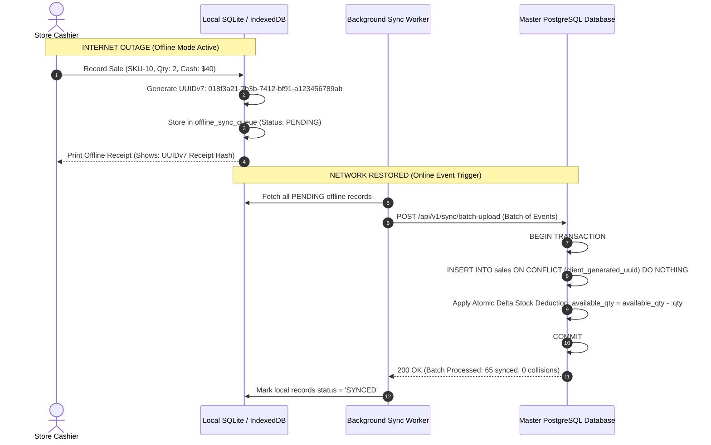

# Blueprint 09: Offline-First Sync & Conflict Resolution

> **Target Problem:** A retail store loses internet connectivity during peak Saturday shopping hours. The cashier needs to keep scanning barcodes and collecting cash. When the Wi-Fi reconnects 2 hours later, 65 offline sales flood the server. If the sync logic is naive, invoice IDs clash, inventory becomes negative, and transaction records are lost.

---

## 1. Assumptions (Asumsi)
* **Intermittent Connectivity is Normal:** Physical retail branches, food trucks, and warehouse field operations will experience frequent ISP outages lasting from 5 minutes to 4 hours.
* **Non-Stop Commercial Obligation:** Customers in physical checkout lines cannot be turned away due to an internet drop; the register must continue printing valid receipts.
* **Asynchronous Eventual Consistency:** Local terminals are the source of truth for the physical cash collected; the central cloud database is the eventual reconciler.

---

## 2. Prerequisites (Prasyarat)
* **Local Terminal Storage:** IndexedDB (for web POS) or local SQLite (for native desktop/tablet POS).
* **Decentralized Primary Keys:** Client-side generation of time-ordered UUIDv7 identifiers to prevent server auto-increment ID collisions.

---

## 3. Failure Scenario & Blast Radius (Skenario Kegagalan)
* **The Failure Story:** An ISP fiber optic cable is severed outside a retail branch. The cloud-only POS freezes with a red modal: `"Connection Lost"`. 12 customers abandon their carts. The store manager switches to an offline cached tablet, but the app generates sequential order numbers (`INV-101`, `INV-102`). Because another branch also issued `INV-101` during the outage, syncing back to the cloud crashes with primary key collisions, resulting in 30 dropped orders and cash book desynchronization.
* **Financial Impact:** $3,500 in lost walkout sales, plus accounting labor required to manually re-type physical paper receipts.
* **Blast Radius:** Customer churn, inventory count corruption, and cashier audit discrepancies.

---

## 4. Architectural Blueprint & DDL (Spesifikasi Arsitektur)



```sql
-- Production DDL: Central Cloud Sync & Delta Ingestion
CREATE TABLE offline_synced_sales (
    id UUID PRIMARY KEY DEFAULT gen_random_uuid(),
    tenant_id UUID NOT NULL REFERENCES tenants(id),
    branch_id UUID NOT NULL,
    client_generated_uuid UUID NOT NULL, -- UUIDv7 generated on offline tablet
    terminal_id VARCHAR(50) NOT NULL,
    cashier_id UUID NOT NULL,
    subtotal_cents BIGINT NOT NULL,
    total_cents BIGINT NOT NULL,
    offline_created_at TIMESTAMPTZ NOT NULL,
    synced_at TIMESTAMPTZ NOT NULL DEFAULT NOW(),
    sync_status VARCHAR(30) NOT NULL DEFAULT 'SYNCED', -- 'SYNCED', 'FLAGGED_STOCK_ANOMALY'
    
    -- HARD CONSTRAINT: Client UUID can NEVER be ingested twice
    CONSTRAINT uq_client_uuid UNIQUE (tenant_id, client_generated_uuid)
);

CREATE INDEX idx_offline_synced_sales_time ON offline_synced_sales(tenant_id, offline_created_at);
```

---

## 5. Recovery Strategy & Self-Healing (Strategi Pemulihan)
* **Atomic Delta Deduction (Never Absolute Overwrite):**
  When syncing inventory, the server executes: `available_qty = available_qty - :qty_sold`. It NEVER runs `available_qty = :client_stock_count` (which would wipe out sales made by other branches).
* **The Ghost Stock Policy:**
  If an offline sale causes inventory to dip below zero (e.g. stock was physically present on the shelf but unrecorded in the cloud), the cloud database allows the reduction but flags the row as `FLAGGED_STOCK_ANOMALY`. An alert is sent to the warehouse manager to perform a physical inventory recount.

---

## 6. Security Boundary & Access Scope (Batas Keamanan)
* **Terminal Cryptographic Keypair:** Each POS terminal has a local private key. Offline receipts and sync payloads are signed locally. The cloud verifies `Terminal-Signature` to prevent unauthorized third parties from submitting fake offline sales.
* **Time Drift Tolerance:** Cloud rejects offline sales with timestamps skewed > 7 days into the past or > 5 minutes into the future to prevent clock tampering fraud.

---

## 7. Test Scenarios (Skenario Pengujian)

```gherkin
Feature: Offline-First Synchronization & Conflict Resolution

  Scenario: Normal Offline Order Sync
    Given the terminal is operating in OFFLINE mode
    When the cashier rings up an order for $50 cash
    Then the terminal generates a UUIDv7 identifier and stores it locally
    And when internet connectivity is restored
    Then the batch upload succeeds with HTTP 200 OK
    And exactly 1 record is created in "offline_synced_sales"

  Scenario: Duplicate Sync Retry After Network Glitch
    Given an offline order "uuid-123" was successfully saved to cloud
    When the terminal sync worker retries uploading "uuid-123" due to a dropped response
    Then the cloud database encounters the "uq_client_uuid" constraint
    And ignores the duplicate without error
    And does NOT deduct inventory a second time
```

---

## 8. Batasan Penerapan & Trade-offs (Kapan JANGAN Digunakan)
* **Contraindications:** Do not implement offline-first architecture for real-time seat reservations (airlines, cinema tickets) or financial stock trading where zero-latency global state locking is strictly mandatory.
* **Storage Limit:** Web-based IndexedDB has local browser storage quotas (~50MB to 1GB). Implement automatic purging of synced transactions older than 30 days on client devices.
