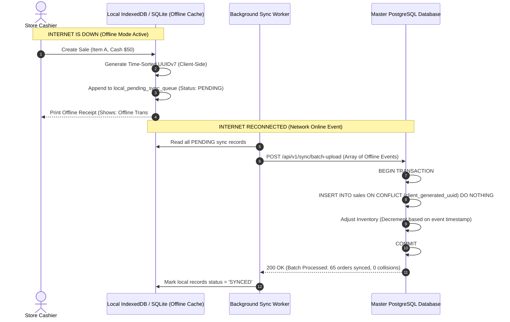

# Blueprint 09: Offline-First Sync & Conflict Resolution

> **Target Problem:** A retail store loses internet connectivity during peak Saturday shopping hours. The cashier needs to keep scanning barcodes and collecting cash. When the Wi-Fi reconnects 2 hours later, 65 offline sales flood the server. If the sync logic is naive, invoice IDs clash, inventory becomes negative, and transaction orders get jumbled.

---

## 1. The Nightmare Scenario
A retail boutique's fiber optic cable is accidentally cut by road construction outside. 
The cloud POS web app freezes with a red screen: `"No Internet Connection"`. 
A line of 12 customers leaves their items on the counter and walks out. 
The owner tries using a tablet with local cache, but when internet returns, the app tries to save orders using auto-incrementing integer IDs (`INV-101`, `INV-102`). 
Because another branch store also issued `INV-101` while the first store was offline, the server crashes with a primary key collision and 30 offline receipts are completely lost.

---

## 2. Architectural Blueprint: Decentralized UUIDv7 & Append-Only Sync Log

---

## 3. Conflict Resolution Rules (Deterministic LWW & Delta Ingestion)

1. **Client-Side UUIDv7 Generation:**
   Never rely on database server auto-incrementing integers (`id = 1, 2, 3`) for offline systems. Use **UUIDv7** (which embeds a millisecond timestamp), allowing thousands of distributed offline devices to generate globally unique, chronological primary keys without consulting the central database.
2. **Inventory Sync Strategy (Delta Adjustment, Never Absolute Overwrite):**
   * *Forbidden:* `SET stock = 4` (If another store sold items in the meantime, this corrupts the truth).
   * *Required:* `SET stock = stock - :qty_sold` (Atomic delta deduction).
3. **Ghost Stock Policy:**
   If offline sales exceed physical stock (e.g. physical stock was counted wrong), the server allows the deduction into a special status `FLAGGED_OVER_DISPATCHED`, alerting management immediately without rejecting the customer receipt that was already printed.
