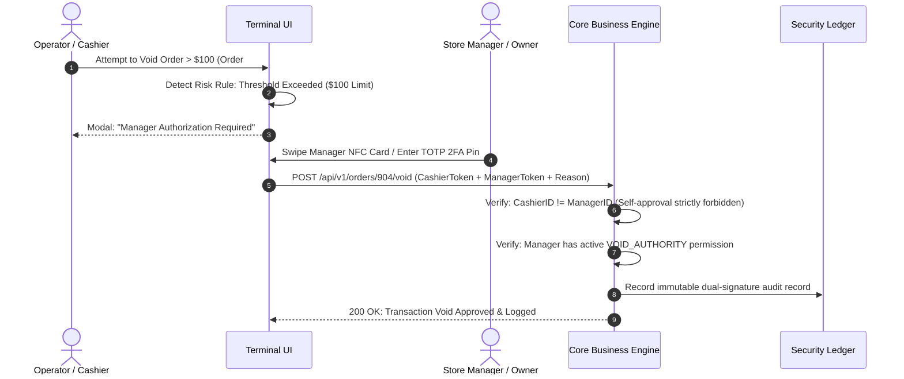

# Blueprint 10: Four-Eyes Approval & Rogue Staff Defense

> **Target Problem:** A store supervisor gets fired. Before HR disables their credentials, they log in remotely, issue a 100% discount on $8,000 worth of luxury stock, void 12 cash sales, and export the entire client contact database to Excel.

---

## 1. The Nightmare Scenario
A salon and spa chain allows branch managers to apply discounts and void transactions. 
A manager planning to launch a competing salon spends 3 days quietly exporting the phone numbers of 2,400 VIP clients. 
On their final Saturday, they void $3,200 in cash receipts, take the cash from the register, and blame it on "system glitches". 
Because the system allowed unilateral discounts and had no export rate-limiting or dual-approval controls, the business owner loses both the cash and their client base.

---

## 2. Architectural Blueprint: The Four-Eyes Gate & Tripwire

The **Four-Eyes Principle (Two-Person Rule)** requires that any high-risk business action (large discounts, debt write-offs, transaction voids, mass exports) MUST be cryptographically approved by two distinct authorized human actors.



---

## 3. Database Specification: Dual-Signature Approvals

```sql
CREATE TABLE high_risk_action_requests (
    id UUID PRIMARY KEY DEFAULT gen_random_uuid(),
    tenant_id UUID NOT NULL REFERENCES tenants(id),
    action_type VARCHAR(50) NOT NULL, -- 'BULK_DATA_EXPORT', 'MANUAL_VOID', 'DISCOUNT_OVER_THRESHOLD'
    entity_id VARCHAR(100) NOT NULL,
    threshold_value NUMERIC(12, 2),
    
    requester_id UUID NOT NULL REFERENCES users(id),
    requested_at TIMESTAMPTZ NOT NULL DEFAULT NOW(),
    
    approver_id UUID REFERENCES users(id),
    approved_at TIMESTAMPTZ,
    status VARCHAR(30) NOT NULL DEFAULT 'PENDING_APPROVAL', -- 'PENDING_APPROVAL', 'APPROVED', 'REJECTED', 'EXPIRED'
    
    -- HARD SECURITY CONSTRAINT: Requester CANNOT approve their own action
    CONSTRAINT chk_no_self_approval CHECK (requester_id <> approver_id)
);
```

---

## 4. Rogue Staff Defense Protocol (The Instant Kill Switch)

1. **Instant Session Invalidation:**
   HR clicks "Terminate Employee" in the Admin Panel. The system immediately revokes all active JWT tokens in Redis and terminates active WebSocket connections in < 500 milliseconds.
2. **Bulk Export Tripwire:**
   Exporting more than 50 customer records triggers an automatic SMS notification to the business owner's personal cell phone: *"Alert: User X just exported 200 customer contacts."*
