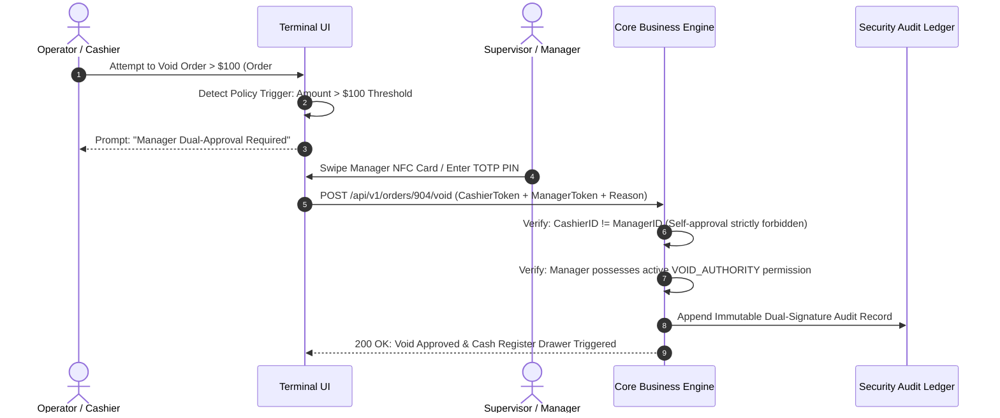

# Blueprint 10: Four-Eyes Approval & Rogue Staff Defense

> **Target Problem:** A branch manager gets fired. Before HR disables their credentials, they log in remotely, apply a 100% discount to $8,000 worth of stock, void 12 cash sales, pocket the money, and export the entire client database to Excel.

---

## 1. Assumptions (Asumsi)
* **Privileged User Vulnerability:** High-ranking staff (supervisors, branch managers) possess elevated credentials that can cause catastrophic financial or data damage if used maliciously.
* **Separation of Duties (SoD):** High-risk business actions (large discounts, transaction voids, mass exports, debt cancellations) must require dual authorization to eliminate single-actor fraud.
* **Rapid Deprovisioning Requirement:** When an employee is terminated, revocation of all active sessions and tokens must occur within sub-second latency across all devices.

---

## 2. Prerequisites (Prasyarat)
* **Role-Based Access Control (RBAC):** Distinct roles (`CASHIER`, `SUPERVISOR`, `GENERAL_MANAGER`, `OWNER`).
* **Multi-Factor Authentication (MFA) / NFC Badges:** Terminal-level approval mechanism (manager PIN, TOTP, or NFC supervisor card swipe).

---

## 3. Failure Scenario & Blast Radius (Skenario Kegagalan)
* **The Failure Story:** An angry supervisor facing termination accesses the store terminal at 9:00 PM after closing. They manually void 15 cash sales totaling $4,200 from the day's receipts, pocket the cash from the safe, and download a CSV containing 3,000 customer phone numbers. Because the software allowed unilateral voids by managers and lacked export rate-limiting, the owner discovers the theft only during monthly tax reconciliation.
* **Financial Impact:** $4,200 cash stolen, loss of intellectual property (customer list), and customer poaching by the ex-employee.
* **Blast Radius:** Cash drawer balances, customer confidentiality, and operational staff morale.

---

## 4. Architectural Blueprint & DDL (Spesifikasi Arsitektur)



```sql
-- Production DDL: Four-Eyes Dual Signature Authorization
CREATE TABLE high_risk_action_requests (
    id UUID PRIMARY KEY DEFAULT gen_random_uuid(),
    tenant_id UUID NOT NULL REFERENCES tenants(id),
    action_type VARCHAR(50) NOT NULL, -- 'BULK_DATA_EXPORT', 'TRANSACTION_VOID', 'DISCOUNT_OVER_THRESHOLD'
    entity_name VARCHAR(50) NOT NULL,
    entity_id VARCHAR(100) NOT NULL,
    threshold_value NUMERIC(12, 2),
    
    requester_id UUID NOT NULL REFERENCES users(id),
    requested_at TIMESTAMPTZ NOT NULL DEFAULT NOW(),
    
    approver_id UUID REFERENCES users(id),
    approved_at TIMESTAMPTZ,
    status VARCHAR(30) NOT NULL DEFAULT 'PENDING_APPROVAL', -- 'PENDING_APPROVAL', 'APPROVED', 'REJECTED', 'EXPIRED'
    justification TEXT NOT NULL,
    
    -- HARD DATABASE CONSTRAINT: Requester CANNOT approve their own action
    CONSTRAINT chk_no_self_approval CHECK (requester_id <> approver_id)
);

CREATE INDEX idx_pending_approvals ON high_risk_action_requests(tenant_id, status) WHERE status = 'PENDING_APPROVAL';
```

---

## 5. Recovery Strategy & Self-Healing (Strategi Pemulihan)
* **Instant Session Revocation (The Kill Switch):**
  When HR or the Business Owner toggles `is_active = FALSE` in the Admin Dashboard:
  1. The API immediately blacklists the user's ID in Redis (`SET blacklist:user:123 true EX 86400`).
  2. All active WebSocket connections are terminated instantly.
  3. All subsequent API calls reject immediately with `401 Unauthorized` without waiting for JWT token expiration.
* **Bulk Export Tripwire Notification:**
  If an authorized user exports > 50 customer contacts, the server dispatches an urgent SMS alert directly to the business owner: *"Security Notice: User X just exported 200 customer contacts at 21:05."*

---

## 6. Security Boundary & Access Scope (Batas Keamanan)
* **Dual Cryptographic Validation:** Both `requester_id` and `approver_id` must have valid, unexpired sessions with independent authorization roles.
* **Self-Approval Guard:** Even users with the `OWNER` role cannot bypass the constraint if the company policy mandates dual-authorization for transaction voids over $1,000.

---

## 7. Test Scenarios (Skenario Pengujian)

```gherkin
Feature: Four-Eyes Dual Signature Authorization

  Scenario: Cashier Voids High-Value Transaction with Manager Approval
    Given an order "ORD-904" with total $250
    And cashier "usr_cashier" requests a void
    When supervisor "usr_manager" enters their 2FA credentials
    Then the void is approved and logged with both user IDs
    And status is marked "APPROVED"

  Scenario: Manager Attempts Self-Approval (Anti-Fraud)
    Given supervisor "usr_manager" attempts to void order "ORD-904"
    When supervisor "usr_manager" attempts to approve their own request
    Then the database aborts with constraint violation "chk_no_self_approval"
    And the transaction void is rejected with HTTP 403 Forbidden
```

---

## 8. Batasan Penerapan & Trade-offs (Kapan JANGAN Digunakan)
* **Contraindications:** Do not implement for solo-operator businesses where only 1 person runs the entire business (a single-person company cannot satisfy the two-person rule). Provide an automated "Owner Override" setting for micro-businesses.
* **Checkout Velocity Trade-off:** Dual approvals add 30–60 seconds of delay at the checkout counter. Keep approval thresholds calibrated to significant risk levels (e.g. only voids > $50 or discounts > 15%).
