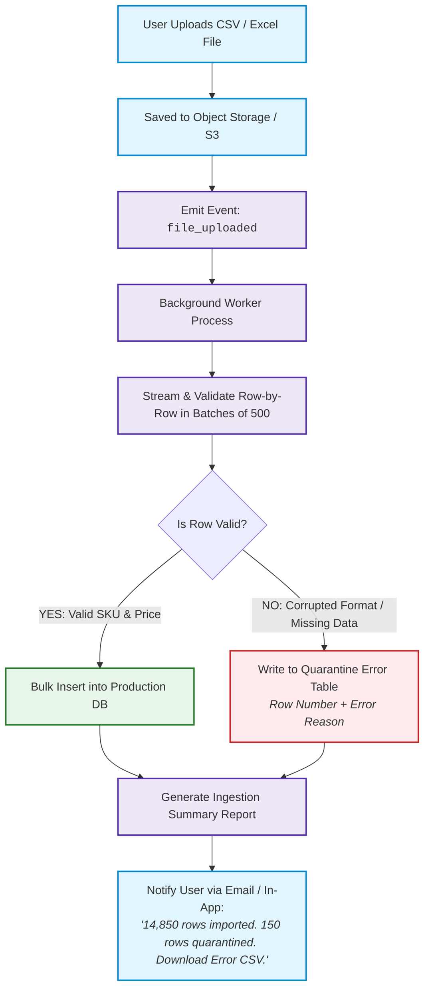

# Blueprint 11: Bulk Data Ingestion & Quarantine Pipeline

> **Target Problem:** A business owner migrates from legacy software and uploads an Excel spreadsheet of 15,000 customers. At row #4,821, there is a broken email format and invalid characters. The developer's naive script crashes midway, leaving 4,820 customers inserted and 10,180 missing, with no log of what succeeded or failed.

---

## 1. The Nightmare Scenario
A newly signed retail client tries to import their master product inventory via a CSV file containing 25,000 SKUs. 
The developer wrote a synchronous web endpoint: `POST /api/products/import-csv`. 
The file upload times out at 30 seconds due to Nginx gateway limits. 
The client tries uploading again. Now the database contains duplicate SKUs, broken pricing, and half-migrated records. 
The client demands a refund and cancels their SaaS contract before their first month ends.

---

## 2. Architectural Blueprint: Asynchronous Ingestion & Quarantine Bucket

Never process bulk file uploads synchronously in a HTTP request thread. All bulk ingestions must follow the **Asynchronous Chunking & Error Quarantine** pattern:



---

## 3. Database Specification: The Ingestion Audit & Quarantine Schema

```sql
CREATE TABLE data_import_jobs (
    id UUID PRIMARY KEY DEFAULT gen_random_uuid(),
    tenant_id UUID NOT NULL REFERENCES tenants(id),
    file_name VARCHAR(255) NOT NULL,
    total_rows INT NOT NULL DEFAULT 0,
    successful_rows INT NOT NULL DEFAULT 0,
    quarantined_rows INT NOT NULL DEFAULT 0,
    status VARCHAR(30) NOT NULL DEFAULT 'PROCESSING', -- 'PROCESSING', 'COMPLETED', 'FAILED'
    created_at TIMESTAMPTZ NOT NULL DEFAULT NOW(),
    completed_at TIMESTAMPTZ
);

CREATE TABLE import_quarantine_records (
    id BIGSERIAL PRIMARY KEY,
    job_id UUID NOT NULL REFERENCES data_import_jobs(id) ON DELETE CASCADE,
    row_number INT NOT NULL,
    raw_row_data JSONB NOT NULL,
    rejection_reason VARCHAR(255) NOT NULL, -- e.g. 'INVALID_EMAIL_FORMAT', 'DUPLICATE_BARCODE'
    created_at TIMESTAMPTZ NOT NULL DEFAULT NOW()
);
```

---

## 4. User Experience Requirement

The user is NEVER shown a generic 500 error screen. Instead:
1. The system displays a progress bar: `"Processing: 45% (6,750 / 15,000 rows)..."`
2. At completion, if errors occurred, the user is provided a 1-click button: **"Download Quarantined Rows (.csv)"**. This CSV contains only the 150 failed rows with a new column explaining exactly why each row was rejected, allowing the business owner to fix and re-upload only the corrected rows.
