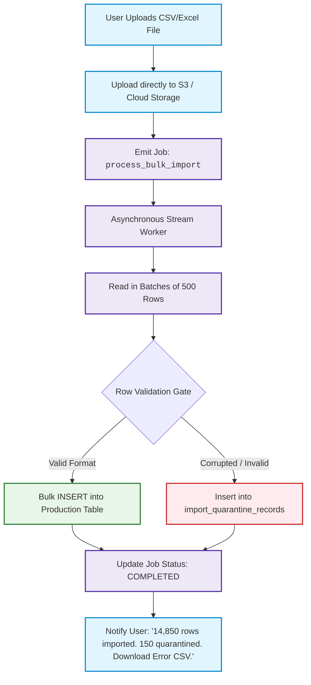

# Blueprint 11: Bulk Data Ingestion & Quarantine Pipeline

> **Target Problem:** A business owner migrates from legacy software and uploads an Excel spreadsheet of 15,000 customers. At row #4,821, there is a corrupted email and broken characters. The developer's naive script crashes midway, leaving 4,820 rows inserted, 10,180 missing, and no log of what succeeded or failed.

---

## 1. Assumptions (Asumsi)
* **Messy Legacy Data:** Real-world customer uploads (CSV/Excel) from non-technical business operators will always contain typos, misplaced columns, broken UTF-8 characters, and invalid formatting.
* **HTTP Timeout Vulnerability:** Parsing files with > 1,000 rows in a synchronous web request thread will trigger HTTP 504 Gateway Timeouts from cloud load balancers (AWS ALB, Cloudflare, Nginx).
* **High Partial-Success Value:** Business operators prefer 98% of valid rows to be ingested immediately, with the remaining 2% isolated into a downloadable error file.

---

## 2. Prerequisites (Prasyarat)
* **Object Storage:** S3, Google Cloud Storage, or Supabase Storage for temporary holding of uploaded raw files.
* **Background Worker Queue:** Asynchronous job processing (BullMQ, Celery, or AWS SQS).

---

## 3. Failure Scenario & Blast Radius (Skenario Kegagalan)
* **The Failure Story:** An onboarding client uploads a 20,000-SKU product catalog. The backend processes the file inside the synchronous API route `POST /api/products/upload`. At 30 seconds, Cloudflare returns a `524 Gateway Timeout`. The client clicks "Upload" again. Now the database contains duplicate SKUs, broken pricing, and half-migrated records. Cleaning up the corrupted database takes 4 days of developer consulting time.
* **Financial Impact:** $3,000 in emergency database engineering cleanup, client onboarding delay, and early churn risk.
* **Blast Radius:** Product catalogs, pricing accuracy, inventory counts, and web server RAM exhaustion.

---

## 4. Architectural Blueprint & DDL (Spesifikasi Arsitektur)



```sql
-- Production DDL: Ingestion Audit & Quarantine Schema
CREATE TABLE data_import_jobs (
    id UUID PRIMARY KEY DEFAULT gen_random_uuid(),
    tenant_id UUID NOT NULL REFERENCES tenants(id),
    file_name VARCHAR(255) NOT NULL,
    entity_type VARCHAR(50) NOT NULL, -- 'PRODUCTS', 'CUSTOMERS', 'INVENTORY'
    total_rows INT NOT NULL DEFAULT 0,
    successful_rows INT NOT NULL DEFAULT 0,
    quarantined_rows INT NOT NULL DEFAULT 0,
    status VARCHAR(30) NOT NULL DEFAULT 'PROCESSING', -- 'PROCESSING', 'COMPLETED', 'FAILED'
    created_at TIMESTAMPTZ NOT NULL DEFAULT NOW(),
    completed_at TIMESTAMPTZ
);

CREATE TABLE import_quarantine_records (
    id BIGSERIAL PRIMARY KEY,
    job_id UUID NOT NULL REFERENCES data_import_jobs(id) ON DELETE CASCADE,
    tenant_id UUID NOT NULL REFERENCES tenants(id),
    row_number INT NOT NULL,
    raw_row_data JSONB NOT NULL,
    rejection_reason VARCHAR(255) NOT NULL, -- e.g. 'INVALID_EMAIL_FORMAT', 'DUPLICATE_SKU'
    created_at TIMESTAMPTZ NOT NULL DEFAULT NOW()
);

CREATE INDEX idx_quarantine_job ON import_quarantine_records(job_id);
```

---

## 5. Recovery Strategy & Self-Healing (Strategi Pemulihan)
* **The "Download Fix-Only CSV" Feature:**
  The web app generates a CSV containing ONLY the failed rows with a new column prepended: `Error_Reason`. The user fixes only those 150 rows in Excel and re-uploads without touching the 14,850 rows that succeeded.
* **Worker Crash Recovery (Checkpointing):**
  The background worker records progress after every batch of 500 rows. If the worker pod restarts, it resumes from the last committed row index rather than starting over from row 1.

---

## 6. Security Boundary & Access Scope (Batas Keamanan)
* **MIME-Type & Extension Whitelist:** Server strictly validates file headers before storage (only `text/csv`, `application/vnd.openxmlformats-officedocument.spreadsheetml.sheet`). Executable extensions (`.exe`, `.sh`, `.php`) are rejected.
* **CSV Injection Defense:** Any cell starting with formula characters (`=`, `+`, `-`, `@`) is prepended with a single quote (`'`) to prevent formula execution attacks when exported back to Excel.

---

## 7. Test Scenarios (Skenario Pengujian)

```gherkin
Feature: Bulk Data Ingestion & Quarantine Pipeline

  Scenario: Bulk Import with Interspersed Corrupted Rows
    Given a CSV file containing 1,000 customer rows
    And row #45 has an invalid email "john.doe@"
    And row #102 has missing required phone number
    When the asynchronous ingestion worker processes the file
    Then exactly 998 rows are inserted into the production "customers" table
    And exactly 2 rows are inserted into "import_quarantine_records"
    And the job status updates to "COMPLETED"
    And the user is provided a downloadable CSV containing the 2 quarantined rows
```

---

## 8. Batasan Penerapan & Trade-offs (Kapan JANGAN Digunakan)
* **Contraindications:** Do not implement asynchronous background pipelines for small single-record forms (e.g. creating 1 customer manually). Synchronous API responses are appropriate for inputs under 10 records.
* **Storage Retention:** Quarantined rows consume database storage. Implement an automated 30-day retention cleanup policy (`DELETE FROM import_quarantine_records WHERE created_at < NOW() - INTERVAL '30 days'`).
