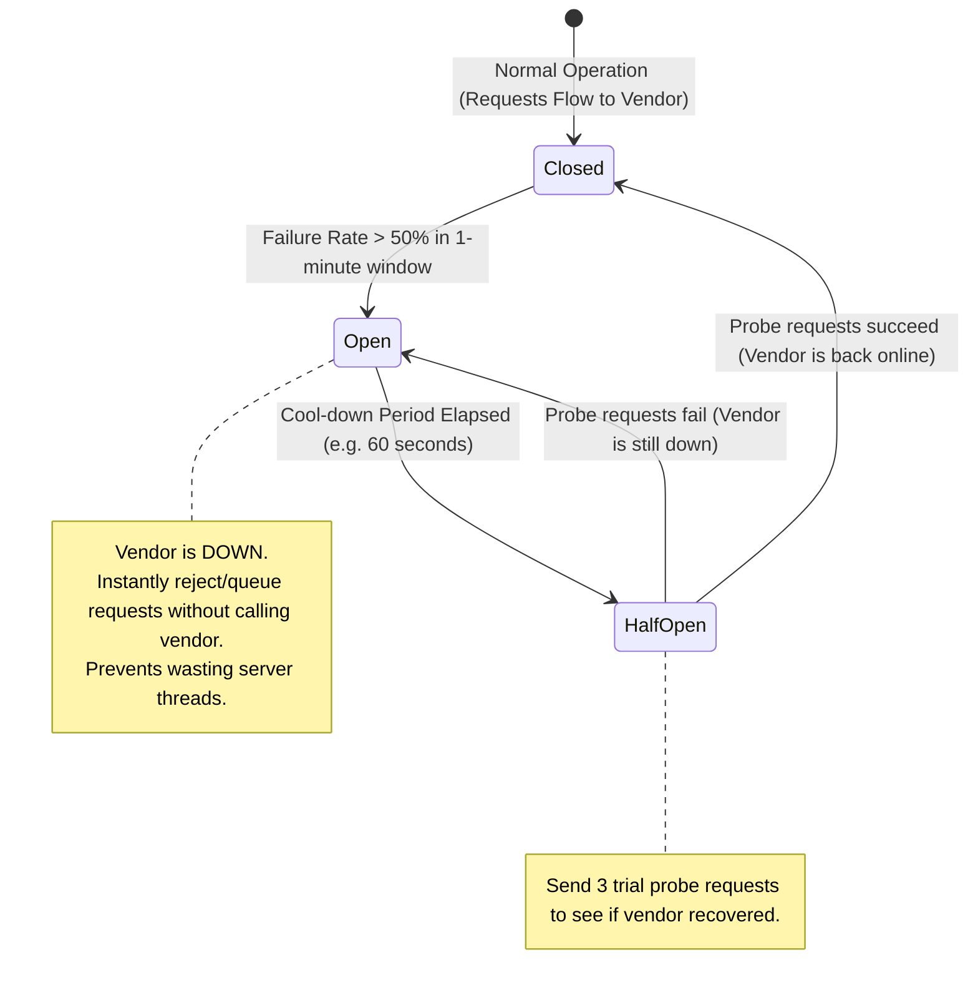

# Blueprint 12: Third-Party Outage Circuit Breaker

> **Target Problem:** Your application integrates with a third-party WhatsApp notification API or AI engine. The vendor experiences a service degradation and takes 45 seconds to respond. Your checkout page freezes waiting for the WhatsApp confirmation message to send, causing 80 paying customers to abandon their shopping carts.

---

## 1. The Nightmare Scenario
During a product launch, a startup's checkout endpoint synchronously calls the SendGrid email API to send a receipt before returning the HTTP 200 response to the customer's browser. 
SendGrid suffers an international outage and API requests hang for 60 seconds before timing out. 
Because all Node.js server connections are held open waiting for SendGrid:
1. The server exhausts its connection pool.
2. The entire website goes down with `504 Gateway Timeout`.
3. 2,000 potential buyers cannot even view product pages.

---

## 2. Architectural Blueprint: The Circuit Breaker & Asynchronous Decoupling

Third-party dependencies must **NEVER sit directly on the critical synchronous path** of user transactions. 

```mermaid
graph TD
    classDef client fill:#e1f5fe,stroke:#0288d1,stroke-width:2px;
    classDef core fill:#e8f5e9,stroke:#2e7d32,stroke-width:2px;
    classDef circuit fill:#fff3e0,stroke:#f57c00,stroke-width:2px;
    classDef vendor fill:#ffebee,stroke:#c62828,stroke-width:2px;

    User[Customer Places Order]:::client --> Core[Core Transaction Engine]:::core
    Core --> DB[(Save Order to PostgreSQL)]:::core
    DB --> ImmediateResponse[Return 200 OK Immediately to Customer<br/><i>'Order Confirmed!' in 120ms</i>]:::client

    Core -.->|Enqueue Event| Queue[(Redis / RabbitMQ Job Queue)]:::circuit
    Queue --> Worker[Background Notification Worker]:::circuit

    Worker --> Breaker{Circuit Breaker State}:::circuit

    Breaker -->|State: CLOSED (Normal)| ThirdParty[Call Vendor API: WhatsApp / Email / AI]:::vendor
    
    Breaker -->|Vendor Times Out 5 Times in 60s| OpenState[TRIP CIRCUIT: State = OPEN]:::circuit
    OpenState --> Fallback[Fallback Strategy:<br/>Queue for Exponential Backoff Retry or Switch to SMS Backup]:::core
```

---

## 3. Circuit Breaker State Transition Rules



---

## 4. Engineering Acceptance Criteria

1. **The 300ms Rule:**
   The user-facing checkout response must NEVER wait for email, SMS, analytics tracking, or AI generation. All auxiliary tasks must be dispatched to background workers.
2. **Exponential Backoff with Jitter:**
   If a background worker fails to contact a vendor, it retries at: `t = 2s, 4s, 8s, 16s, 32s` with random millisecond jitter to avoid thundering herd spikes when the vendor comes back online.
