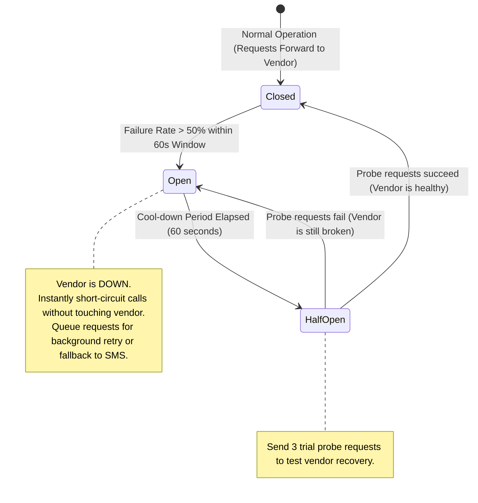
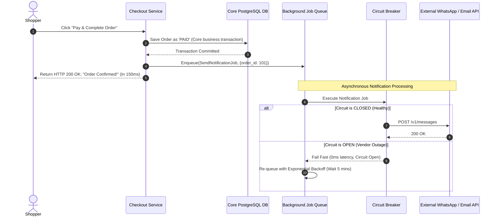

# Blueprint 12: Third-Party Outage Circuit Breaker

> **Target Problem:** Your application integrates with a third-party WhatsApp notification API or AI engine. The vendor experiences a service degradation and takes 45 seconds to respond. Your checkout page freezes waiting for the confirmation message to send, causing 80 paying customers to abandon their shopping carts.

---

## 1. Assumptions (Asumsi)
* **Third-Party SLA Unreliability:** External cloud APIs (WhatsApp Business, OpenAI, SendGrid, Twilio, Shipping Rate APIs) will suffer periodic outages, elevated latency, and network degradation outside your control.
* **Cascading Thread Starvation:** When a synchronous backend request waits 30+ seconds for an external vendor, web server worker threads exhaust their connection pool, taking down the entire website.
* **Graceful Degradation Requirement:** A customer should be able to complete their purchase even if email receipts or WhatsApp notifications are temporarily delayed.

---

## 2. Prerequisites (Prasyarat)
* **Circuit Breaker Library / In-Memory State:** Redis or application-level state machine (Opossum, Resilience4j, or Polly).
* **Decoupled Background Job Queue:** Redis BullMQ, RabbitMQ, or Amazon SQS.

---

## 3. Failure Scenario & Blast Radius (Skenario Kegagalan)
* **The Failure Story:** During a marketing campaign, the checkout API synchronously calls the SendGrid email service to dispatch a receipt before returning the HTTP 200 response to the customer's browser. SendGrid experiences an international API incident where requests hang for 60 seconds before failing. All Node.js event-loop threads become blocked waiting for SendGrid.
* **Financial Impact:** 2,000 visitors receive `504 Gateway Timeout`. $18,000 in lost revenue during a 40-minute outage.
* **Blast Radius:** Entire web platform down, checkout completely broken, lost ad spend efficiency.

---

## 4. Architectural Blueprint & State Machine (Spesifikasi Arsitektur)





---

## 5. Recovery Strategy & Self-Healing (Strategi Pemulihan)
* **Fail-Fast Short Circuiting:** When in the `OPEN` state, requests return immediately in 0ms without consuming outbound network sockets or waiting for vendor timeouts.
* **Exponential Backoff with Jitter:** Background workers retry failed notification jobs at: $t = 2s, 4s, 8s, 16s, 32s$ with randomized jitter to prevent "thundering herd" spikes when the vendor comes back online.
* **Multi-Provider Fallback:** If the primary WhatsApp provider trips the circuit breaker, the notification worker automatically re-routes messages to SMS fallback (Twilio).

---

## 6. Security Boundary & Access Scope (Batas Keamanan)
* **Strict 3-Second Timeout:** All external HTTP client requests MUST enforce a hard 3,000ms socket timeout. Requests hanging longer than 3 seconds are aborted forcefully.
* **API Key Rotation:** Third-party credentials stored in encrypted environment vaults (AWS Secrets Manager, Doppler), not hardcoded in application repositories.

---

## 7. Test Scenarios (Skenario Pengujian)

```gherkin
Feature: Third-Party Outage Circuit Breaker

  Scenario: Fast Checkout When Vendor API is Hanging
    Given the external email vendor API takes 30 seconds to respond
    When a customer completes a checkout order
    Then the checkout endpoint returns HTTP 200 OK in less than 200 milliseconds
    And the order is safely saved in the database
    And the email dispatch is handled asynchronously in the background

  Scenario: Circuit Breaker Trips After Consecutive Failures
    Given 5 consecutive email requests fail with network timeouts
    When the 6th notification job executes
    Then the Circuit Breaker enters the "OPEN" state
    And zero network requests are sent to the broken vendor
    And the job is deferred to the retry queue
```

---

## 8. Batasan Penerapan & Trade-offs (Kapan JANGAN Digunakan)
* **Contraindications:** Do not implement circuit breakers on synchronous core payment capture endpoints (Stripe/Payment Gateway). If the payment processor is down, the order cannot be marked paid; the user must be informed immediately.
* **Notification Lag Trade-off:** Customers may experience a 10–30 minute delay in receiving confirmation emails during external vendor outages.
