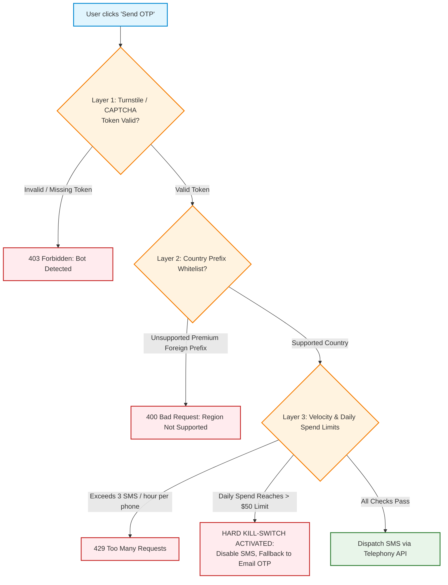

# Blueprint 13: OTP Cost-Explosion & Scraping Shield

> **Target Problem:** A malicious bot discovers your public phone verification endpoint (`/api/auth/send-otp`). Over a weekend, the bot triggers 45,000 SMS requests to premium international phone numbers (SMS Toll Fraud). On Monday morning, the founder wakes up to a $6,500 Twilio bill and a suspended payment gateway.

---

## 1. Assumptions (Asumsi)
* **SMS Toll Fraud Real-World Threat:** Organized bot syndicates systematically probe public signup endpoints to trigger SMS messages to high-rate foreign telco ranges they control (Artificially Inflated Traffic / AIT), splitting the revenue with rogue local carriers.
* **Proxy-Network Rotation:** Attackers use residential rotating proxies; single-IP rate-limiting (e.g. 5 requests/IP) is completely useless against distributed bot attacks.
* **Financial Blast Radius:** Telephony APIs (Twilio, MessageBird, Vonage) charge per message sent ($0.05–$0.25/SMS), turning unmetered verification endpoints into direct cash drains.

---

## 2. Prerequisites (Prasyarat)
* **Bot Verification Service:** Cloudflare Turnstile (recommended, free) or reCAPTCHA v3.
* **Phone Number Parsing & Geofencing Library:** Google `libphonenumber` to validate carrier region and E.164 formats before dispatch.

---

## 3. Failure Scenario & Blast Radius (Skenario Kegagalan)
* **The Failure Story:** An early-stage startup launches a customer portal with phone OTP authentication. A bot script fires 35,000 verification requests targeting Zimbabwean and Somali premium prefixes (+252, +263) at $0.18/SMS over a Saturday night. By Sunday afternoon, the startup's corporate credit card on file has been debited $6,300 in automatic top-ups.
* **Financial Impact:** $6,300 in cash drained, depletion of operational payroll runway, and frozen communications channels.
* **Blast Radius:** Corporate credit cards, marketing SMS budgets, and legitimate customer signups blocked due to account suspension.

---

## 4. Architectural Blueprint & Defense Shield (Spesifikasi Arsitektur)



```sql
-- Production DDL: SMS Spend Tracker & Velocity Defense
CREATE TABLE otp_dispatch_log (
    id UUID PRIMARY KEY DEFAULT gen_random_uuid(),
    tenant_id UUID NOT NULL REFERENCES tenants(id),
    phone_number_e164 VARCHAR(20) NOT NULL,
    country_code VARCHAR(5) NOT NULL,
    ip_address INET NOT NULL,
    estimated_cost_cents INT NOT NULL DEFAULT 6, -- e.g. 6 cents
    status VARCHAR(20) NOT NULL DEFAULT 'SENT',
    created_at TIMESTAMPTZ NOT NULL DEFAULT NOW()
);

CREATE INDEX idx_otp_phone_window ON otp_dispatch_log (phone_number_e164, created_at);
CREATE INDEX idx_otp_daily_spend ON otp_dispatch_log (created_at);
```

---

## 5. Recovery Strategy: The Automated Spend Kill Switch (Strategi Pemulihan)
* **The $50/Day Hard Circuit Breaker:**
  If the sum of `estimated_cost_cents` across the last 24 hours exceeds $50.00 USD:
  1. The system automatically toggles `SMS_EMERGENCY_KILLSWITCH = TRUE` in application memory.
  2. The frontend switches verification methods to **Email Verification Only**.
  3. An urgent SMS and Telegram alert is dispatched to the founder: *"EMERGENCY: Daily SMS spend threshold exceeded ($50). SMS dispatch temporarily halted to prevent toll fraud."*

---

## 6. Security Boundary & Access Scope (Batas Keamanan)
* **Geofencing Whitelist:** Strictly allow SMS dispatch ONLY to countries where the business actually operates (e.g. US/Canada +1, Indonesia +62). All other country codes are rejected before calling third-party APIs.
* **Exponential Cooldown per Phone Number:**
  * Attempt 1: Immediate dispatch
  * Attempt 2: 60-second cooldown
  * Attempt 3: 5-minute cooldown
  * Attempt 4: 24-hour lockout (User must contact customer support)

---

## 7. Test Scenarios (Skenario Pengujian)

```gherkin
Feature: Toll Fraud & SMS Protection Shield

  Scenario: Bot Submits Form Without Turnstile Token
    Given a request to "/api/auth/send-otp" arrives with missing "cf-turnstile-response"
    When the endpoint executes
    Then the request is rejected with HTTP 403 Forbidden
    And zero telephony API calls are dispatched

  Scenario: Attack Targeting Unsupported Foreign Prefix
    Given a request to send OTP to a phone number with prefix "+252" (Somalia)
    And the business only operates in Indonesia and the US
    When the endpoint executes
    Then the request is rejected with HTTP 400 Bad Request: "Country not supported"
    And zero telephony API credits are consumed
```

---

## 8. Batasan Penerapan & Trade-offs (Kapan JANGAN Digunakan)
* **Contraindications:** Do not enforce aggressive CAPTCHAs inside authenticated mobile applications where the device has already completed biometrics (FaceID/Fingerprint).
* **International Expansion:** When expanding into a new legitimate international country, the country code must be explicitly added to the geofence whitelist configuration.
