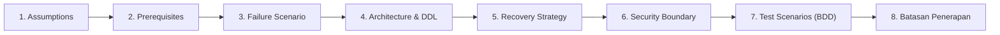

# 🛡️ 06 — The Anti-Failure & Edge-Case Blueprints
> **14 Battle-Tested System Specifications That Prevent Multi-Million Dollar Downtime, Legal Fines, and Scope Creep.**  
> *Part of the Business-to-Engineering (B2E) Specification Framework in `system-blueprint-os`.*

---

## 🏛️ The Strict 7-Pillar Blueprint Standard

In `system-blueprint-os`, every blueprint is an executable architectural standard, not a casual document. Every single blueprint in this directory is mandated to satisfy the **7 Invariant Pillars**:

See [`SPEC-TEMPLATE.md`](./SPEC-TEMPLATE.md) for the authoring standard and [`FRAMEWORK.md`](../FRAMEWORK.md) for framework governance.

---

## 📑 The 14 Anti-Failure Blueprints Matrix

| # | Blueprint Specification | Primary Threat Prevented | Target Layer |
|---|-------------------------|--------------------------|--------------|
| **01** | [Payment Webhook Idempotency & Auto-Reconciliation](./01-payment-idempotency-and-webhook-reconciliation.md) | Double billing, ghost orders, dropped payment webhooks | Layer 1: Financial Integrity |
| **02** | [Inventory Concurrency & Race Conditions](./02-inventory-concurrency-and-race-conditions.md) | Negative stock, overselling on flash sales, double booking | Layer 2: Concurrency & State |
| **03** | [Multi-Tenant Data Isolation & RLS](./03-multi-tenant-data-isolation-rls.md) | Tenant data leaks (Company A seeing Company B's private data) | Layer 3: Security & Governance |
| **04** | [Immutable Audit Trail & Anti-Fraud Log](./04-immutable-audit-trail-and-anti-fraud.md) | Internal employee theft, silent record tampering, untracked voids | Layer 3: Security & Governance |
| **05** | [The Anti-Scope Creep Pact & Definition of Done](./05-the-anti-scope-creep-pact.md) | Budget blowout, indefinite delivery delays, client-agency disputes | Layer 5: Scope Governance |
| **06** | [Chargebacks, Refunds & Dispute Cascade](./06-chargebacks-refunds-and-dispute-cascades.md) | Unrecovered affiliate payouts, tax desync, orphan subscription access | Layer 1: Financial Integrity |
| **07** | [Tax & Multi-Currency Decimal Rounding Integrity](./07-tax-and-multi-currency-rounding-integrity.md) | Floating-point accounting desync, failed tax audits | Layer 1: Financial Integrity |
| **08** | [GDPR Anonymization vs Statutory Audit Compliance](./08-gdpr-anonymization-vs-audit-compliance.md) | Massive privacy fines vs breaking statutory tax retention laws | Layer 3: Security & Governance |
| **09** | [Offline-First Sync & Conflict Resolution](./09-offline-first-sync-and-conflict-resolution.md) | Broken sales during internet outages, duplicate receipt numbers | Layer 2: Concurrency & State |
| **10** | [Four-Eyes Approval & Rogue Staff Defense](./10-four-eyes-approval-and-rogue-staff-defense.md) | Unauthorized bulk discounts, malicious data wipes, hostage databases | Layer 3: Security & Governance |
| **11** | [Bulk Data Ingestion & Quarantine Pipeline](./11-bulk-data-quarantine-pipeline.md) | Corrupted Excel uploads halting system, silent garbage ingestion | Layer 4: Resilience & Queues |
| **12** | [Third-Party Outage Circuit Breaker](./12-third-party-outage-circuit-breaker.md) | Slow third-party APIs (WhatsApp, OpenAI, Stripe) freezing the UI | Layer 4: Resilience & Queues |
| **13** | [OTP Cost-Explosion & Scraping Shield](./13-otp-cost-explosion-and-scraping-shield.md) | Bot toll fraud, overnight $10k SMS bills, inventory scraping | Layer 4: Resilience & Queues |
| **14** | [Zero-Downtime Database Migration Protocol](./14-zero-downtime-database-migrations.md) | Table-locking downtime during schema updates on live production | Layer 2: Concurrency & State |
