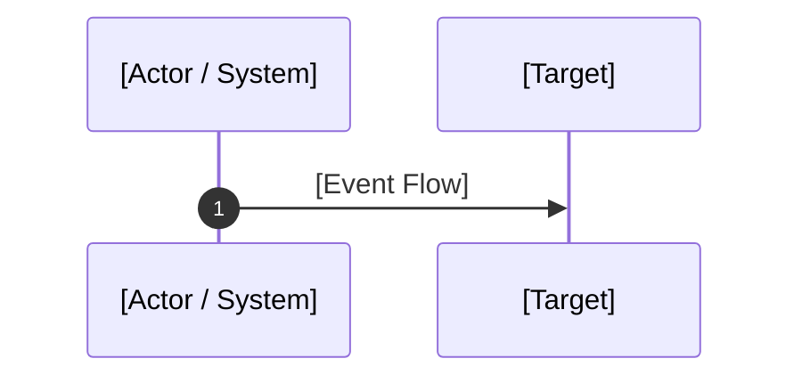

# 📑 Blueprint Specification Template (The Two-Tier Standard)
> **Use this standard template when authoring or contributing new blueprints to `system-blueprint-os`.**  
> *Compliance with both Tier 1 (Analysis Integrity Standard) and Tier 2 (Seven-Pillar Standard) is mandatory before a blueprint can be merged.*

---

# Blueprint XX: [Formal Title of Specification]

> **Target Problem:** [Concise 1-2 sentence problem statement highlighting business and engineering friction]

---

## 📋 Governance & Verification Metadata

| Attribute | Specification Value | Verification Standard |
|---|---|---|
| **Blueprint ID** | `BP-XX` | Unique sequential identifier |
| **Architectural Layer** | `[Layer 1: Financial / Layer 2: Concurrency / Layer 3: Security / Layer 4: Resilience / Layer 5: Scope]` | [FRAMEWORK.md](../FRAMEWORK.md) |
| **Maturity Rating** | `[Level 1: PROPOSED / Level 2: SPEC_COMPLETE / Level 3: BATTLE-TESTED]` | Evidence-Based Maturity System |
| **Empirical Evidence** | `[e.g. Deployed in ROTARI Production / Verified via pgTAP Integration Tests / Staging Benchmark]` | Empirical verification reference |
| **Requirement Anchor** | `[e.g. PRD-Req-402 / GDPR Article 17(3)(b) / IRS Code § 6001 / ADR-014]` | Traceability source link |

### Analysis Integrity Standard (AIS) Verification Sign-off:
- [ ] **1. Mathematical & Financial Rigor:** Monetary/numeric amounts use atomic integer units; Banker's Rounding verified against tax drift.
- [ ] **2. Cross-Blueprint Consistency:** Confirmed zero invariant collisions with dependent blueprints (e.g. GDPR vs Tax Ledger, Offline vs Online Locks).
- [ ] **3. Empirical Reality Check:** Models worst-case infrastructure failures (network timeouts, rogue employees, vendor outages).
- [ ] **4. Requirement Integrity & Evidence Traceability:** Design decisions are directly anchored to verified business problems or legal statutes, not arbitrary preferences.

---

## 1. Assumptions (Asumsi)
*Document the underlying business, infrastructure, and environmental assumptions.*
* **Business Assumption:** e.g., Multi-outlet retail business with central inventory reconciliation.
* **Architecture Assumption:** e.g., Relational database (PostgreSQL 14+) acts as single source of truth.
* **Volume Baseline:** e.g., Sustains bursts of up to 500 concurrent checkout requests per second.

---

## 2. Prerequisites (Prasyarat)
*List all infrastructure, dependencies, libraries, and organizational agreements required before implementation.*
* **Infrastructure:** e.g., PostgreSQL 14+, Redis 6.2+ for distributed lock coordination.
* **Security & Tokens:** e.g., Telephony API keys stored in encrypted environment vaults.
* **Organizational Sign-off:** e.g., Formal management approval of refund escrow windows.

---

## 3. Failure Scenario & Blast Radius (Skenario Kegagalan)
*Detail the catastrophic failure scenario if this blueprint is omitted.*
* **The Failure Story:** [Narrative describing the exact chain of failure]
* **Direct Financial Impact:** [Specific dollar loss, fraud liability, or regulatory fines]
* **Blast Radius:** [Which downstream tables, services, or customer groups are affected]

---

## 4. Architectural Specification & DDL (Spesifikasi Arsitektur)
*Visual Mermaid flows, state machines, and executable database schemas.*



```sql
-- Production DDL: Executable SQL Constraints & Tables
CREATE TABLE example (
    id UUID PRIMARY KEY DEFAULT gen_random_uuid()
);
```

---

## 5. Recovery Strategy & Self-Healing (Strategi Pemulihan)
*How the system heals itself when network drops, servers crash, or unexpected anomalies occur.*
* **Automated Self-Healing:** e.g., Scheduled cron reconciler, exponential backoff with jitter.
* **Dead-Letter Queue (DLQ):** e.g., Failed payloads routed to quarantine queue for inspection.
* **Manual Operational Runbook:** e.g., Standard Operating Procedure (SOP) for support personnel.

---

## 6. Security Boundary & Access Scope (Batas Keamanan)
*Access control, data isolation, and tamper prevention.*
* **Principle of Least Privilege:** e.g., Web API role has only `SELECT/UPDATE` permissions, zero DDL rights.
* **Multi-Tenant Row-Level Security:** e.g., PostgreSQL RLS policy enforcement.
* **Chain of Custody:** e.g., Cryptographic hashing preventing retroactive record alteration.

---

## 7. Test Scenarios (Skenario Pengujian)
*Executable acceptance criteria covering positive, negative, and stress conditions.*

```gherkin
Feature: [Feature Name]

  Scenario: Happy Path (Ideal Business Flow)
    Given [Initial system state]
    When [Action occurs]
    Then [Expected successful state]

  Scenario: Negative Edge-Case (Failure Mode Encountered)
    Given [System state with edge condition]
    When [Action occurs]
    Then [System rejects or safely mitigates failure]

  Scenario: Concurrency / Stress Condition
    Given [Multiple concurrent requests hitting the same resource]
    When [Actions occur within the same millisecond]
    Then [Exactly one request succeeds and others are handled gracefully]
```

---

## 8. Batasan Penerapan & Trade-offs (Kapan JANGAN Digunakan)
*Architectural honesty: define when this blueprint should NOT be applied.*
* **Contraindications:** e.g., Do not use for zero-cost free trial checkouts or early 48-hour hackathons.
* **Performance Overhead:** e.g., Distributed locking adds 2–6ms of latency per transaction.
* **Operational Complexity:** e.g., Requires ongoing monitoring of Redis memory utilization and TTL expiry.
