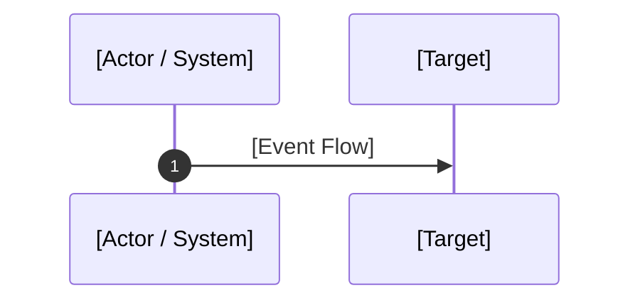

# 📑 Blueprint Specification Template (The 7-Pillar Standard)
> **Use this standard template when authoring or contributing new blueprints to `system-blueprint-os`. All seven sections are mandatory.**

---

# Blueprint XX: [Formal Title of Specification]

> **Target Problem:** [Concise 1-2 sentence problem statement highlighting business and engineering friction]

---

## 1. Assumptions (Asumsi)
*Document the underlying business, infrastructure, and environmental assumptions.*
* **Business Assumption:** e.g., The business operates a multi-outlet retail model with central inventory.
* **Architecture Assumption:** e.g., A relational database with ACID compliance (PostgreSQL) is the source of truth.
* **Volume Assumption:** e.g., The system handles up to 500 concurrent checkout requests per second.

---

## 2. Prerequisites (Prasyarat)
*List all infrastructure, dependencies, libraries, and organizational agreements required before implementation.*
* **Infrastructure:** e.g., PostgreSQL 14+, Redis 6.2+ for distributed locks.
* **Vendor Configuration:** e.g., Payment Gateway configured with webhook signature verification keys.
* **Organizational:** e.g., Management approval of the refund policy and SLA definitions.

---

## 3. Failure Scenario & Blast Radius (Skenario Kegagalan)
*Detail the catastrophic failure scenario if this blueprint is omitted.*
* **The Failure Story:** [Narrative describing what triggers the breakdown]
* **Financial Impact:** [Direct monetary loss, fraud exposure, or chargeback fees]
* **Blast Radius:** [Which users, systems, or downstream tables are corrupted or affected]

---

## 4. Architectural Specification & DDL (Spesifikasi Arsitektur)
*Visual Mermaid flows, state machines, and executable database schemas.*



```sql
-- Production-Ready SQL Constraints & Tables
CREATE TABLE example (
    id UUID PRIMARY KEY DEFAULT gen_random_uuid()
);
```

---

## 5. Recovery Strategy & Self-Healing (Strategi Pemulihan)
*How the system heals itself when network drops, servers crash, or unexpected anomalies occur.*
* **Automated Self-Healing:** e.g., Scheduled cron reconcilers, retry workers with exponential backoff.
* **Dead-Letter Queue (DLQ) & Quarantine:** e.g., Poison messages moved to manual inspection queues.
* **Manual Operational Runbook:** e.g., Step-by-step instructions for support staff when automated recovery fails.

---

## 6. Security Boundary & Access Scope (Batas Keamanan)
*Access control, data isolation, and tamper prevention.*
* **Principle of Least Privilege:** e.g., Application web workers have only `INSERT/SELECT` rights, not `DROP/TRUNCATE`.
* **Multi-Tenant Isolation:** e.g., PostgreSQL Row-Level Security (RLS) enforcement.
* **Immutable Chain of Custody:** e.g., Cryptographic hashing preventing retroactive edits.

---

## 7. Test Scenarios (Skenario Pengujian)
*Executable acceptance criteria covering positive, negative, and stress conditions.*

```gherkin
Feature: [Feature Name]

  Scenario: Happy Path (Ideal Business Flow)
    Given [Initial system state]
    When [Action occurs]
    Then [Expected successful state]

  Scenario: Negative Edge-Case (Failure Mode Encountered)
    Given [System state with edge condition]
    When [Action occurs]
    Then [System rejects or safely mitigates failure]

  Scenario: Concurrency / Stress Condition
    Given [Multiple concurrent requests hitting the same resource]
    When [Actions occur within the same millisecond]
    Then [Exactly one request succeeds and others are handled gracefully]
```

---

## 8. Batasan Penerapan & Trade-offs (Kapan JANGAN Digunakan)
*Architectural honesty: every pattern has trade-offs. Define when this blueprint should NOT be applied.*
* **Contraindications:** e.g., Do not use this pattern for simple read-heavy static blogs or prototypes where Redis overhead is unjustified.
* **Performance Overhead:** e.g., Distributed locking adds 5-15ms of latency per transaction.
* **Complexity Burden:** e.g., Requires ongoing monitoring of Redis memory utilization and connection pools.
