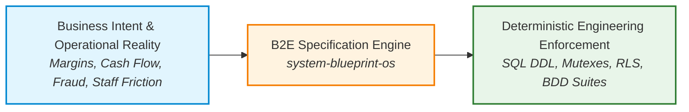
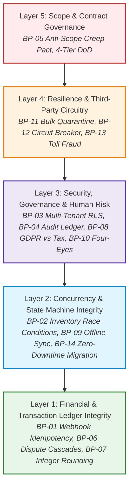
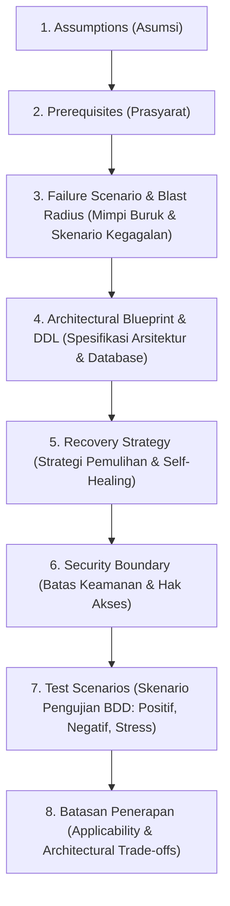
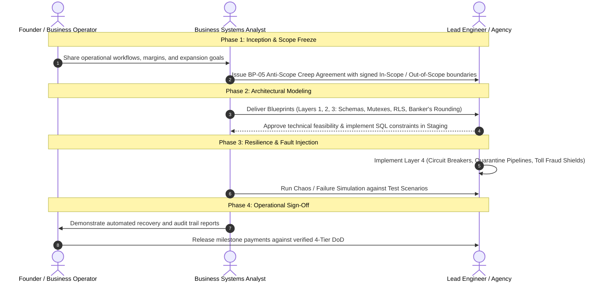

# 🏛️ The Business-to-Engineering (B2E) Specification Framework

> **A Formal Architectural Methodology for Translating Business Risk, Operational Realities, and Financial Constraints into Developer-Ready Systems Specifications.**

---

## 1. What Makes This a Framework, Not Just a Template Library?

A document collection is static; **a framework is an operational methodology with strict rules, structural invariants, and governance.**

Traditional Business Analysis produces bulky Word documents that software engineers ignore. Traditional Software Engineering produces technical implementations that business stakeholders don't understand—leading to costly post-launch failures.

The **Business-to-Engineering (B2E) Specification Framework** establishes a deterministic bridge between business intent and database/code enforcement.

---

## 2. The 5 Functional Layers of the B2E Framework

Every system specification in `system-blueprint-os` is mapped across five architectural layers:

---

## 3. The 7 Invariant Rules of Every Blueprint (The Mandatory Anatomy)

In `system-blueprint-os`, no blueprint is valid unless it satisfies all seven architectural dimensions:

| Section | Definition & Purpose | Verification Criteria |
|---|---|---|
| **1. Assumptions** | Baseline conditions of the business environment and infrastructure. | What must be true for this blueprint to be valid? |
| **2. Prerequisites** | Technical, operational, or vendor dependencies needed prior to implementation. | Required tools (e.g. PostgreSQL 14+, Redis, PubSub). |
| **3. Failure Scenario** | Detailed real-world failure mode, financial loss model, and blast radius. | Exactly what breaks and how much money/data is lost? |
| **4. Architecture & DDL** | Native Mermaid flows, state machines, and production SQL constraints. | Visual process map + executable database definitions. |
| **5. Recovery Strategy** | Automated self-healing, reconciliation workers, DLQ, and manual rollback protocols. | How does the system fix itself without human panic? |
| **6. Security Boundary** | Principle of least privilege, data isolation policies, and non-repudiation limits. | Who can trigger it, and who is strictly prohibited? |
| **7. Test Scenarios** | Given-When-Then BDD test cases covering happy path, edge-case failure, and race conditions. | Verifiable automated testing acceptance criteria. |
| **8. Batasan Penerapan** | Clear contraindications: when **NOT** to use this blueprint and the architectural trade-offs. | When is this pattern overkill or contraindicated? |

---

## 4. The 4-Phase Implementation Lifecycle

When adopting the framework on a software project, follow this four-phase lifecycle:

