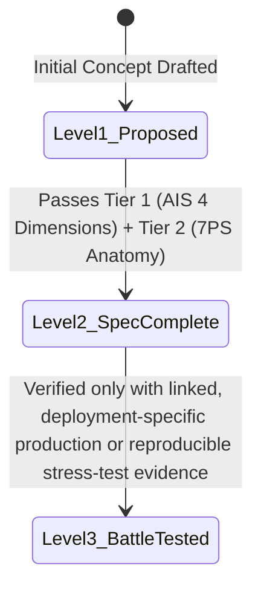

# 🏛️ The Business-to-Engineering (B2E) Specification Framework
> **An Evidence-Based Architectural Methodology for Translating Business Risk, Operational Realities, and Financial Constraints into Verifiable Systems Specifications.**

---

## 1. The Core Philosophy: Substance Over Checkboxes

In `OpenBSA` (OpenBSA), **no blueprint may claim "Enterprise-Ready" status simply because all template sections are filled.**

Completing seven structural headings is merely a syntactic prerequisite. True readiness is governed by **substantive analysis quality, empirical verification, mathematical proof, and operational traceability.**

To enforce this rigor, the framework operates on **The Two-Tier Governance Standard**:

```mermaid
graph TD
    classDef t1 fill:#e1f5fe,stroke:#0288d1,stroke-width:2px;
    classDef t2 fill:#ede7f6,stroke:#512da8,stroke-width:2px;
    classDef m fill:#e8f5e9,stroke:#2e7d32,stroke-width:2px;

    subgraph Tier 1: Analysis Integrity Standard (AIS)
        A1[1. Mathematical & Financial Rigor]:::t1
        A2[2. Cross-Blueprint Consistency]:::t1
        A3[3. Empirical Reality Check]:::t1
        A4[4. Requirement Integrity & Evidence Traceability]:::t1
    end

    subgraph Tier 2: Seven-Pillar Blueprint Standard (7PS)
        P1[1. Assumptions & 2. Prerequisites]:::t2
        P2[3. Failure Scenario & Blast Radius]:::t2
        P3[4. Architecture & Executable DDL]:::t2
        P4[5. Recovery Strategy & Self-Healing]:::t2
        P5[6. Security Boundary & Access Scope]:::t2
        P6[7. Test Scenarios BDD]:::t2
        P7[8. Batasan Penerapan / Trade-offs]:::t2
    end

    Tier 1 --> VerificationGate{Verification & Evidence Gate}
    Tier 2 --> VerificationGate
    VerificationGate --> Maturity[Evidence-Based Maturity Rating<br/><i>Level 1: PROPOSED -> Level 2: SPEC_COMPLETE -> Level 3: BATTLE-TESTED</i>]:::m
```

---

## 2. Tier 1: The Analysis Integrity Standard (AIS) — 4 Mandatory Dimensions

Before any architectural solution or code is accepted, the business systems analysis must pass all four integrity dimensions:

### Dimension 1: Mathematical & Financial Rigor
* Every currency, quantity, fee, and tax computation must be mathematically provable.
* Binary floating-point arithmetic (`FLOAT`/`DOUBLE`) is strictly prohibited in financial ledgers. All monetary values must adhere to the **Atomic Integer Cent Invariant** and use standardized **Banker's Rounding (Half-Even)** to eliminate cumulative tax drift.

### Dimension 2: Cross-Blueprint Traceability & Consistency
* A rule in Blueprint X must never break, contradict, or invalidate an invariant in Blueprint Y.
* *Example:* The GDPR Right to Erasure procedure in BP-08 **must not** delete historical billing invoices required by the Financial Ledger in BP-07, nor may it break the cryptographic SHA-256 hash chaining of the Immutable Audit Trail in BP-04.

### Dimension 3: Empirical Reality Check
* Specifications must never assume an idealized world where networks never fail, employees are 100% honest, customers enter valid data, or third-party vendors maintain 100% SLA.
* Every specification must model real-world chaos: severed Wi-Fi cables, malicious insider actions, webhook retry bursts, and third-party API freezes.

### Dimension 4: Requirement Integrity & Evidence Traceability
* **Every single design decision, constraint, and table schema must be bidirectionally traceable** to a concrete business requirement, verified regulatory law, or signed stakeholder decision.
* Arbitrary engineering preferences are rejected. Each constraint must document:
  1. *Originating Business Problem:* What commercial pain or operational leak does this solve?
  2. *Verified Fact / Precedent:* What empirical law, tax code (e.g. IRS § 6001, GDPR Art 17), or RFC standard mandates this?
  3. *Traceable Requirement ID:* Direct mapping to the project's PRD, BRD, or Architectural Decision Record (ADR).

---

## 3. Tier 2: The Seven-Pillar Blueprint Standard (7PS)

The standard defines seven invariant pillars, documented through eight mandatory structural sections:

| Pillar | Engineering Mandate | Verification Criteria |
|---|---|---|
| **1. Assumptions** | Baseline conditions of the business environment, data volume, and hardware. | What must be true for this blueprint to be applicable? |
| **2. Prerequisites** | Concrete infrastructure, versions, and libraries required before coding. | e.g. PostgreSQL 14+, Redis 6.2+, Turnstile keys. |
| **3. Failure Scenario** | Detailed narrative of the nightmare breakdown, direct monetary loss, and blast radius. | Exactly what breaks, which tables corrupt, and how much money is lost? |
| **4. Architecture & DDL** | Native Mermaid sequence/state diagrams and production-ready SQL constraints. | Executable DDL: `CHECK`, `UNIQUE`, RLS policies, PL/pgSQL triggers. |
| **5. Recovery Strategy** | Automated self-healing, reconciliation crons, DLQ queues, and manual runbooks. | How does the system fix itself without human panic when failure strikes? |
| **6. Security Boundary** | Least privilege, session immutability, role separation, and tamper prevention. | Who can trigger the action, and who is strictly prohibited? |
| **7. Test Scenarios** | Given-When-Then BDD test cases covering happy path, edge failure, and concurrency spikes. | Verifiable automated testing acceptance criteria. |
| **8. Batasan Penerapan** | Architectural honesty: clear contraindications defining when **NOT** to use this pattern. | When is this pattern overkill, contraindicated, or too complex? |

---

## 4. The Evidence-Based Maturity Rating System (Kelayakan Berbasis Bukti)

Every blueprint in `OpenBSA` carries an explicit, honest **Maturity Rating Badge**:



### Level 1: `PROPOSED / DRAFT` 🟡
* The problem statement and initial architecture flow are documented.
* Sections are still under active review or missing empirical validation.
* **Status:** Experimental. Not yet approved for client contractual use.

### Level 2: `SPEC_COMPLETE` 🔵
* All 4 dimensions of the **Analysis Integrity Standard (AIS)** have been verified.
* All eight mandatory documentation sections of the **Seven-Pillar Blueprint Standard (7PS)** are fully authored.
* Gherkin BDD test scenarios have been designed and peer-reviewed.
* **Status:** Ready for implementation and sprint planning.

### Level 3: `BATTLE-TESTED / VERIFIED` 🟢
* **Empirically Proven:** The specification has been deployed in a live production environment (in a named deployment with reproducible test evidence linked in the blueprint), survived real-world concurrency loads, or passed automated database integration stress tests.
* Zero unresolved edge-case vulnerabilities.
* **Status:** Gold standard reference architecture.

---

## 5. The 4-Phase Governance Lifecycle

```mermaid
sequenceDiagram
    autonumber
    actor Founder as Business Founder / Operator
    actor Analyst as Lead Systems Analyst (Tri Raida)
    actor Architect as Lead Software Architect

    Note over Founder,Architect: Phase 1: Requirement Integrity Audit
    Founder->>Analyst: State commercial goals, operational friction, and revenue leaks
    Analyst->>Analyst: Apply AIS Dimension 4 (Requirement Integrity & Evidence Traceability)
    Analyst->>Founder: Deliver BP-05 Scope Agreement with explicit Out-of-Scope lists

    Note over Founder,Architect: Phase 2: Structural 7-Pillar Modeling
    Analyst->>Architect: Issue Tier 2 Blueprint Specifications (Schemas, DDL, State Machines)
    Architect->>Analyst: Validate technical feasibility against PostgreSQL/Redis prerequisites

    Note over Founder,Architect: Phase 3: Cross-Blueprint Consistency Audit
    Analyst->>Analyst: Run AIS Dimension 2 Check (GDPR vs Tax, Concurrency vs Offline Sync)
    Architect->>Architect: Deploy DDL constraints and BDD test suites in Staging

    Note over Founder,Architect: Phase 4: Production Verification & Sign-off
    Architect->>Analyst: Execute concurrency stress test and automated self-healing crons
    Analyst->>Founder: Present verified audit reports; milestone approved for deployment
```

---

## 6. Anticipatory Gap Analysis — Seeing Beyond the Stated Requirement

OpenBSA expects a BSA to look beyond the feature request and examine what the business may have missed. This is a business-analysis discipline, not a requirement to predict every possible failure or prescribe a particular technology.

### 6.1 Separate facts from uncertainty

Every material finding must be distinguished as:
- **FACT:** supported by observation, records, or a reliable source.
- **ASSUMPTION:** accepted temporarily for planning and still requiring validation.
- **POSSIBLE GAP:** a missing rule, capability, decision, or scenario worth investigating.
- **DECISION:** an explicit choice made by an accountable stakeholder.

An unverified assumption must never be presented as a confirmed requirement.

### 6.2 Look across the business, not only the requested feature

Use the following discovery lenses where relevant:
- Business goals, constraints, and scope boundaries.
- People, roles, authority, delegation, and absence.
- Normal workflows, exceptions, corrections, and workarounds.
- Customer and stakeholder experience.
- Data ownership, quality, retention, and recordkeeping.
- Pricing, payments, refunds, reconciliation, and financial exposure.
- Time, peak demand, growth, and operational capacity.
- Suppliers, integrations, and external dependencies.
- Security, misuse, privacy, and trust.
- Continuity, recovery, change, migration, and exit.

### 6.3 Explore plausible future conditions

Consider relevant scenarios such as growth or contraction, key-person absence, service disruption, human error or abuse, policy or provider changes, disputes, and customer/vendor exit. For each selected scenario ask:

1. What changes or triggers the situation?
2. Who or what is affected?
3. What business consequence could follow?
4. How would the business notice early?
5. What prevention, fallback, recovery, or decision is proportionate?

### 6.4 Prioritize with honest evidence

Assess impact, exposure, detectability, reversibility, and readiness. Use plain-language priorities (Critical, High, Medium, Low, Watch) and explain the rationale. Do not invent probabilities, financial losses, or numerical risk scores without defensible inputs.

### 6.5 Convert analysis into decisions

Each material gap should have a clear owner, evidence or uncertainty statement, trigger, consequence, priority rationale, proposed response, and review condition. The business may resolve it now, design for later, create a fallback, monitor it, investigate it, accept it explicitly, or document it as out of scope.

The BSA identifies and explains the business need and acceptance outcome. Developers and technical specialists choose an appropriate implementation with stakeholders.

**Reference documents:**
- [Anticipatory Gap Analysis Standard](./00-governance-and-standards/08-anticipatory-gap-analysis-standard.md)
- [Anticipatory Gap Register Template](./01-core-templates/04-anticipatory-gap-register.md)

**Integrity rule:** A scenario is not proof that an event will occur. The objective is to make important uncertainty visible early and prepare a proportionate response—not to expand every project with speculative features.

