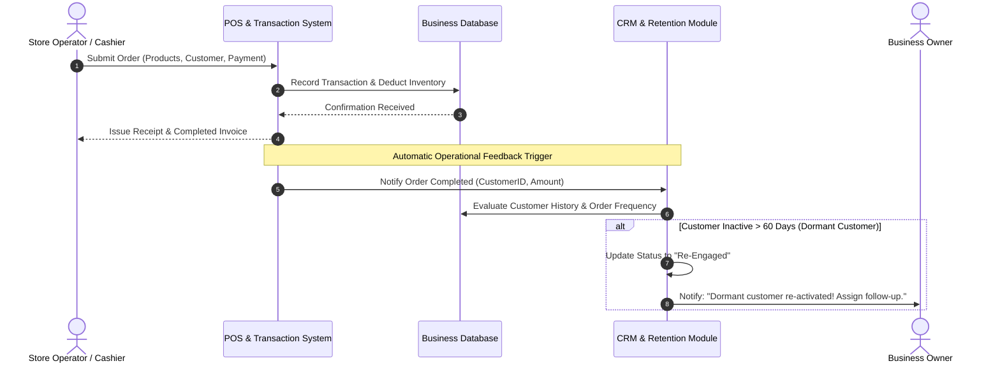
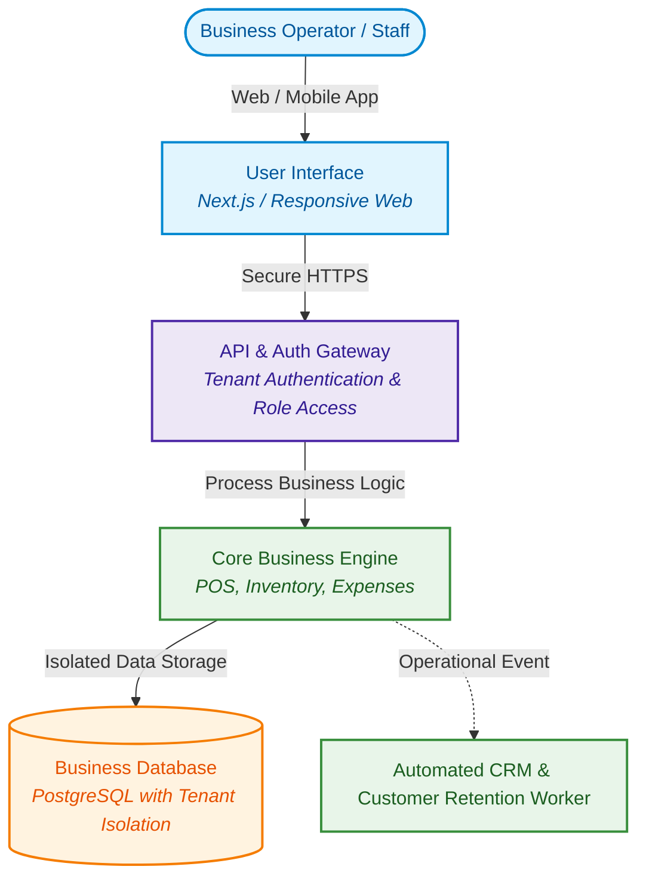

# 📐 OpenBSA — Pragmatic Business Systems Analysis Toolkit

**Production-ready Markdown templates, visual process flows, and system specifications designed by an entrepreneur-turned-analyst. Bridging real-world business operations with modern software engineering.**

[Explore Templates](#-repository-modules) • [Featured Case Study (ROTARI)](#-featured-case-study-rotari) • [Consulting & Advisory](#-consulting--advisory-services) • [Contributing](#-contributing)

---

## 💡 The Philosophy: Business First, System Second

> *"I didn't start with computer science theory in a classroom. I started on the front lines as an entrepreneur running real businesses. I know where daily operations break, where revenue leaks, and why development teams often end up building software that business operators can't use.*  
>  
> *A transaction should never be treated as just a static database record. It is an operational trigger that tells the business what action to take next."*  
> — **Tri Raida**, *Founder & Business Systems Analyst*

Most business requirements documents (BRDs) fail because they are written by technologists who don't understand business friction, or by business stakeholders who don't know how to structure requirements for developers.

**OpenBSA** bridges this exact gap:
- **Operator-Driven Insights:** Grounded in genuine business workflows—cash flow, dead-stock prevention, customer churn, and cashier usability.
- **AI-Augmented Precision:** Leveraging modern AI to rapidly synthesize, structure, and visualize comprehensive requirements without administrative fluff.
- **Docs-as-Code & Visuals:** Markdown-first templates with embedded **Mermaid.js** diagrams that render natively on GitHub, keeping business logic aligned with engineering code.

---

## ⚡ Live Preview: Translating Business Logic into System Flows

This is how business operations and customer retention feedback loops are documented visually using native Mermaid markdown:

### The Transaction-to-Action Feedback Loop

### High-Level Multi-Tenant Architecture Overview

---

## 📂 Repository Modules

Every folder contains production-ready, standardized Markdown templates ready to be used in client projects or internal company systems:

### 1. [`01-core-templates/`](./01-core-templates/)
* **`PRD-Template.md`** — Product Requirements Document focused on business objectives, user personas, problem validation, and MoSCoW prioritization.
* **`SRS-Template.md`** — System Requirements Specification defining external interfaces, user access, and system workflows.
* **`ADR-Template.md`** — Architecture Decision Record to document the business reasoning behind technological choices.
* **`NFR-Checklist.md`** — Non-Functional Requirements checklist (System availability, latency expectations, data privacy, and backup plans).

### 2. [`02-diagrams-as-code/`](./02-diagrams-as-code/)
* **`c4-model-architecture.md`** — C4 System Context and Container templates in Mermaid.js.
* **`system-sequence-flows.md`** — Clear sequence flows for transactions, payment webhooks, and authentication.
* **`business-state-machines.md`** — Visual state diagrams for order lifecycles and customer dormancy statuses.
* **`entity-relationship-erd.md`** — Relational database entity models showing business relationships (Tenants, Customers, Orders, Products).

### 3. [`03-data-and-api-specs/`](./03-data-and-api-specs/)
* **`api-contract-template.md`** — Functional API contracts mapping business inputs, validation rules, and error handling.
* **`data-dictionary-sttm.md`** — Source-to-Target Mapping (STTM) for migrating legacy spreadsheets/systems into modern databases.
* **`event-driven-pubsub-spec.md`** — Decoupled event-driven flows for business notifications and automations.

### 4. [`04-agile-and-qa/`](./04-agile-and-qa/)
* **`gherkin-bdd-user-stories.md`** — Business user stories with `Given-When-Then` acceptance criteria that developers and QA can immediately test.
* **`traceability-matrix-rtm.md`** — Traceability matrix ensuring every business goal has a matching feature and test plan.

### 5. [`05-modern-ai-spec/`](./05-modern-ai-spec/)
* **`llm-system-spec.md`** — Specification template for AI-driven business features (Copilots, automated re-stocking, and prompt contracts).

---

## 🏆 Featured Case Study: ROTARI

To see this business-first methodology in a real, live application, explore **ROTARI**—a multi-tenant business management and CRM system designed by the author:

* **Repository:** [https://github.com/reviveproject4-source/ROTARI](https://github.com/reviveproject4-source/ROTARI)
* **Live Application:** [https://rotari.vercel.app](https://rotari.vercel.app)
* **What ROTARI Demonstrates:**
  * Translating real-world small business operations into a unified digital system.
  * Multi-tenant data isolation using PostgreSQL Row-Level Security (RLS).
  * Connecting daily POS transactions directly to automated CRM customer retention actions.
  * Modern, functional tech stack: Next.js, React, TypeScript, Supabase, Tailwind CSS.

---

## 👨‍💼 Consulting & Advisory Services

Are you a founder, startup, or business owner looking to digitize messy operations, build custom software, or align your business requirements with external developers?

I provide **Business Systems Analysis & Digital Transformation Advisory** for international clients:
* **Workflow Discovery & Gap Analysis:** Identifying operational bottlenecks, data leaks, and manual friction across your business.
* **Developer-Ready Functional Specifications:** Turning your vision into crystal-clear PRDs, user stories, and visual diagrams so your development team builds it right the first time.
* **Digital Transformation Roadmapping:** Pragmatic advice on tools, SaaS integration, and custom software decisions.

👉 **[Explore Full Service Packages & How We Can Work Together](./SERVICES.md)**  
📫 **Direct Inquiry:** Reach out via [GitHub Issues](https://github.com/reviveproject4-source/ROTARI) or email **`tri.raida.consulting@gmail.com`**.

---

## 🤝 Contributing

Contributions, feedback, and community improvements are welcome! If you have useful process patterns or templates:
1. Fork the Project
2. Create your Feature Branch (`git checkout -b feature/NewTemplate`)
3. Commit your Changes (`git commit -m 'Add NewTemplate'`)
4. Push to the Branch (`git push origin feature/NewTemplate`)
5. Open a Pull Request

See [CONTRIBUTING.md](./CONTRIBUTING.md) for guidelines.

---

## ⭐️ Show Your Support

If this toolkit helped clarify your business requirements or saved your team time, please **give this repository a Star (⭐️)**! It helps other founders and analysts discover practical, business-first systems analysis.

---

## 📄 License

Distributed under the MIT License. See [`LICENSE`](./LICENSE) for details.

*(c) 2026 Tri Raida. Built with practical business experience & ❤️ for the global tech community.*
