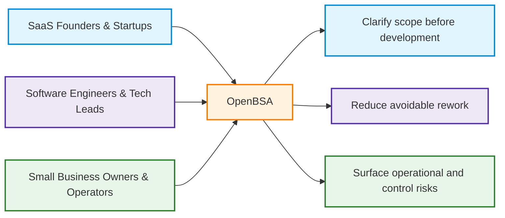
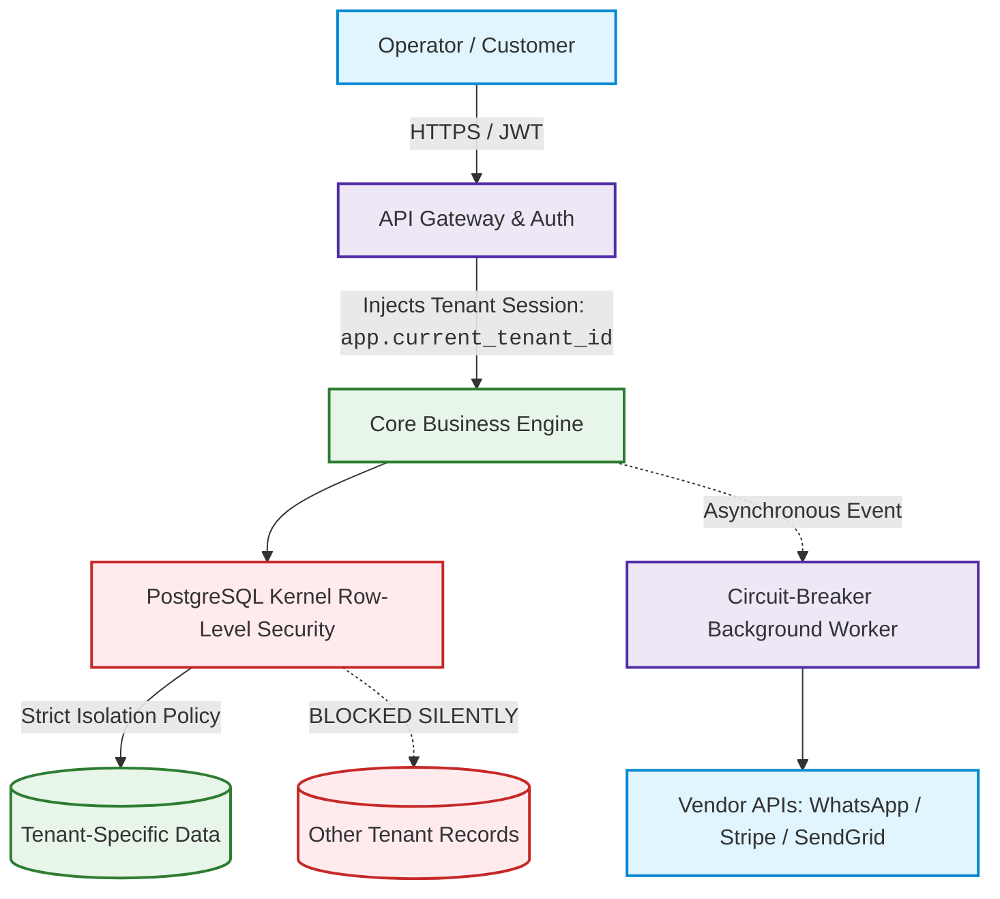

# ⚡ OpenBSA
> **The Open Business-to-Engineering (B2E) Specification Framework.**  
> *Bridging Founder Vision with Engineering Execution — Anticipating the Critical Edge Cases Before You Write Code or Sign a Dev Contract.*

**A structured business analysis framework, visual process models, and reference failure-mode blueprints designed to make overlooked business needs visible before development.**

[Read the B2E Framework Guide](./FRAMEWORK.md) • [Explore 14 Blueprints](./06-edge-cases-and-anti-failure/) • [Launch Web Studio](./web/) • [Consulting & Advisory](./SERVICES.md)

---

## 🏛️ The Two-Tier Governance Standard: Substance Over Checkboxes

`OpenBSA` is not a casual library of 14 markdown files. It is an operational **Business-to-Engineering (B2E) Specification Framework** designed to bridge the chasm between commercial business operators and software engineering teams.

> **Crucial Rule:** In this framework, **no blueprint may claim "Enterprise-Ready" status simply because all headings are filled.** Readiness is strictly evidence-based, governed by two independent layers of scrutiny:

### 1. Analysis Integrity Standard (AIS) — 4 Mandatory Dimensions
1. **Mathematical & Financial Rigor:** Strict atomic integer cents, zero floating-point math, and Banker's Rounding to eliminate tax ledger drift.
2. **Cross-Blueprint Traceability & Consistency:** Zero invariant collisions (e.g. GDPR pseudonymization in BP-08 preserves financial invoices in BP-07 and hash chains in BP-04).
3. **Empirical Reality Check:** Models worst-case infrastructure chaos: severed store Wi-Fi cables, rogue employee voids, webhook retry storms, and vendor API outages.
4. **Requirement Integrity & Evidence Traceability:** Every architectural decision and table schema is bidirectionally traceable to a verified business need, legal statute (GDPR Art 17, IRS § 6001), or signed stakeholder contract (ADR).

### 2. Seven-Pillar Blueprint Standard (7PS) — The 8 Structural Sections
Every blueprint provides complete operational engineering controls:
`1. Assumptions` • `2. Prerequisites` • `3. Failure Scenario & Blast Radius` • `4. Architecture & Executable DDL` • `5. Recovery Strategy & Self-Healing` • `6. Security Boundary` • `7. Test Scenarios (BDD)` • `8. Batasan Penerapan (Trade-offs)`.

### 3. Evidence-Based Maturity System
* 🟡 **Level 1: `PROPOSED`** — Initial concept and failure narrative documented.
* 🔵 **Level 2: `SPEC_COMPLETE`** — Passed all 4 AIS dimensions, full 7PS anatomy authored, BDD test suite verified.
* 🟢 **Level 3: `BATTLE-TESTED`** — Empirically proven in live production (e.g. [ROTARI Retail Engine](https://github.com/reviveproject4-source/ROTARI)), stress-tested against race conditions, or verified via live database constraint benchmarks.

👉 **[Read the complete Framework Governance & Methodology in FRAMEWORK.md](./FRAMEWORK.md)**

---

## 🎯 The Premise: Why Software Projects Miss Business Expectations

Software can be built exactly as described and still disappoint the business when the original analysis missed important rules, exceptions, responsibilities, or future conditions.

* **Founders & SMB Owners** can spend significant time and money correcting unclear requirements, uncontrolled scope, and operational realities that were not discussed before development.
* **Software Engineers** may receive vague requests without clear business rules, exception handling, decision ownership, or acceptance criteria—creating avoidable clarification and rework.

`OpenBSA` provides a structured way to discover, document, prioritize, and communicate business needs, important edge cases, and unresolved decisions before implementation. Its reference blueprints are starting points for review and adaptation, not guaranteed or universal solutions.

---

## 🤝 Business-to-Developer Handoff: Make the Analysis Actionable

OpenBSA aims to give developers more than a feature list. A useful handoff explains the business problem, desired outcome, process, roles, business rules, important exceptions, plausible future gaps, acceptance criteria, and unresolved decisions—without forcing a programming language or technical architecture.

- **[Business-to-Developer Handoff Standard](./00-governance-and-standards/09-business-to-developer-handoff-standard.md)** — what a developer should be able to understand before estimation and implementation.
- **[Business-to-Developer Handoff Pack](./01-core-templates/05-business-to-developer-handoff-pack.md)** — a practical template for preparing the project handoff.
- **[Worked Example: Refund Request](./07-worked-examples/01-refund-request-handoff-example.md)** — demonstrates how a simple "refund button" request becomes a clear business process with rules, exceptions, open decisions, and acceptance criteria.

**The intended result:** a developer can see what the business needs, which risks have already been considered, what is still undecided, and how the business will judge whether the solution is correct. Developers remain free to choose the technical implementation.

---

## 👥 Who This Is Built For

1. **SaaS Founders & Indie Hackers:** Lock down your PRD, multi-tenant security, and payment idempotency before spending your first dollar on engineering.
2. **Small Business Owners (SMBs):** Make operational gaps, manual workarounds, responsibilities, and control needs visible before selecting or changing software.
3. **Software Engineers & Freelance Agencies:** Use the analysis and handoff materials to clarify the business problem, rules, exceptions, open decisions, and acceptance conditions before implementation.

---

## 🛡️ Reference Blueprints for Common Failure Modes

The repository includes examples such as PostgreSQL DDL, Mermaid flows, and BDD acceptance criteria. Each blueprint is a reference pattern to review against the actual business context; it does not mean the risk is universally solved or that every project needs every control.

| # | Blueprint Specification | Business or system risk considered |
|---|-------------------------|------------------------|
| **01** | [Payment Webhook Idempotency & Reconciliation](./06-edge-cases-and-anti-failure/01-payment-idempotency-and-webhook-reconciliation.md) | Ghost orders, double-billing, and dropped webhook retries. |
| **02** | [Inventory Concurrency & Race Conditions](./06-edge-cases-and-anti-failure/02-inventory-concurrency-and-race-conditions.md) | Overselling items during flash sales and negative stock. |
| **03** | [Multi-Tenant Data Isolation & RLS](./06-edge-cases-and-anti-failure/03-multi-tenant-data-isolation-rls.md) | Tenant data breaches (Company A seeing Company B's data). |
| **04** | [Immutable Audit Trail & Anti-Fraud Log](./06-edge-cases-and-anti-failure/04-immutable-audit-trail-and-anti-fraud.md) | Internal employee theft, silent record tampering, untracked voids. |
| **05** | [The Anti-Scope Creep Pact & Definition of Done](./06-edge-cases-and-anti-failure/05-the-anti-scope-creep-pact.md) | Scope disputes, unending revisions, and broken dev contracts. |
| **06** | [Chargebacks, Refunds & Dispute Cascade](./06-edge-cases-and-anti-failure/06-chargebacks-refunds-and-dispute-cascades.md) | Unrecovered affiliate payouts and lingering subscription access. |
| **07** | [Tax & Multi-Currency Decimal Integrity](./06-edge-cases-and-anti-failure/07-tax-and-multi-currency-rounding-integrity.md) | Float math rounding errors resulting in failed corporate tax audits. |
| **08** | [GDPR Anonymization vs Audit Law](./06-edge-cases-and-anti-failure/08-gdpr-anonymization-vs-audit-compliance.md) | Resolving the conflict between "Right to be Forgotten" and 7-year tax laws. |
| **09** | [Offline-First Sync & Conflict Resolution](./06-edge-cases-and-anti-failure/09-offline-first-sync-and-conflict-resolution.md) | POS operations during internet outages without primary key clashes. |
| **10** | [Four-Eyes Approval & Rogue Staff Defense](./06-edge-cases-and-anti-failure/10-four-eyes-approval-and-rogue-staff-defense.md) | Unauthorized bulk discounts and disgruntled employee data wipes. |
| **11** | [Bulk Data Ingestion & Quarantine Pipeline](./06-edge-cases-and-anti-failure/11-bulk-data-quarantine-pipeline.md) | Corrupted Excel imports crashing servers without partial saves. |
| **12** | [Third-Party Outage Circuit Breaker](./06-edge-cases-and-anti-failure/12-third-party-outage-circuit-breaker.md) | WhatsApp, Stripe, or AI vendor outages freezing the user checkout. |
| **13** | [OTP Cost-Explosion & Scraping Shield](./06-edge-cases-and-anti-failure/13-otp-cost-explosion-and-scraping-shield.md) | Toll fraud botnets generating overnight $10,000 Twilio SMS bills. |
| **14** | [Zero-Downtime Database Migration Protocol](./06-edge-cases-and-anti-failure/14-zero-downtime-database-migrations.md) | Production table-locking downtime during schema updates. |

---

## ⚡ Live Visual Flow: Multi-Tenant Architecture & Data Isolation

---

## 📂 Core Repository Modules

| Module Directory | Contents & Purpose |
|------------------|--------------------|
| [`00-governance-and-standards/`](./00-governance-and-standards/) | **P0 Foundation:** AIS, 7PS, Rules of Evidence, Standard Glossary, Anticipatory Gap Analysis, and Business-to-Developer Handoff standards. |
| [`01-core-templates/`](./01-core-templates/) | PRD, SRS, Architecture Decision Records (ADRs), Non-Functional Checklists, Anticipatory Gap Register, and Business-to-Developer Handoff Pack. |
| [`02-diagrams-as-code/`](./02-diagrams-as-code/) | Native Mermaid.js diagrams: C4 models, sequence flows, state machines, ERD models. |
| [`03-data-and-api-specs/`](./03-data-and-api-specs/) | API contracts, Source-to-Target mapping (STTM), and decoupled event pub/sub specs. |
| [`04-agile-and-qa/`](./04-agile-and-qa/) | Gherkin BDD (`Given-When-Then`) user stories and Requirements Traceability Matrix (RTM). |
| [`05-modern-ai-spec/`](./05-modern-ai-spec/) | Specifications for AI agents, prompt contract guardrails, and deterministic fallback logic. |
| [`06-edge-cases-and-anti-failure/`](./06-edge-cases-and-anti-failure/) | Reference failure-mode blueprints with business and technical controls; maturity varies by blueprint. |
| [`07-worked-examples/`](./07-worked-examples/) | Worked examples showing how business analysis becomes a developer-readable handoff. |
| [`web/`](./web/) | **Interactive Vercel-ready Web Application** (Scope Risk Calculator & Spec Generator). |

---

## 💻 Interactive Web App (Deployable to Vercel)

Inside the [`web/`](./web/) folder is a modern, standalone web application that can be deployed to **Vercel** with a single click:
* 🧮 **Scope Risk & Budget Leakage Calculator:** Assess your software project against 8 failure dimensions and get a real-time risk index.
* 📝 **Interactive Edge-Case Generator:** Select features (e.g. Subscriptions, POS, Marketplace) and generate developer-ready Markdown specifications.
* 📊 **Mermaid Diagram Studio:** Instant interactive visualization and copy-pasteable diagram code.

---

## 👨‍💼 Consulting & Advisory Services

Are you a founder, startup, or business owner looking to digitize messy operations, build custom software, or prevent expensive development mistakes?

I provide **Business Systems Analysis & Architecture Advisory** for international clients:
* **Operational Workflow Audit & Gap Analysis:** Uncovering revenue leakage, staff bottlenecks, and manual inefficiencies.
* **Developer-Ready Functional Specifications:** Converting complex business operations into crystal-clear PRDs, user stories, and architecture diagrams.
* **Anti-Failure Pre-Build Review:** Auditing your planned software architecture against the 14 critical failure modes before you sign contractor agreements.

👉 **[Explore Full Service Packages & Retainer Options](./SERVICES.md)**  
📫 **Direct Inquiry:** Email **`tri.raida.consulting@gmail.com`** or open an issue on GitHub.

---

## 🤝 Contributing

We welcome battle-tested edge cases and architectural patterns from operators and engineers worldwide!
1. Fork the Repository.
2. Create your Feature Branch (`git checkout -b feature/NewFailureBlueprint`).
3. Commit your Changes (`git commit -m 'Add NewFailureBlueprint'`).
4. Push to the Branch (`git push origin feature/NewFailureBlueprint`).
5. Open a Pull Request.

See [`CONTRIBUTING.md`](./CONTRIBUTING.md) for detailed guidelines.

---

## ⭐️ Show Your Support

If this blueprint saved your startup from a costly rewrite, helped you scope a project cleanly, or protected your business from failure, please **star this repository (⭐️)**! It helps other founders and engineers discover pragmatic systems architecture.

---

## 📄 License

Distributed under the **MIT License**. See [`LICENSE`](./LICENSE) for details.

*(c) 2026 Tri Raida. Designed with real operational business experience & ❤️ for the global tech community.*

## Automated quality checks

Pull requests run a syntax check for the Web Studio's inline JavaScript and PostgreSQL 16 smoke tests for the documented tenant-isolation pattern. These checks validate source syntax and the reference RLS pattern; they do not certify a deployed application or replace tenant-specific security testing.

