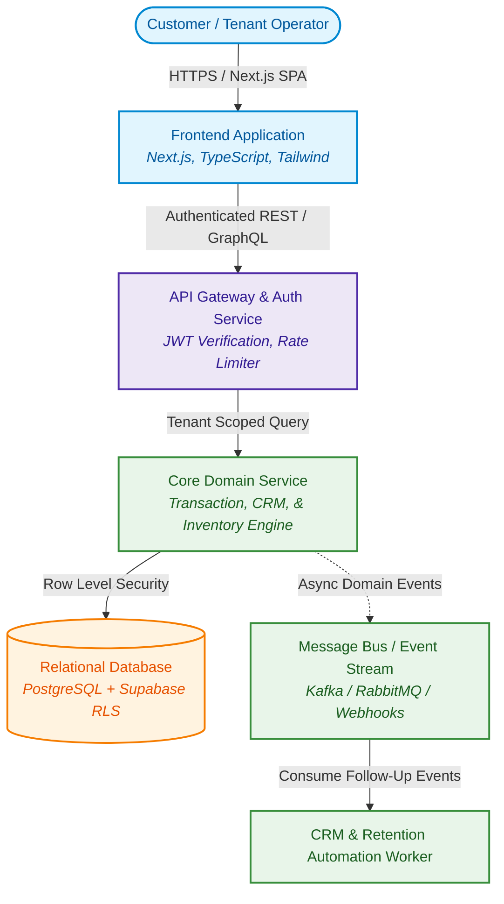
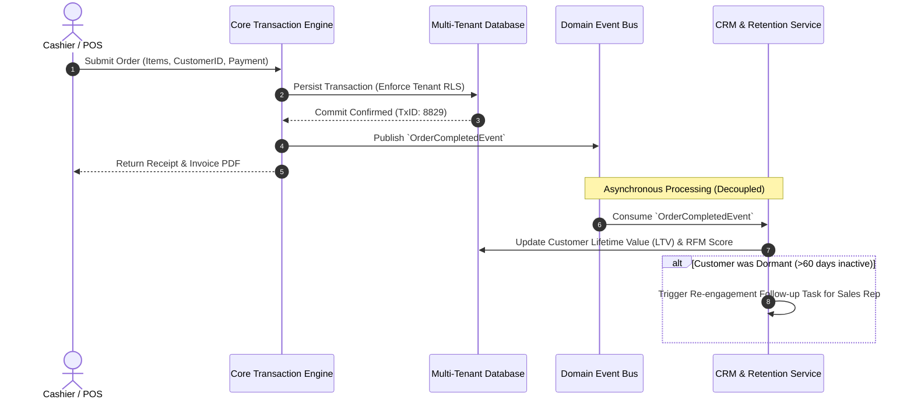

# 📐 OpenBSA — Enterprise Business & System Analyst Operating System

**Production-ready Markdown templates, C4 & Mermaid.js diagrams-as-code, API & data mapping specifications, BDD Gherkin scenarios, and Architecture Decision Records (ADRs) for modern software engineering teams.**

[Explore Templates](#-repository-modules) • [Featured Case Study (ROTARI)](#-featured-case-study-rotari) • [Hire the Author (Consulting)](#-hire-the-author--consulting-services) • [Contributing](#-contributing)

---

## 💡 The Manifesto

> *"Understand the business first. Then design the system. A transaction should not simply create a record; it should create actionable intelligence for the next business decision."*  
> — **Tri Raida**, *Founder & Technical Business System Analyst*

Most business requirements documents (BRDs) gather dust in siloed Confluence spaces or 60-page PDFs that developers ignore. **OpenBSA** changes this by treating system analysis and business modeling as **first-class code artifacts**:

- **Docs-as-Code:** Version-controlled Markdown documents stored directly alongside application code in Git.
- **Visuals-as-Code:** Hierarchical system architecture (C4 Model), sequence flows, and ERDs written in **Mermaid.js** that render natively inside GitHub previews.
- **Engineer-Ready:** Eliminates ambiguity with concrete API contracts, Gherkin BDD test scenarios, and Source-to-Target Data Mapping (STTM).

---

## ⚡ Live Preview: Diagrams-as-Code in Action

This is how architecture and event-driven business workflows are documented using native GitHub Mermaid markdown in OpenBSA:

### C4 Level 2: Modern Multi-Tenant Container Architecture

### The Transaction-to-Action Feedback Loop

---

## 📂 Repository Modules

This repository is organized into modular directories ready to be cloned, copied, or referenced in production software projects:

### 1. [`01-core-templates/`](./01-core-templates/)
* **`PRD-Template.md`** — Comprehensive Product Requirements Document (Goals, Non-Goals, Personas, Success Metrics, Feature Scope).
* **`SRS-Template.md`** — System Requirements Specification (IEEE 830 adapted for modern cloud/microservices architectures).
* **`ADR-Template.md`** — Architecture Decision Record (Context, Decision, Consequences, Compliance, Alternatives Evaluated).
* **`NFR-Checklist.md`** — Non-Functional Requirements Checklist (Latency, Throughput, RPO/RTO, GDPR/SOC2, Concurrency, Rate Limiting).

### 2. [`02-diagrams-as-code/`](./02-diagrams-as-code/)
* **`c4-model-architecture.md`** — C4 Architecture templates (Context, Containers, Components) in native Mermaid.js.
* **`system-sequence-flows.md`** — Enterprise integration flows (Idempotent Payment processing, OAuth2 PKCE, Webhook signatures).
* **`business-state-machines.md`** — Order lifecycle, multi-tenant state transitions, and approval workflows.
* **`entity-relationship-erd.md`** — Relational database modeling with multi-tenant row-level isolation.

### 3. [`03-data-and-api-specs/`](./03-data-and-api-specs/)
* **`api-contract-template.md`** — REST & Webhook functional API specification with JSON Schema payloads & error models.
* **`data-dictionary-sttm.md`** — Source-to-Target Data Mapping (STTM) matrix for migrations, data pipelines, and ETL.
* **`event-driven-pubsub-spec.md`** — Message schema specification, topic taxonomy, and at-least-once delivery guarantees.

### 4. [`04-agile-and-qa/`](./04-agile-and-qa/)
* **`gherkin-bdd-user-stories.md`** — User stories structured with automated `Given-When-Then` acceptance criteria.
* **`traceability-matrix-rtm.md`** — Requirements Traceability Matrix linking business requirements directly to QA tests.

### 5. [`05-modern-ai-spec/`](./05-modern-ai-spec/)
* **`llm-system-spec.md`** — Production specification template for GenAI / LLM applications (Context budgets, Guardrails, Fallbacks, Latency SLA).

---

## 🏆 Featured Case Study: ROTARI

To see how this framework is implemented in a live system, explore **ROTARI**—a multi-tenant business operations and CRM system designed and built by the author:

* **Repository:** [https://github.com/reviveproject4-source/ROTARI](https://github.com/reviveproject4-source/ROTARI)
* **Live Application:** [https://rotari.vercel.app](https://rotari.vercel.app)
* **Architecture Highlights:**
  * Multi-tenant data isolation using PostgreSQL Row-Level Security (RLS).
  * Connected transaction feedback loop linking Point-of-Sale (POS) operations with automated CRM re-engagement.
  * Modern tech stack: Next.js, React, TypeScript, Tailwind CSS, Supabase, PostgreSQL.

---

## 👨‍💼 Hire the Author / Consulting Services

Looking for an experienced **Technical Business System Analyst** to bridge your business vision with cloud architecture?

I work with **US, European, and global tech teams** on:
* **System Discovery & Technical Roadmaps** (Translating founder visions into dev-ready specs).
* **Architecture Decision Reviews & C4 Modeling** (Clarifying distributed systems before coding).
* **API Contracts & Multi-Tenant Data Modeling** (Supabase, PostgreSQL RLS, Webhooks).
* **Sprint Backlog Grooming & BDD User Stories** (Ensuring engineers hit the ground running).

👉 **[View Full Services & Engagement Models](./SERVICES.md)**  
📫 **Get in Touch:** Reach out via [GitHub Issues](https://github.com/reviveproject4-source/ROTARI) or email directly at **`tri.raida.consulting@gmail.com`**.

---

## 🤝 Contributing

Contributions, feedback, and suggestions are welcome! Whether it's adding a new Mermaid pattern, refining a template, or translating into another format:

1. Fork the Project
2. Create your Feature Branch (`git checkout -b feature/AmazingTemplate`)
3. Commit your Changes (`git commit -m 'Add some AmazingTemplate'`)
4. Push to the Branch (`git push origin feature/AmazingTemplate`)
5. Open a Pull Request

Please read [CONTRIBUTING.md](./CONTRIBUTING.md) for details on our code of conduct.

---

## ⭐️ Show Your Support

If this toolkit helped you organize your project, saved your engineering team hours of alignment meetings, or inspired your system analysis workflow, please **give it a Star (⭐️) on GitHub**! It helps more analysts and engineers discover the power of Docs-as-Code.

---

## 📄 License

Distributed under the MIT License. See [`LICENSE`](./LICENSE) for more information.

*(c) 2026 Tri Raida. Built with ❤️ for the global tech & business analysis community.*
